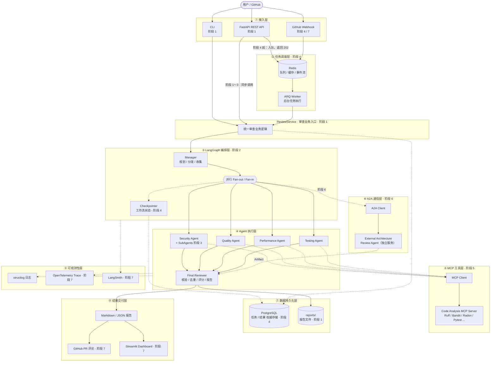
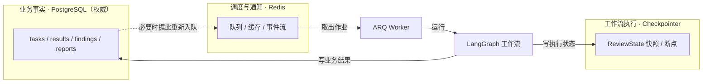
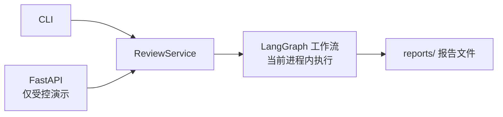
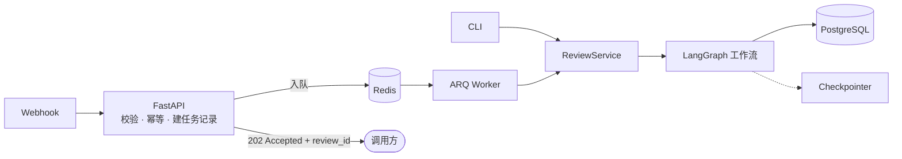
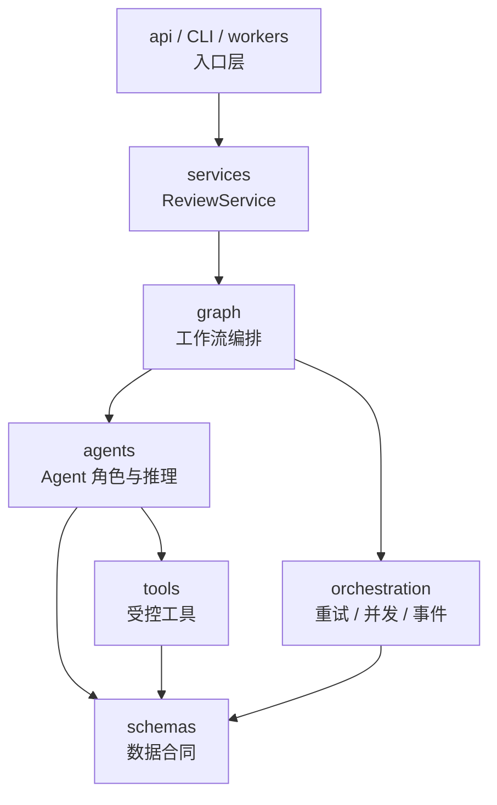
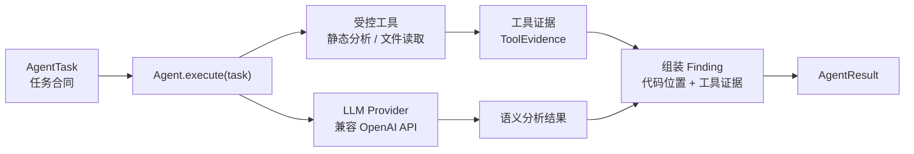
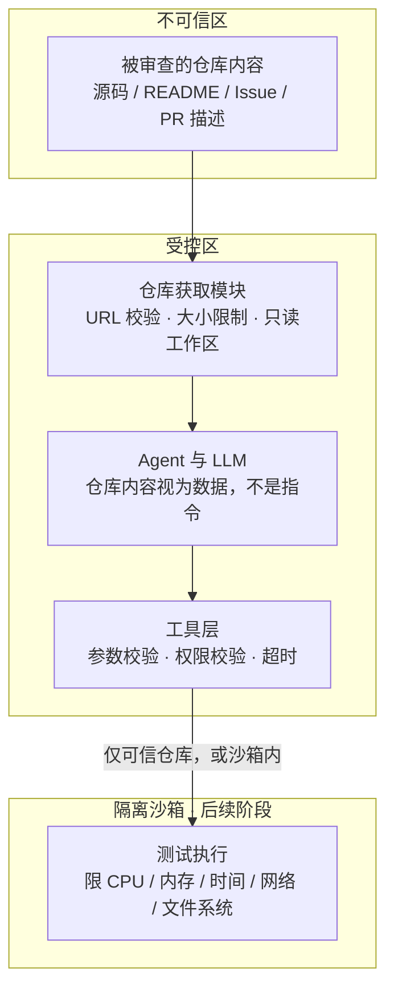
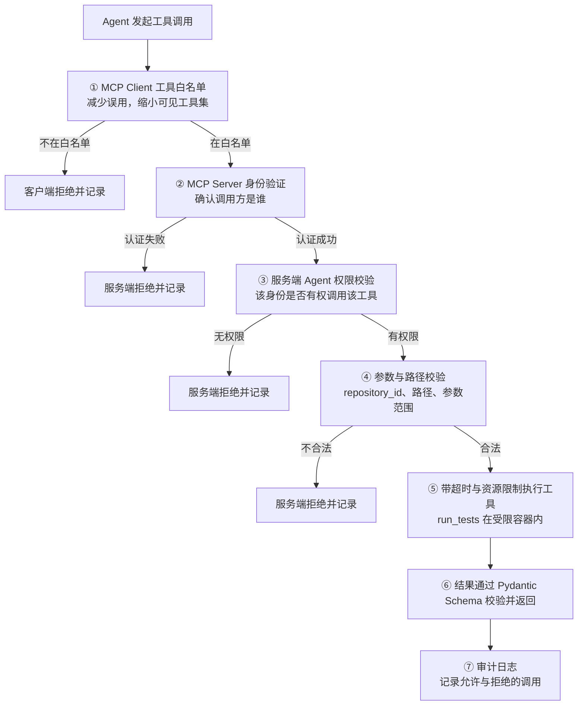
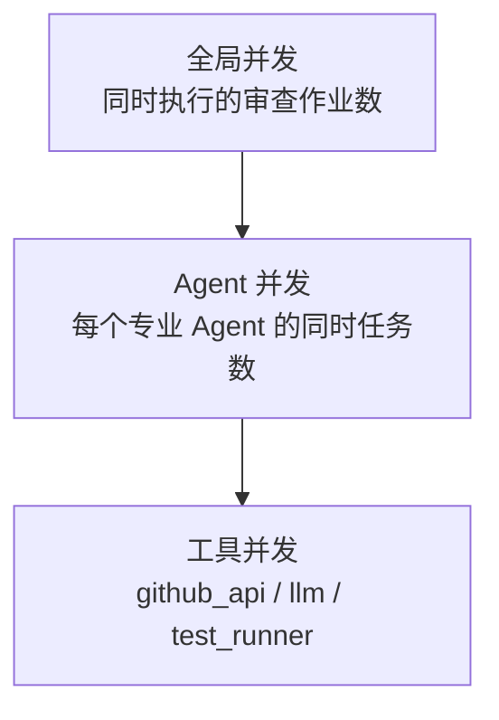
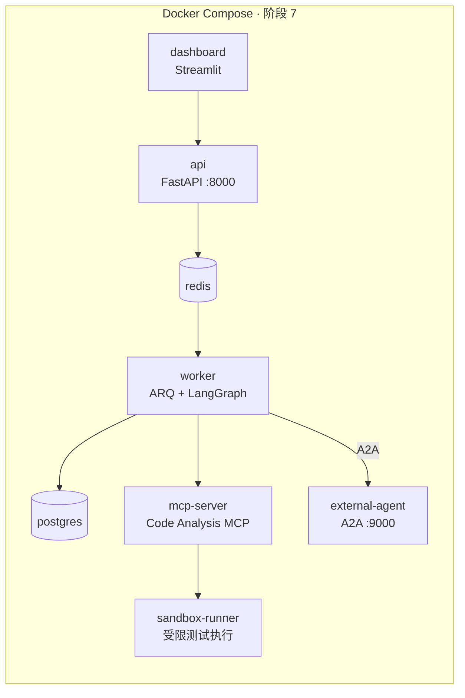

# 架构文档（Architecture）

| 项目 | 内容 |
| --- | --- |
| 项目名称 | Multi-Agent Code Review System |
| 文档版本 | v1.0 |
| 适用范围 | Multi-Agent Code Review System 阶段 0～阶段 7 的工程实施基线 |
| 当前阶段 | 阶段 0：工程初始化与需求冻结 |
| 最后更新 | 2026-11-09 |
| 状态 | 已冻结（Frozen） |
| 关联文档 | `requirements.md`、`workflow.md`、`task_contracts.md`、`acceptance.md` |

> **阅读提示：本文档描述的是“最终目标架构”。** 阶段 0 实际落地的只有工程骨架与数据合同（见第 12 章）。文中每个组件都标注了引入阶段，请勿把目标架构当作当前已实现功能。

---

## 1. 架构设计原则

| 编号 | 原则 | 说明 |
| --- | --- | --- |
| AP-1 | 渐进式演进 | 先做可靠的单进程多 Agent 系统，再演进为分布式多 Agent 系统。每个阶段只引入少量新的不确定因素。 |
| AP-2 | 职责单一、边界清晰 | 编排（LangGraph）、任务调度（Redis + ARQ）、业务持久化（PostgreSQL）、工作流状态（Checkpointer）、工具协议（MCP）、Agent 通信协议（A2A）、可观测性（OpenTelemetry）各司其职，不混用。 |
| AP-3 | 合同先行 | 所有组件之间通过 `task_contracts.md` 定义的数据合同通信。 |
| AP-4 | 证据驱动 | 确定性工具产生可重复的证据，LLM 负责解释与补充，Final Reviewer 核验。 |
| AP-5 | 最小权限与不可信输入 | 仓库内容是不可信数据；每个 Agent 只拥有完成其职责所需的最小工具权限。 |
| AP-6 | 业务逻辑与执行方式解耦 | 审查业务逻辑统一在 `ReviewService`，CLI、FastAPI、ARQ Worker 只是不同的“入口/执行方式”。 |
| AP-7 | 失败是一等公民 | 超时、重试、部分完成、未执行都是明确的状态，不是异常分支里的隐式处理。 |
| AP-8 | 固定四个核心评分维度 | Security、Quality、Performance、Testing 是**固定的四个核心评分维度**；SubAgent 和外部 A2A Agent 是执行扩展，不自动改变核心评分结构（`ReviewReport` 的 `dimension_scores` 与 `agent_results` 始终是这四个维度）。 |

---

## 2. 目标架构总览

### 2.1 九层架构

| 层 | 名称 | 核心组件 | 引入阶段 |
| --- | --- | --- | --- |
| ① | 接入层 | CLI、FastAPI REST API、GitHub Webhook | 1（CLI/API）、4（Webhook 异步化）、7（PR 集成） |
| ② | 任务调度层 | Redis Queue、ARQ Worker、Job Dispatcher | 4 |
| ③ | LangGraph 编排层 | Manager、Supervisor-Worker 图、SubGraph、Checkpointer | 2（进程内）、3（SubGraph）、4（Checkpointer） |
| ④ | Agent 执行层 | Security / Quality / Performance / Testing Agent、SubAgent、Final Reviewer | 2、3 |
| ⑤ | MCP 工具层 | Code Analysis MCP Server、MCP Client | 5 |
| ⑥ | A2A 通信层 | A2A Client、Agent Card、External Architecture Review Agent | 6 |
| ⑦ | 数据持久化层 | PostgreSQL、Redis（缓存/事件）、本地报告文件 | 1（文件）、4（数据库） |
| ⑧ | 可观测性层 | structlog、OpenTelemetry、LangSmith、Token 统计 | 0（日志）、7（全链路） |
| ⑨ | 结果交付层 | Markdown / JSON 报告、GitHub PR 评论、Streamlit Dashboard | 1（报告）、7（PR 评论、Dashboard） |

### 2.2 系统总体架构图（目标架构）



> 图中虚线表示“后续阶段引入”或“旁路（观测、持久化）”依赖。**Final Reviewer 在第一版是 LangGraph 工作流中的一个独立 Node**，不是独立服务；它与 Manager 在逻辑上分离，但运行在同一个进程内。

---

## 3. 分层详解

### ① 接入层

| 项目 | 内容 |
| --- | --- |
| 职责 | 接收审查请求（仓库 URL、分支、PR 信息）；参数校验与鉴权；调用 `ReviewService` 或将任务入队。 |
| 组件 | CLI（阶段 1～3 的主要验收入口）；FastAPI（`POST /api/reviews`、查询接口、Webhook）。 |
| 边界 | 接入层**不包含**审查业务逻辑；FastAPI 在阶段 4 之后**不在请求线程中**执行完整 Agent 工作流，只做校验、幂等检查、创建任务记录、入队，并返回 `202 Accepted` 与 `review_id`。 |
| 阶段演进 | 阶段 1：CLI 与 FastAPI 都调用 `ReviewService`，FastAPI 仅适用于受控的小型同步演示；阶段 4：FastAPI 入队，ARQ Worker 执行，并提供 Webhook 接收基础设施（HMAC-SHA256 签名校验、`delivery_id` 幂等、入队）；阶段 7：GitHub PR 集成（PR 触发审查、评论回写，评论发布带独立的幂等键）。 |

### ② 任务调度层（阶段 4）

| 项目 | 内容 |
| --- | --- |
| 职责 | 任务入队、去重、并发限制、后台调度、失败重试。 |
| 组件 | Redis（队列）、ARQ（执行）、Job Dispatcher。 |
| 边界 | 调度层只负责“何时、由谁执行一个审查作业”，**不理解 Agent 之间的编排逻辑**——后者属于 LangGraph。 |

### ③ LangGraph 编排层（阶段 2 起）

| 项目 | 内容 |
| --- | --- |
| 职责 | 定义审查工作流：Manager 规划 → 并行分发 → 汇合 → Final Reviewer；状态管理；并行与汇合控制；SubGraph。 |
| 组件 | `ReviewState`、节点、边、Supervisor-Worker 图、Security SubGraph（阶段 3）、Checkpointer（阶段 4）。 |
| 边界 | 阶段 2 **先采用进程内编排**，由当前 Python 进程直接运行图；不在阶段 2 引入分布式执行。LangGraph 管理“工作流如何走”，不管理“队列怎么排”，也不是业务数据库。 |
| 关键约束 | 并行节点只返回自己负责的字段（如 Security 节点只更新 `security_result`）；列表型状态使用 Reducer（`Annotated[list, operator.add]`），避免 `InvalidUpdateError`；Worker 输入限制为对应的任务合同，而不是整个 State。 |

### ④ Agent 执行层

| 项目 | 内容 |
| --- | --- |
| 职责 | 各 Agent 在其职责范围内完成分析并返回统一的 `AgentResult`。 |
| 组件 | `BaseAgent` 统一接口；四个专业 Agent；SubAgent；Final Reviewer；LLM Provider 抽象。 |
| 边界 | Agent 通过 Prompt、工具与输出 Schema 区分职责；Agent 不直接依赖 LangGraph 内部状态，便于单独测试；Agent 不直接启动外部进程，必须通过受控工具层。 |

### ⑤ MCP 工具层（阶段 5）

| 项目 | 内容 |
| --- | --- |
| 职责 | 以标准协议暴露代码分析能力，让 Agent 不需要知道 Bandit、Ruff 等工具如何调用。 |
| 组件 | Code Analysis MCP Server（`scan_security`、`check_quality`、`analyze_complexity`、`run_tests`、`get_coverage`、`get_file_content`）、MCP Client。 |
| 边界 | MCP **只负责标准化工具接入**，不负责 Agent 的任务规划与协作；所有工具必须校验仓库 ID、路径与参数；测试执行必须在受限容器内进行。**权限的真正边界在 MCP Server 端**：Agent 侧的工具白名单只是辅助，服务端必须独立完成身份认证与授权（见 §9.3）。 |

### ⑥ A2A 通信层（阶段 6）

| 项目 | 内容 |
| --- | --- |
| 职责 | 与独立部署的外部 Agent 进行发现、任务委派、状态跟踪、Artifact 接收。 |
| 组件 | A2A Client、Agent Card、External Architecture Review Agent（独立服务，不共享 Python Runtime）。 |
| 边界 | A2A 负责**跨服务 Agent 通信**；A2A Task 的状态由 A2A Server 管理，Manager 管理自己发起的外层任务；A2A Server 不暴露其内部 SubAgent。A2A 与 MCP 不可互相替代：MCP 连接 Agent 与工具，A2A 连接 Agent 与 Agent。 |

### ⑦ 数据持久化层

| 存储 | 内容 | 引入阶段 |
| --- | --- | --- |
| PostgreSQL | 审查作业、任务（含父子关系）、AgentResult、Finding、报告元数据、事件日志、Token 使用记录 | 4 |
| Redis | 队列、缓存、必要的消息传递（事件流） | 4 |
| 本地 `reports/` 目录 | `metadata.json`、`static_analysis.json`、`test_report.json`、`report.md`、`report.json` | 1 |
| LangGraph Checkpointer 存储 | 工作流执行状态与断点 | 4 |

### ⑧ 可观测性层

| 层级 | 内容 | 阶段 |
| --- | --- | --- |
| 日志 | structlog 结构化日志，包含 `review_id / task_id / agent_name / event / status` | 0 起可用，阶段 1 起使用 |
| Trace | OpenTelemetry：跨服务统一 Trace，覆盖 Agent、SubAgent、MCP 调用、A2A Task | 7 |
| Agent 调试 | LangSmith：LangGraph 节点与模型调用的调试与评估 | 7 |
| 成本 | Token 使用量与成本，来源于模型响应的真实 `usage` | 7 |

### ⑨ 结果交付层

| 渠道 | 内容 | 阶段 |
| --- | --- | --- |
| Markdown / JSON 报告 | 报告文件，JSON 必须符合 `ReviewReport` 合同 | 1 起 |
| GitHub PR 评论 | 由受控的“评论发布模块”执行，具备幂等保护（幂等键防止重复评论） | 7 |
| Streamlit Dashboard | 创建任务、查看状态与结果、成本 | 7 |

---

## 4. 关键组件职责与边界

> 这是本文档的重点：九个组件容易被混用，必须明确“负责什么”与“不负责什么”。

| 组件 | 负责什么 | 不负责什么 | 引入阶段 |
| --- | --- | --- | --- |
| **FastAPI** | 对外 HTTP 接口：接收请求、参数校验、鉴权、幂等检查、创建任务记录、入队（阶段 4）、查询状态与结果、接收 Webhook | 不执行完整的 Agent 工作流（阶段 4 起）；不包含审查业务逻辑（由 `ReviewService` 承担） | 1 |
| **LangGraph** | Agent 工作流编排：节点、边、并行 Fan-out/Fan-in、`ReviewState` 状态管理、SubGraph、条件路由 | 不做任务排队与分布式调度；不是业务数据的权威存储；阶段 2 不做分布式执行 | 2 |
| **Redis** | 任务队列、缓存、必要的消息传递（阶段 4 的事件使用 Redis Streams） | 不是任务执行引擎；不是业务数据的权威存储；不使用普通 Pub/Sub 作为可靠的任务完成通知存储（不支持持久化与消费重放） | 4 |
| **ARQ** | Python 异步后台任务执行：从 Redis 取任务并调用 `ReviewService`，启动 LangGraph 工作流 | 不负责 Agent 之间的编排；任务可能因 Worker 中断而重复执行，所以必须配合幂等机制 | 4 |
| **PostgreSQL** | **业务任务与结果的权威持久化存储**：审查作业、任务树、AgentResult、Finding、报告、事件记录、Token 使用 | 不保存 LangGraph 的内部执行状态；不做队列 | 4 |
| **LangGraph Checkpointer** | **工作流执行状态与断点恢复**：保存图的执行进度，使工作流可从中断处继续 | 不是业务数据的权威来源；不用于业务查询与报表 | 4 |
| **MCP** | **标准化工具接入**：把代码分析与测试能力封装为可发现、可调用、可统一授权与审计的工具服务 | 不做任务规划、不做 Agent 间协作 | 5 |
| **A2A** | **跨服务 Agent 通信**：Agent Card 发现、任务委派、长任务状态跟踪、Artifact 返回 | 不用于调用普通工具；不暴露对端 Agent 的内部实现 | 6 |
| **OpenTelemetry** | 跨服务统一 Trace（Trace ID、Span）、工具调用与基础设施观测 | 不替代业务日志与业务数据存储；不负责 Agent 工作流调试（该职责由 LangSmith 辅助） | 7 |

补充说明：

- **LangSmith 与 OpenTelemetry 并不冲突**：LangSmith 侧重 Agent 工作流调试、模型调用与评估；OpenTelemetry 侧重跨服务统一 Trace、基础设施与工具调用观测。
- **Redis + ARQ 的分工**：Redis 负责队列、缓存与必要的消息传递；ARQ 负责 Python 后台任务的取出与执行。不要把 Redis 本身误认为完整的任务执行引擎。
- **一句话分工**：*LangGraph 管理工作流，事件机制负责通知，数据库负责持久化。*

---

## 5. 三类“状态”不得混用

系统中存在三种不同性质的状态，必须明确归属，**不得把三者混成一个状态管理系统**。

| 状态类型 | 权威存储 | 内容 | 用途 | 丢失后的影响 |
| --- | --- | --- | --- | --- |
| 业务任务与结果 | **PostgreSQL** | 审查作业状态、任务树、AgentResult、Finding、报告 | 查询、审计、幂等、对外展示 | 业务数据丢失，不可接受（需要备份） |
| 工作流执行状态 | **LangGraph Checkpointer** | 图执行进度、`ReviewState` 快照 | 中断后的断点恢复 | 无法从断点恢复，只能重新执行（业务数据仍在） |
| 队列、缓存、临时消息 | **Redis** | 待执行任务、缓存、事件流 | 调度与通知 | 排队任务需根据 PostgreSQL 中的记录重新入队 |



**一致性原则**：业务状态的权威以 PostgreSQL 为准；先保存结果，再更新任务状态，再发布事件。事件只是通知，**不承载任务结果本身**，也不能代替 LangGraph 的流程控制。

---

## 6. 执行模式演进

### 6.1 阶段 1～3：单进程执行



- CLI 为主要开发与验收入口；FastAPI 仅为可选的本地演示与接口测试入口。
- 两个入口调用同一个 `ReviewService`，避免出现两套审查逻辑。
- 不将长时间运行的 Agent 工作流放在 HTTP 请求中执行。
- 不要求实现多进程 Worker、任务队列与分布式任务状态管理。
- 该模式仅用于本地开发与受控演示，**不代表生产级后台任务架构**。

### 6.2 阶段 4 起：异步 Worker 模式



保持 `ReviewService` 的业务逻辑不变，只升级“任务如何被触发与调度”。CLI 与 FastAPI 仍然复用同一个 `ReviewService`。

---

## 7. 模块与目录架构

### 7.1 最终目标目录的职责

| 目录 | 职责 | 引入阶段 |
| --- | --- | --- |
| `config/` | 运行配置（`settings.py`）；后续的 `agents.yaml`、`tools.yaml`、`review_rules.yaml` | 0 起 |
| `src/code_review/schemas/` | 统一数据合同（`task.py`、`result.py`、`report.py`） | 0 |
| `src/code_review/api/` | FastAPI 路由、Webhook、请求/响应模型 | 1 |
| `src/code_review/services/` | **`ReviewService`（`review_service.py`）**：审查业务的唯一入口，负责“获取仓库 → 运行工作流 → 生成报告”的串联；CLI、FastAPI、ARQ Worker 都只调用它 | 1 |
| `src/code_review/tools/` | GitHub、仓库、静态分析、测试等工具的本地实现 | 1 |
| `src/code_review/agents/` | Agent 角色定义与推理逻辑；`prompts/` 保存各 Agent 提示词 | 2 |
| `src/code_review/graph/` | LangGraph 的 State、节点、边、工作流与子图 | 2 |
| `src/code_review/orchestration/` | 跨节点任务生命周期、事件通知、重试、并发、任务管理 | 3～4 |
| `src/code_review/workers/` | ARQ Worker 与后台作业 | 4 |
| `src/code_review/storage/` | 数据库连接、模型与仓储 | 4 |
| `src/code_review/mcp/` | MCP Server 与 Client | 5 |
| `src/code_review/a2a/` | A2A Client、Server、Agent Card | 6 |
| `external_agents/` | 独立部署的外部 Agent 服务 | 6 |
| `src/code_review/observability/` | Trace、Token 统计、成本、日志 | 7 |
| `src/code_review/reporting/` | 报告生成、Markdown、GitHub 评论 | 1～7 |
| `tests/` | `unit/`、`integration/`、`e2e/`、`fixtures/` | 0 起逐步增加 |
| `docs/` | 项目文档 | 0 |
| `reports/` | 审查结果输出 | 0 |

### 7.2 模块调用方向与依赖规则

**模块调用方向（调用方 → 被调用方）**：图中箭头由调用方指向被调用方。Python 的 import 方向与调用方向一致——**调用方可以导入被调用方，被调用方禁止反向导入调用方**。



> 为保持图的可读性，只画主要调用边：`schemas` 是最底层的公共合同，上层各模块（含 `api`、`services`、`graph`）都可以直接使用它，图中不再逐一连线。

等价的分层关系（上层调用下层）：

```
API / CLI / Workers
        ↓
  ReviewService（services/review_service.py）
        ↓
      Graph
     ↙     ↘
Orchestration   Agents
                  ↓
                Tools
                  ↓
               Schemas
```

| 规则 | 说明 |
| --- | --- |
| DR-1 | `schemas` 位于最底层，被所有模块使用，**自身不导入任何业务模块**，只依赖 Pydantic 与标准库。 |
| DR-2 | `agents` 不得导入 `graph`、`services` 与入口层；Agent 可脱离 LangGraph 单独测试。 |
| DR-3 | `graph` 负责把 Agent 组装成工作流，不实现具体审查逻辑；`graph` 调用 `agents` 与 `orchestration`。 |
| DR-4 | 入口层（`api` / CLI / `workers`）**只调用 `ReviewService`**，不直接调用 `graph`、`agents` 或 `tools`。 |
| DR-5 | 不要把所有业务逻辑塞进 `manager.py`；不要把 LangGraph 节点定义、模型调用与工具实现混在同一个文件。 |
| DR-6 | 模型调用通过 Provider 抽象，不在 Agent 内部写死具体厂商。 |
| DR-7 | **`ReviewService` 的代码归属固定为 `src/code_review/services/review_service.py`**（阶段 1 创建）。禁止把它放进 `agents/manager.py`、`graph/` 或 `api/`。 |
| DR-8 | `orchestration` 不直接导入具体 Agent，通过 `BaseAgent` 接口以参数注入的方式执行任务（例如 `execute_with_retry(agent, task)`），避免与 `agents` 形成循环依赖。 |
| DR-9 | 后续阶段新增模块的位置：`storage` 由 `services` 与 `orchestration` 调用；`reporting` 由 `services` 调用；`mcp` / `a2a` 的客户端作为工具提供方由 `agents`（及 `graph` 中的 `external_review_node`）调用。被调用方同样不得反向导入调用方。 |

---

## 8. Agent 内部架构



- 所有专业 Agent 继承统一的 `BaseAgent` 接口，`execute(task) -> AgentResult`。
- 工具提供“可重复验证的证据”，LLM 提供“语义理解与解释”，两者在 Agent 内合并为带证据的 `Finding`。
- Agent 的 Prompt 以独立文件保存（`prompts/*.md`），便于评审与版本管理。
- SubAgent 不一定调用 LLM：确定性工具 Worker 也可以作为父 Agent 内部的执行单元。
- 模型接入采用 Provider 抽象：第一版使用兼容 OpenAI API 的国内模型服务，后续扩展多模型。

---

## 9. 安全与权限架构

### 9.1 信任边界



### 9.2 Agent 与工具权限矩阵（目标）

| 角色 | 允许 | 禁止 |
| --- | --- | --- |
| Manager | 创建/分发任务、读取任务状态与结果 | 直接分析代码、生成最终结论、写仓库 |
| Security | 读取代码，执行安全扫描（`scan_security`、`get_file_content`） | 执行仓库代码、运行测试、写仓库 |
| Quality | 读取代码，执行质量检查（`check_quality`、`analyze_complexity`） | 安全判定、执行仓库代码 |
| Performance | 读取代码、复杂度分析、受控性能测试 | 对外部不可信仓库压测、写仓库 |
| Testing | 执行测试与覆盖率（**仅限可信仓库，或隔离沙箱内**） | 在宿主机执行外部不可信仓库代码 |
| Final Reviewer | 读取所有结果与只读代码快照，生成报告 | 获得仓库写权限、直接发布 GitHub 评论 |
| 评论发布模块 | 唯一有权向 GitHub PR 发布评论的受控模块，带幂等键 | — |
| External Agent | 仅获得必要的代码上下文 | 访问主系统其他数据与凭证 |

> **注意**：上表是目标权限设计，必须由 **MCP Server 端强制执行**（见 §9.3）。仅在 Agent 侧配置 `allowed_tools` 不构成安全边界。

### 9.3 MCP 工具权限：客户端白名单 + 服务端授权

#### 9.3.1 为什么只做客户端限制不够

如果权限只在 Agent / MCP Client 一侧限制，例如：

```text
allowed_tools = ["scan_security", "get_file_content"]
```

这**不能构成真正的安全边界**，因为：

- Agent 可能被 Prompt Injection 诱导，构造出越权的工具调用；
- MCP Client 自身可能有 Bug，或被绕过（直接向 MCP Server 发请求）；
- 客户端的所有配置都运行在“可能被不可信内容影响”的一侧，不能作为信任根。

**结论：客户端白名单负责减少误用，服务端授权负责真正阻止越权。** 两层同时存在，缺一不可，且以服务端为准。

#### 9.3.2 调用链上的校验顺序



文字版：

```text
Agent
  ↓
MCP Client 工具白名单          （辅助：减少误用）
  ↓
MCP Server 身份验证            （确认“你是谁”）
  ↓
服务端 Agent 权限校验          （真正阻止越权）
  ↓
参数与路径校验
  ↓
执行工具
```

#### 9.3.3 两层校验的职责划分

| 层 | 位置 | 作用 | 是否构成安全边界 |
| --- | --- | --- | --- |
| 客户端白名单 | Agent / MCP Client | 只向 Agent 暴露其职责所需的工具，降低误用与 Prompt Injection 的触发面，让 LLM 的工具选择更聚焦 | **否** |
| 服务端授权 | MCP Server | 独立认证调用方身份，按服务端持有的权限表判定是否允许，默认拒绝 | **是** |

#### 9.3.4 服务端必须实施的校验

| 编号 | 要求 | 说明 |
| --- | --- | --- |
| MS-1 | **身份验证** | 每个 Agent 使用独立的身份凭据调用 MCP Server；服务端根据已验证的凭据确定调用方身份，**不信任请求体中自报的 `agent_name`**。 |
| MS-2 | **服务端权限表，默认拒绝** | 权限表由服务端自行加载并执行；未明确授权的 (身份, 工具) 组合一律拒绝。该表与客户端白名单同源配置（如 `config/tools.yaml`）但在服务端独立校验，不依赖客户端传来的任何权限声明。 |
| MS-3 | **工具可见性按身份过滤** | 服务端的工具发现结果只包含该身份被授权的工具。 |
| MS-4 | **凭据作用域最小化** | 凭据限定到具体 Agent 身份，并尽量绑定到 `review_id` 与 `repository_id`，设置较短有效期；跨审查、跨仓库的调用被拒绝。 |
| MS-5 | **参数与路径校验** | 校验 `repository_id` 是否已登记、路径是否位于工作区内、参数范围与类型；以 `repository_id` 引用仓库而非接收任意路径。 |
| MS-6 | **执行约束** | 设置超时、输出大小与资源限制；`run_tests` 只在受限容器内执行。 |
| MS-7 | **审计** | 允许与拒绝的调用都要记录：身份、工具名、`repository_id`、参数摘要、结果、耗时、`review_id`；越权尝试作为安全事件单独标记，便于排查 Prompt Injection。 |
| MS-8 | **凭据不进入 LLM 上下文** | 身份凭据由客户端代码注入，LLM 既看不到也无法选择；工具调用参数中不接受“身份”“权限”类字段；凭据不写入日志、任务合同与报告。 |

> 身份验证的具体实现方式取决于所选 MCP 传输方式（如本地 stdio 或 HTTP）与 MCP SDK 版本，在阶段 5 设计时确定；但“服务端基于已验证身份做授权、默认拒绝”这一原则不随传输方式改变。

#### 9.3.5 与 A2A 的关系

A2A 外部 Agent 同样遵循“服务端自己做授权”的原则：外部 Agent 作为独立服务，只信任自身验证过的调用方身份与最小必要的代码上下文，不信任主系统的任何自我声明（见 §3 ⑥ 与 §9.2）。

### 9.4 其他安全措施

| 措施 | 说明 |
| --- | --- |
| URL 校验 | 只允许 HTTPS GitHub 地址，限制域名与端口，防 SSRF 与恶意 Git URL。 |
| 路径校验 | 任务输入只含工作区内的相对/沙箱路径，禁止 `..` 与宿主机任意路径。 |
| 敏感文件排除 | 不读取 `.env`、私钥、凭证文件作为 LLM 上下文。 |
| 资源限制 | 工具执行设置超时、输出大小与资源上限。 |
| 密钥管理 | 密钥只通过环境变量注入，不写入合同、日志与报告；报告中涉及密钥的证据必须脱敏。 |
| Webhook | HMAC-SHA256 签名校验、Payload 校验、`delivery_id` 幂等。 |

---

## 10. 幂等、并发与失败处理架构

### 10.1 幂等设计

ARQ 的任务在 Worker 中断后可能被重新执行，因此需要以下机制（阶段 4 实现）：

| 机制 | 作用 |
| --- | --- |
| `review_id` 唯一标识 | 同一审查只有一份结果。 |
| `delivery_id`（阶段 4） | 防止同一个 Webhook 被重复处理，不产生重复的审查作业与报告。 |
| 评论发布幂等键（阶段 7） | 防止重复发布 GitHub 评论；属于 GitHub PR 集成，**阶段 4 不实现**。 |
| 数据库唯一约束 | 以存储层保证“不重复”，不依赖应用层判断。 |
| 任务执行状态校验 | 执行前检查状态，已完成的任务不得再次执行。 |

### 10.2 三层并发控制



可复现的**初始测试配置**如下，数值仅用于测试复现，**不是生产环境的最终性能参数**：

```yaml
concurrency:
  security_subagents: 2
  global_subagents: 4
```

- **阶段 3**：以 `asyncio.Semaphore` 实现 Security SubAgent 的局部并发限制（`security_subagents: 2`），验证局部最大并发数不超过 2；全局并发限制**只完成设计，不提前实现完整的全局调度**。设计目的：避免多个 Agent 各自开启子任务（例如四个 Agent 各 2 个共 8 个）叠加后超出模型或工具资源上限。
- **阶段 4**：实现全局并发限制（`global_subagents: 4`），验证最大并发数不超过 4（例如同时处理多个审查时，各自局部最多 2 个，总数仍不得超过 4，超出部分排队等待）；并提供全局、Agent、工具三层可配置的并发控制。
- **验证方式**：测试必须通过计数器记录运行期间观测到的**最大并发数**，而不是仅检查配置值。

### 10.3 失败处理分层

| 层 | 处理方式 |
| --- | --- |
| 工具层 | 超时、输出限制、错误分类（返回 `ErrorInfo`）。 |
| Agent 层 | 将异常转为 `AgentResult(status=failed/partial)`，不向上抛出未分类异常。 |
| 编排层 | 基于 `retryable` 与 `retry_count` 决定重试；非必需子任务失败不阻塞父任务。 |
| 报告层 | 存在 `partial` / `failed` 时，报告 `report_status = partial`，结论不得为 `APPROVE`。 |

---

## 11. 部署架构演进

| 阶段 | 运行方式 |
| --- | --- |
| 0～3 | 本地 Python（Conda 环境 `multi-agent-review`）单进程运行，**不要求 Docker**。 |
| 4 | Docker Compose 管理 Redis 与 PostgreSQL；FastAPI 与 ARQ Worker 仍在本地运行。 |
| 5～6 | 根据 MCP、A2A 的实际需要逐步增加独立服务（MCP Server、External Agent）。 |
| 7 | 完整 Docker Compose：`api`、`redis`、`worker`、`postgres`、`mcp-server`、`external-agent`、`dashboard`（以及 Sandbox Runner）。 |

阶段 7 的最终多服务部署拓扑：



本地开发 GitHub Webhook 时可使用 ngrok 建立公网隧道；生产环境使用正式 HTTPS Endpoint。

---

## 12. 阶段 0 实际落地范围

### 12.1 阶段 0 已实现 / 将要实现的内容

| 内容 | 位置 | 说明 |
| --- | --- | --- |
| Conda 环境与依赖清单 | `environment.yml` | Python 3.12；仅阶段 0 基础依赖。 |
| 配置管理 | `config/settings.py` | 基于 `pydantic-settings` 与 `.env`；`.env.example` 只含占位符。 |
| 数据合同 | `src/code_review/schemas/` | `task.py`、`result.py`、`report.py`。 |
| 单元测试 | `tests/unit/` | 验证数据合同。 |
| 项目文档 | `docs/` | 五份核心文档。 |
| 报告目录占位 | `reports/.gitkeep` | 后续存放审查结果。 |

### 12.2 阶段 0 中“尚不存在”的组件

下列组件在本文档中有设计，但**阶段 0 不得实现**（OpenTelemetry 的约束见 `acceptance.md` AC-0-05：不主动安装 `opentelemetry-sdk` 与 Exporter，不接入 Trace；允许依赖解析引入的被动传递依赖 `opentelemetry-api`）：FastAPI 路由与 `ReviewService`、LangGraph、任何 Agent、MCP、A2A、Redis、ARQ、PostgreSQL、Checkpointer、OpenTelemetry、LangSmith、Streamlit、Docker。

### 12.3 阶段 0 目录结构

```
multi-agent-code-review/
├── README.md
├── environment.yml
├── .env.example
├── .gitignore
├── config/
│   └── settings.py
├── src/
│   └── code_review/
│       ├── __init__.py
│       └── schemas/
│           ├── __init__.py
│           ├── task.py
│           ├── result.py
│           └── report.py
├── tests/
│   ├── __init__.py
│   └── unit/
│       ├── __init__.py
│       ├── test_task_schema.py
│       ├── test_result_schema.py
│       └── test_report_schema.py
├── docs/
│   ├── requirements.md
│   ├── architecture.md
│   ├── workflow.md
│   ├── task_contracts.md
│   └── acceptance.md
└── reports/
    └── .gitkeep
```

---

## 13. 关键架构决策记录

| 编号 | 决策 | 理由 | 备选方案与不采用的原因 |
| --- | --- | --- | --- |
| ADR-1 | 阶段 2 使用进程内 LangGraph 编排 | 清晰区分 Agent 编排与分布式调度，便于定位问题 | 一开始就接入 Redis 队列：复杂度叠加，故障难以定位 |
| ADR-2 | Final Reviewer 作为独立 Node，而非独立服务 | 保持职责分离同时避免过早引入额外运行时 | 独立 Agent 服务：第一版没有必要 |
| ADR-3 | 业务状态以 PostgreSQL 为权威，Checkpointer 只管工作流执行状态 | 状态性质不同、生命周期不同，混用会导致一致性问题 | 单一存储承担所有状态：边界不清 |
| ADR-4 | 阶段 4 的可靠事件使用 Redis Streams，而非普通 Pub/Sub | Pub/Sub 不支持消息持久化与消费重放 | Pub/Sub：可能丢失完成通知 |
| ADR-5 | 事件机制只做通知，不替代 LangGraph 控制 | 避免重复实现任务调度逻辑 | 父 Agent 仅依靠事件监听判断子图是否完成：状态分散，易出错 |
| ADR-6 | 数据合同先于 Agent 实现，并带版本号 | 提前消除接口不一致，支持演进 | 先写 Agent 再补格式：后期返工 |
| ADR-7 | 确定性工具产生证据，LLM 负责解释 | 可重复、可验证、抑制幻觉 | 完全由 LLM 判断：不可核验 |
| ADR-8 | 外部仓库测试执行延后到沙箱建立之后 | 仓库代码是不可信输入 | 宿主机直接执行：存在安全风险 |
| ADR-9 | CLI 与 FastAPI 复用 `ReviewService`，并固定放在 `services/review_service.py` | 避免两套重复逻辑，也避免实现时被随意放进 `manager.py` 或 `graph/` | 各自实现：逻辑漂移；放入 `graph/`：入口层被迫依赖编排细节 |
| ADR-11 | MCP 权限由服务端强制执行，客户端白名单仅作辅助 | Prompt Injection 与客户端 Bug 都可能绕过客户端限制，客户端不是信任根 | 只在 Agent 侧配置 `allowed_tools`：可被绕过，不构成安全边界 |
| ADR-10 | 阶段 0 依赖最小化，后续按阶段引入 | 保持环境干净，避免提前绑定技术 | 一次性安装所有依赖：违背渐进式原则 |

---

## 修订记录

| 项目 | 内容 |
| --- | --- |
| 修订日期 | 2026-11-09 |
| 修订类型 | v1.0 冻结前跨文档一致性确认（D-1～D-9） |
| 修订内容 | 本文档的九层架构、组件职责、依赖方向与阶段边界经核对与最终数据合同一致，本轮无实质性架构修改。确认：`task_contracts.md` 为数据合同唯一权威；任务树深度、父任务存在性、环检测与派生权限属于阶段 3 编排层，不在阶段 0 单个 `AgentTask` Schema 中实现；阶段 0 仅交付工程骨架、Schema 与单元测试。 |
| 数据合同权威顺序 | `task_contracts.md` 是数据合同唯一权威；本文档不得与其冲突。 |
| 阶段归属 | 任务树拓扑与派生权限属于阶段 3；失败重试、持久化与调度属于阶段 4。 |
| 架构影响 | 未改变整体系统架构、阶段划分与核心业务方向。 |
