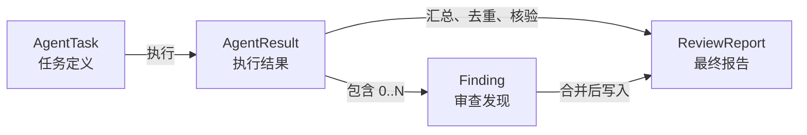
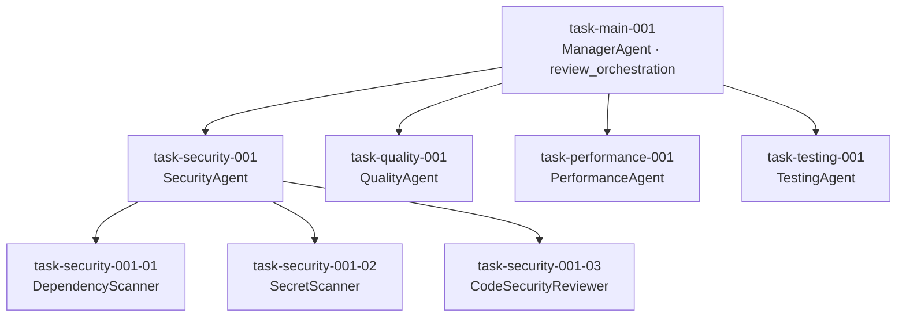
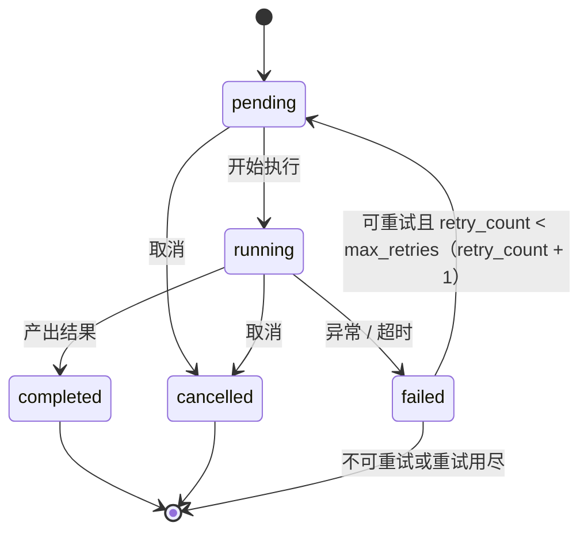

# 任务数据合同（Task Contracts）

| 项目 | 内容 |
| --- | --- |
| 文档版本 | v1.0（合同版本 `schema_version = "1.0"`） |
| 适用范围 | Multi-Agent Code Review System 阶段 0～阶段 7 的工程实施基线 |
| 适用阶段 | 阶段 0 冻结，阶段 1～7 只允许“向后兼容地扩展” |
| 对应代码 | `src/code_review/schemas/task.py`、`result.py`、`report.py` |
| 对应测试 | `tests/unit/test_task_schema.py`、`test_result_schema.py`、`test_report_schema.py` |
| 最后更新 | 2026-11-09 |
| 状态 | 已冻结（Frozen） |
| 关联文档 | `requirements.md`、`architecture.md`、`workflow.md`、`acceptance.md` |

> 本文档是阶段 0 最重要的文档。后续所有 Agent、LangGraph 节点、Redis/ARQ 任务、MCP 工具、A2A 适配器之间传递的数据，都必须符合这里的合同。**先有合同，再写 Agent。**

---

## 1. 设计目标与原则

多 Agent 系统最常见的故障不是“模型不会推理”，而是数据对不上：Manager 给 Security 的输入与 Security 需要的不一致、各 Agent 返回格式不统一、并行节点互相覆盖状态、Final Reviewer 无法判断结论是否有真实证据、子任务失败后不知道该重试谁。本合同用于消除这五类问题。

| 编号 | 原则 | 含义 |
| --- | --- | --- |
| P1 | 合同先行 | 任何 Agent 的输入输出都必须是本文档定义的 Pydantic 模型，不允许裸 `dict` 在 Agent 之间流转。 |
| P2 | 证据可追溯 | 每个 Finding 必须能追溯到“代码位置”或“工具输出”，禁止仅凭自然语言下结论。 |
| P3 | 失败显式化 | 失败、部分完成、未执行都必须有明确状态和错误信息，不允许用“空结果”冒充成功，也不允许伪造测试结果。 |
| P4 | 单一职责 | `AgentTask` 描述“要做什么”，`AgentResult` 描述“做完的结果”，`Finding` 描述“发现了什么”，`ReviewReport` 描述“最终结论”。四者不得混用。 |
| P5 | 可序列化 | 所有合同可无损转为 JSON 并还原，可跨进程（Redis）、跨服务（A2A / MCP）、跨存储（PostgreSQL）传递。 |
| P6 | 版本化 | 合同带 `schema_version`，新增字段必须向后兼容，破坏性修改必须升级主版本号。 |
| P7 | 最小授权 | 任务输入只携带该 Agent 完成任务所需的最小上下文，不携带密钥、令牌，不暴露宿主机任意路径。 |
| P8 | 固定四个核心评分维度 | Security、Quality、Performance、Testing 是**固定的四个核心评分维度**；SubAgent 和外部 A2A Agent 是执行扩展，不自动改变核心评分结构（`ReviewReport` 的 `dimension_scores` 与 `agent_results` 始终是这四个维度）。 |

---

## 2. 四个核心对象

| 对象 | 回答的问题 | 创建者 | 消费者 | 定义位置 |
| --- | --- | --- | --- | --- |
| `AgentTask` | 要谁做什么、输入是什么、期望交付什么 | Manager（SubAgent 任务由父 Agent 创建） | 被分配的 Agent | `schemas/task.py` |
| `AgentResult` | 某个任务执行得怎么样 | 各专业 Agent / SubAgent | Manager、Final Reviewer | `schemas/result.py` |
| `Finding` | 具体发现了什么问题、证据在哪 | 专业 Agent / 工具 | Final Reviewer、报告 | `schemas/result.py` |
| `ReviewReport` | 整次审查的最终结论 | Final Reviewer | 用户、API、GitHub PR 评论 | `schemas/report.py` |

> 说明：总规划 V2.0 的目录中曾出现 `schemas/finding.py`，但阶段 0 目录约定只有 `task.py`、`result.py`、`report.py`，因此 `Finding` 与 `ToolEvidence` 定义在 `result.py`。`ErrorInfo` 同时被 `AgentTask` 与 `AgentResult` 使用，定义在 `task.py`，由 `result.py` 导入。模块依赖方向固定为：`task.py` ← `result.py` ← `report.py`，不得反向依赖。

对象关系：



---

## 3. 父任务与子任务

### 3.1 任务层级

一次审查（一个 `review_id`）对应一棵任务树，最大深度为 2（阶段 3 起生效；阶段 0～2 只有深度 0 和 1）。

| 深度 | 角色 | `parent_task_id` | 示例 |
| --- | --- | --- | --- |
| 0 | 根任务（Manager 的编排任务，用于记录整次审查的生命周期） | `null` | `task-main-001` |
| 1 | 专业审查任务（Security / Quality / Performance / Testing）、阶段 6 起的外部 A2A 任务 | 根任务 ID | `task-security-001` |
| 2 | 子任务（SubAgent，阶段 3 起，首先在 Security Agent 内实现） | 所属专业任务 ID | `task-security-001-01` |
| 3 | 禁止创建 | — | — |

**任务树编排层约束（阶段 3 校验，不是单个 `AgentTask` 的 Schema 校验）：**

- 深度 0 的 Manager 根任务可以创建深度 1 的专业 Agent 任务；深度 1 的 Security Agent 可以创建深度 2 的 SubAgent 任务；深度 2 的 SubAgent 不得再创建子任务（即深度 3 禁止创建，最大深度为 2）。
- 除根任务外，父任务必须真实存在；父子任务的 `review_id` 必须一致；父子关系不得形成环。
- 只有具备子任务派生权限的 Agent 才能创建子任务：阶段 3 仅 Manager（深度 0 → 1）与 Security Agent（深度 1 → 2）具备该权限，其他专业 Agent 不得任意创建子任务。
- 上述规则涉及多个任务对象之间的拓扑与权限关系，由阶段 3 的编排层任务树校验实现；`AgentTask` 不新增 `task_depth` / `depth` 字段。



**Final Reviewer 不在任务树中。** 它是 LangGraph 工作流里位于四个专业 Agent 之后的**汇总节点**，处理的是四个 `AgentResult` 的结果集合，而不是与专业 Agent 同级的审查 Worker：

```text
根任务（Manager 编排任务）
    ├── Security
    ├── Quality
    ├── Performance
    └── Testing
              ↓  结果集合（四个 AgentResult）
     Final Reviewer（工作流汇总节点，不创建 AgentTask）
              ↓
        ReviewReport
```

| 编号 | 约定 |
| --- | --- |
| TT-1 | Final Reviewer **不创建独立的 `AgentTask`**，也不拥有 `task_id`、`task_type`、`status`；它不负责分发任务。 |
| TT-2 | 任务树中只有：深度 0 的根任务、深度 1 的专业审查任务（阶段 6 起含外部架构审查任务）、深度 2 的 SubAgent 子任务。 |
| TT-3 | `ExecutionSummary.total_tasks` 只统计深度 1 的专业审查任务（阶段 2 为 4；阶段 6 起启用外部审查时为 5），不包含 Manager 根任务与 Final Reviewer。 |
| TT-4 | Final Reviewer 的执行情况记录在 `ReviewReport` 与执行日志中，而不是任务表中。 |
| TT-5 | Final Reviewer 自身执行失败属于**整次审查失败**（无法生成可信报告），不属于专业任务的 `partial`。 |

### 3.2 ID 规则

| 字段 | 规则 |
| --- | --- |
| `task_id` | 全局唯一的非空字符串。默认由 `uuid4` 生成；也允许人工可读 ID（如 `task-security-001`），推荐子任务采用“父 ID + 两位序号”格式。合同**不强制格式**，只强制非空、唯一。 |
| `parent_task_id` | 根任务为 `null`；其余任务必须指向一个已存在的任务。不得等于自身 `task_id`；任务树中不得出现环。 |
| `review_id` | 一次审查的唯一标识，同一棵任务树下所有任务、结果、报告共享同一个 `review_id`。 |
| `finding_id` | 在同一个 `review_id` 内唯一。推荐前缀：`SEC-`、`QUA-`、`PER-`、`TST-`、`ARC-`（外部架构审查 Agent），如 `SEC-001`。 |

### 3.3 父子任务约束

1. 子任务的 `review_id` 必须与父任务一致。
2. 父任务只有在**所有 `required = true` 的子任务**进入终态后才能汇总结果：
   - 全部 `completed` → 父任务可 `completed`；
   - 存在必需子任务 `failed`，但其他子任务产出了可用结果 → 父任务的 `AgentResult.status = partial`；
   - 所有必需子任务均失败 → 父任务 `AgentResult.status = failed`。
3. 非必需子任务（`required = false`）失败不影响父任务状态，但必须记录在父任务 `AgentResult.metadata` 中。
4. 取消父任务时，所有未结束的子任务必须同步取消（`cancelled`）。
5. 子任务不得再创建子任务（最大深度 2）。需要更深层级时必须先修订本合同。
6. 子任务的结果不直接进入最终报告，必须先由父 Agent 汇总为一个 `AgentResult`。

---

## 4. AgentTask：任务定义

### 4.1 字段

| 字段 | 类型 | 必填 | 默认值 | 说明 |
| --- | --- | --- | --- | --- |
| `schema_version` | `str` | 否 | `"1.0"` | 合同版本。 |
| `task_id` | `str` | 否 | `uuid4` | 当前任务唯一标识。 |
| `parent_task_id` | `str \| null` | 否 | `null` | 父任务 ID，根任务为 `null`。 |
| `review_id` | `str` | **是** | — | 所属审查任务 ID。 |
| `agent_name` | `str` | **是** | — | 任务执行者，见 §4.3 名称注册表。 |
| `task_type` | `str` | **是** | — | 任务类型，见 §4.3 注册表。 |
| `description` | `str` | **是** | — | 任务目标的自然语言描述，不得包含密钥或令牌。 |
| `input_data` | `dict[str, Any]` | **是** | — | 任务输入，必须包含 §4.2 的标准键。 |
| `expected_output` | `dict[str, Any]` | **是** | — | 期望交付说明，见 §4.4。 |
| `priority` | `"low" \| "medium" \| "high"` | 否 | `"medium"` | 调度优先级。 |
| `required` | `bool` | 否 | `true` | 该任务失败时是否影响父任务（仅对子任务有实际意义）。 |
| `status` | `"pending" \| "running" \| "completed" \| "failed" \| "cancelled"` | 否 | `"pending"` | 任务状态，见 §6。 |
| `retry_count` | `int` | 否 | `0` | 已重试次数，`≥ 0`。 |
| `max_retries` | `int` | 否 | `2` | 最大重试次数，`≥ 0`。 |
| `timeout_seconds` | `float \| null` | 否 | `null` | 单次执行超时时间；`null` 表示使用系统默认值；设置时必须 `> 0`。 |
| `created_at` | `datetime` | 否 | 当前 UTC 时间 | 创建时间。 |
| `started_at` | `datetime \| null` | 否 | `null` | 最近一次开始执行时间。 |
| `finished_at` | `datetime \| null` | 否 | `null` | 进入终态的时间。 |
| `last_error` | `ErrorInfo \| null` | 否 | `null` | 最近一次失败信息，见 §7。 |

### 4.2 `input_data` 标准键

阶段 0 中 `input_data` 保持为 `dict`，以便各 Agent 在后续阶段定义自己的输入模型；但下列键为所有审查类任务的**约定标准键**，阶段 2 起由各 Agent 的输入模型（Pydantic）强制校验。

| 键 | 类型 | 必需 | 说明 |
| --- | --- | --- | --- |
| `repository_path` | `str` | 是 | **沙箱/工作区内**的仓库路径，例如 `/workspace/review-001/repo`。禁止传递宿主机任意路径。 |
| `commit_sha` | `str` | 是 | 本次审查固定的 40 位 Commit SHA。所有行号均对应此版本。 |
| `language` | `str` | 是 | 审查语言，第一版固定为 `"python"`。 |
| `target_files` | `list[str]` | 否 | 需要重点审查的文件，POSIX 风格相对路径；缺省表示审查整个仓库。 |
| `rules` | `dict` | 否 | 本任务的规则参数（如阈值），来自 `review_rules.yaml`（后续阶段）。 |

`input_data` 的安全约束：

- 不得包含 API Key、GitHub Token、`.env` 内容、私钥等凭证；
- 不得包含源代码全文（Agent 通过受控工具按需读取文件）；
- `repository_path`、`target_files` 中的路径不得包含 `..`，且必须位于该审查的工作区之内；
- 仓库内容（源码、README、Issue、PR 描述）一律视为**不可信数据**，不得拼接进系统指令。

### 4.3 名称注册表

`agent_name` 与 `task_type` 为字符串，不使用 `Literal`，以便 SubAgent 和外部 Agent 扩展；但必须使用下表的规范名称。

| `agent_name` | 角色 | 允许的 `task_type` | 引入阶段 |
| --- | --- | --- | --- |
| `ManagerAgent` | 编排 | `review_orchestration` | 2 |
| `SecurityAgent` | 安全审查 | `security_review` | 2 |
| `QualityAgent` | 质量审查 | `quality_review` | 2 |
| `PerformanceAgent` | 性能审查 | `performance_review` | 2 |
| `TestingAgent` | 测试验证 | `testing_review` | 2 |
| `FinalReviewerAgent` | 证据核验与汇总（**逻辑角色名称**，用于日志、`verification_status` 的核验来源标注；**不创建 `AgentTask`**，因此没有 `task_type`） | — | 2 |
| `DependencyScannerSubAgent` | Security 子任务 | `dependency_scan` | 3 |
| `SecretScannerSubAgent` | Security 子任务 | `secret_scan` | 3 |
| `CodeSecurityReviewerSubAgent` | Security 子任务 | `code_security_review` | 3 |
| `ExternalArchitectureReviewAgent` | 外部 A2A 架构审查 | `architecture_review` | 6 |

### 4.4 `expected_output`

`expected_output` 是“交付说明”，不是返回值模板。统一格式：

```json
{
  "result_schema": "AgentResult",
  "must_include_evidence": true,
  "finding_categories": ["sql_injection", "hardcoded_secret"]
}
```

| 键 | 说明 |
| --- | --- |
| `result_schema` | 固定为 `"AgentResult"`。所有专业 Agent 必须返回统一的 `AgentResult`。 |
| `must_include_evidence` | 固定为 `true`。任何 Finding 都必须满足 §5.3 的可追溯规则。 |
| `finding_categories` | 可选，限定本任务关注的问题类别。 |

### 4.5 校验规则

| 编号 | 规则 |
| --- | --- |
| TK-01 | `task_id`、`review_id`、`agent_name`、`task_type`、`description` 不得为空字符串。 |
| TK-02 | `parent_task_id` 不得等于 `task_id`。 |
| TK-03 | `status` 只允许 `pending / running / completed / failed / cancelled`。 |
| TK-04 | `priority` 只允许 `low / medium / high`。 |
| TK-05 | `retry_count ≥ 0`，`max_retries ≥ 0`，且 `retry_count ≤ max_retries`。 |
| TK-06 | `timeout_seconds` 若不为 `null`，必须 `> 0`。 |
| TK-07 | `input_data` 与 `expected_output` 必须是字典。 |
| TK-08 | 默认 `task_id` 不重复（连续创建多个任务，ID 互不相同）。 |
| TK-09 | `status = failed` 时必须携带 `last_error`。 |
| TK-10 | `created_at`、`started_at`、`finished_at` 必须为带时区的 UTC 时间；`finished_at` 不得早于 `started_at` 与 `created_at`。 |
| TK-11 | 未声明的字段一律拒绝（`extra = "forbid"`），防止字段拼写错误被静默吞掉。 |
| TK-12 | JSON 往返一致：`model_validate_json(model.model_dump_json())` 与原对象相等。 |
| TK-13 | **状态与时间戳一致性**：`pending` 时 `finished_at` 必须为 `null`；`running` 时 `started_at` 必须非空且 `finished_at` 为 `null`；`completed` / `cancelled` 时 `finished_at` 必须非空；`failed` 时，若 `last_error.retryable = true` 且 `retry_count < max_retries`（仍可重试），`finished_at` 必须为 `null`，否则（最终失败）`finished_at` 必须非空。 |

### 4.6 完整 JSON 示例

**示例 1：根任务（Manager 编排任务）**

```json
{
  "schema_version": "1.0",
  "task_id": "task-main-001",
  "parent_task_id": null,
  "review_id": "review-001",
  "agent_name": "ManagerAgent",
  "task_type": "review_orchestration",
  "description": "编排 review-001 的完整代码审查流程",
  "input_data": {
    "repository_url": "https://github.com/owner/demo-project",
    "branch": "main",
    "commit_sha": "9fceb02d0ae598e95dc970b74767f19372d61af8",
    "repository_path": "/workspace/review-001/repo",
    "language": "python"
  },
  "expected_output": {
    "deliverable": "task_plan"
  },
  "priority": "medium",
  "required": true,
  "status": "running",
  "retry_count": 0,
  "max_retries": 0,
  "timeout_seconds": null,
  "created_at": "2026-11-08T10:00:00Z",
  "started_at": "2026-11-08T10:00:01Z",
  "finished_at": null,
  "last_error": null
}
```

**示例 2：专业审查任务（Security Agent，深度 1）**

```json
{
  "schema_version": "1.0",
  "task_id": "task-security-001",
  "parent_task_id": "task-main-001",
  "review_id": "review-001",
  "agent_name": "SecurityAgent",
  "task_type": "security_review",
  "description": "检查仓库是否存在安全漏洞，包括注入风险与硬编码凭证",
  "input_data": {
    "repository_path": "/workspace/review-001/repo",
    "commit_sha": "9fceb02d0ae598e95dc970b74767f19372d61af8",
    "language": "python",
    "target_files": ["src/auth.py", "src/database.py", "src/config.py"],
    "rules": {}
  },
  "expected_output": {
    "result_schema": "AgentResult",
    "must_include_evidence": true,
    "finding_categories": ["sql_injection", "hardcoded_secret", "command_injection"]
  },
  "priority": "high",
  "required": true,
  "status": "pending",
  "retry_count": 0,
  "max_retries": 2,
  "timeout_seconds": 120,
  "created_at": "2026-11-08T10:00:02Z",
  "started_at": null,
  "finished_at": null,
  "last_error": null
}
```

**示例 3：子任务（深度 2，阶段 3 起使用）**

```json
{
  "schema_version": "1.0",
  "task_id": "task-security-001-02",
  "parent_task_id": "task-security-001",
  "review_id": "review-001",
  "agent_name": "SecretScannerSubAgent",
  "task_type": "secret_scan",
  "description": "扫描仓库中的硬编码密钥与凭证",
  "input_data": {
    "repository_path": "/workspace/review-001/repo",
    "commit_sha": "9fceb02d0ae598e95dc970b74767f19372d61af8",
    "language": "python"
  },
  "expected_output": {
    "result_schema": "AgentResult",
    "must_include_evidence": true,
    "finding_categories": ["hardcoded_secret"]
  },
  "priority": "high",
  "required": true,
  "status": "failed",
  "retry_count": 2,
  "max_retries": 2,
  "timeout_seconds": 60,
  "created_at": "2026-11-08T10:00:05Z",
  "started_at": "2026-11-08T10:01:10Z",
  "finished_at": "2026-11-08T10:02:10Z",
  "last_error": {
    "error_type": "timeout",
    "message": "密钥扫描工具执行超过 60 秒",
    "retryable": true,
    "occurred_at": "2026-11-08T10:02:10Z",
    "details": {}
  }
}
```

---

## 5. Finding：具体审查发现

### 5.1 字段

| 字段 | 类型 | 必填 | 默认值 | 说明 |
| --- | --- | --- | --- | --- |
| `finding_id` | `str` | **是** | — | 在同一 `review_id` 内唯一，如 `SEC-001`。 |
| `agent_name` | `str` | **是** | — | 产生该发现的 Agent。 |
| `category` | `str` | **是** | — | 问题类别，小写蛇形命名，见 §5.5。 |
| `severity` | `"critical" \| "high" \| "medium" \| "low" \| "info"` | **是** | — | 严重级别，见 §5.4。 |
| `title` | `str` | **是** | — | 简短标题，≤ 200 字符。 |
| `description` | `str` | **是** | — | 问题说明。 |
| `file_path` | `str \| null` | 条件必填 | `null` | 相对仓库根目录的 POSIX 路径。 |
| `start_line` | `int \| null` | 条件必填 | `null` | 起始行（从 1 开始）。 |
| `end_line` | `int \| null` | 否 | `null` | 结束行；为 `null` 时等价于 `start_line`。 |
| `evidence` | `str` | **是** | — | 证据文本：代码片段或工具原始消息，非空，≤ 4000 字符。 |
| `tool_evidence` | `list[ToolEvidence]` | 条件必填 | `[]` | 工具佐证，见 §5.2。 |
| `recommendation` | `str` | **是** | — | 修复建议。 |
| `confidence` | `float` | **是** | — | 置信度，`0 ≤ confidence ≤ 1`。 |
| `verification_status` | `"unverified" \| "verified" \| "rejected"` | 否 | `"unverified"` | 证据核验状态。专业 Agent 只能输出 `unverified`；只有 Final Reviewer 可以改写。 |
| `merged_from` | `list[str]` | 否 | `[]` | 去重合并时，被合并的原始 `finding_id` 列表。 |

### 5.2 ToolEvidence：工具证据

| 字段 | 类型 | 必填 | 说明 |
| --- | --- | --- | --- |
| `tool_name` | `str` | **是** | 如 `bandit`、`ruff`、`radon`、`semgrep`、`pytest`、`coverage`。 |
| `rule_id` | `str \| null` | 否 | 工具规则编号，如 `B608`。 |
| `tool_version` | `str \| null` | 否 | 工具版本。 |
| `raw_output_ref` | `str` | **是** | 指向原始工具输出的引用，如 `reports/review-001/static_analysis.json#/bandit/results/0`。 |

### 5.3 可追溯规则（核心）

**不允许 Agent 仅凭自然语言输出一个没有代码位置或工具证据的结论。**

满足下列任一条件，Finding 才合法：

- **A 类：代码位置证据** —— `file_path` 非空，且 `start_line ≥ 1`，且 `evidence` 非空；
- **B 类：工具证据** —— `tool_evidence` 至少包含一条，且每条都有 `tool_name` 与 `raw_output_ref`。

附加规则：

| 编号 | 规则 |
| --- | --- |
| FD-01 | A 类与 B 类至少满足一类；两类都不满足的 Finding 必须被 Schema 拒绝。 |
| FD-02 | `severity` 为 `critical` 或 `high` 的 Finding **必须满足 A 类**（有明确代码位置），不能只有工具证据。 |
| FD-03 | 只有 `file_path` 没有 `start_line`（或相反）视为不完整，拒绝。 |
| FD-04 | `end_line` 若存在，必须 `≥ start_line`；`start_line` 必须 `≥ 1`。 |
| FD-05 | `file_path` 必须是相对路径：不得以 `/` 开头，不得包含 `..` 段，不得包含反斜杠或盘符（如 `C:`）。 |
| FD-06 | `confidence` 必须在 `[0, 1]` 范围内。 |
| FD-07 | `title`、`description`、`evidence`、`recommendation` 不得为空白字符串。 |
| FD-08 | `severity` 只允许 `critical / high / medium / low / info`。 |
| FD-09 | `agent_name` 为专业 Agent 时，`verification_status` 不得为 `verified`（核验权属于 Final Reviewer；该规则在编排层检查，Schema 层不强制）。 |
| FD-10 | 涉及密钥、令牌、密码的 Finding，`evidence` 中的敏感值必须脱敏（例如 `API_KEY = "sk-****REDACTED"`），不得把完整密钥写入结果、报告或日志。 |

> 行号语义：所有 `start_line` / `end_line` 对应 `AgentResult.commit_sha` 指向的版本。代码变更后不得沿用旧行号。

**Schema 层与语义层的分工**

- **Schema 层（阶段 0，Pydantic）**：只检查“结构上是否具备可追溯信息”。
- **语义层（阶段 2，Final Reviewer 的 Evidence Validator）**：检查文件是否真实存在、行号是否在文件范围内、证据片段是否确实出现在对应行、工具输出是否佐证、是否疑似误报。

### 5.4 严重级别定义

| 级别 | 定义 | 示例 |
| --- | --- | --- |
| `critical` | 可被直接利用并造成严重后果，必须修复后才能合并。 | SQL 注入、硬编码生产密钥、命令注入。 |
| `high` | 明显缺陷或高风险，应在合并前修复。 | 不安全反序列化、关键路径无错误处理。 |
| `medium` | 影响可维护性或存在潜在风险，应计划修复。 | 圈复杂度过高、重复代码。 |
| `low` | 轻微问题，建议改进。 | 命名不规范、缺少类型标注。 |
| `info` | 提示性信息，不影响评分。 | 工具未覆盖的区域说明。 |

### 5.5 类别（`category`）初始词表

`category` 为小写蛇形字符串，允许扩展，不做枚举限制。初始推荐值：

| 维度 | 推荐类别 |
| --- | --- |
| 安全 | `sql_injection`、`hardcoded_secret`、`command_injection`、`insecure_deserialization`、`path_traversal`、`dependency_vulnerability`、`weak_crypto` |
| 质量 | `high_complexity`、`code_smell`、`duplication`、`style_violation`、`missing_error_handling`、`poor_naming` |
| 性能 | `algorithmic_complexity`、`inefficient_io`、`n_plus_one_query`、`resource_leak`、`blocking_call` |
| 测试 | `test_failure`、`low_coverage`、`missing_tests`、`flaky_test` |
| 架构（外部） | `circular_dependency`、`layering_violation`、`api_incompatibility` |

### 5.6 JSON 示例

**示例 A：代码位置 + 工具双重证据（critical）**

```json
{
  "finding_id": "SEC-001",
  "agent_name": "SecurityAgent",
  "category": "sql_injection",
  "severity": "critical",
  "title": "Potential SQL Injection",
  "description": "SQL 查询直接拼接用户输入 user_id，攻击者可构造恶意输入篡改查询语义。",
  "file_path": "src/database.py",
  "start_line": 25,
  "end_line": 25,
  "evidence": "query = f'SELECT * FROM users WHERE id={user_id}'",
  "tool_evidence": [
    {
      "tool_name": "bandit",
      "rule_id": "B608",
      "tool_version": null,
      "raw_output_ref": "reports/review-001/static_analysis.json#/bandit/results/0"
    }
  ],
  "recommendation": "使用参数化查询，例如 cursor.execute('SELECT * FROM users WHERE id = %s', (user_id,))。",
  "confidence": 0.98,
  "verification_status": "unverified",
  "merged_from": []
}
```

**示例 B：硬编码密钥（证据已脱敏）**

```json
{
  "finding_id": "SEC-002",
  "agent_name": "SecurityAgent",
  "category": "hardcoded_secret",
  "severity": "high",
  "title": "Hardcoded API key",
  "description": "配置文件中直接写入了服务访问密钥。",
  "file_path": "src/config.py",
  "start_line": 18,
  "end_line": 18,
  "evidence": "API_KEY = \"sk-****REDACTED\"",
  "tool_evidence": [],
  "recommendation": "改为从环境变量读取，并轮换已泄露的密钥。",
  "confidence": 0.9,
  "verification_status": "unverified",
  "merged_from": []
}
```

**示例 C：仅有工具证据的 Finding（`medium`，合法）**

```json
{
  "finding_id": "TST-001",
  "agent_name": "TestingAgent",
  "category": "low_coverage",
  "severity": "medium",
  "title": "项目整体测试覆盖率低于阈值",
  "description": "Coverage.py 报告整体覆盖率为 41.2%，低于配置阈值 60%。",
  "file_path": null,
  "start_line": null,
  "end_line": null,
  "evidence": "TOTAL coverage: 41.2%",
  "tool_evidence": [
    {
      "tool_name": "coverage",
      "rule_id": null,
      "tool_version": "7.x",
      "raw_output_ref": "reports/review-001/test_report.json#/coverage/total"
    }
  ],
  "recommendation": "为核心业务模块补充单元测试。",
  "confidence": 1.0,
  "verification_status": "unverified",
  "merged_from": []
}
```

**非法示例（必须被拒绝）：只有自然语言结论**

```json
{
  "finding_id": "SEC-099",
  "agent_name": "SecurityAgent",
  "category": "sql_injection",
  "severity": "critical",
  "title": "可能存在 SQL 注入",
  "description": "我认为这个项目的数据库层不太安全。",
  "file_path": null,
  "start_line": null,
  "end_line": null,
  "evidence": "感觉不安全",
  "tool_evidence": [],
  "recommendation": "请检查。",
  "confidence": 0.7
}
```

> 拒绝原因：既无代码位置，也无工具证据（违反 FD-01、FD-02）。

---

## 6. 任务生命周期状态

### 6.1 AgentTask 状态（阶段 0 冻结）

| 状态 | 含义 | 是否终态 |
| --- | --- | --- |
| `pending` | 已创建，等待执行（含“等待重试”）。 | 否 |
| `running` | 正在执行。 | 否 |
| `completed` | 执行完成并产生了合法的 `AgentResult`（`completed` 或 `partial`）。 | 是 |
| `failed` | 执行失败。重试次数未用尽且错误可重试时，可回到 `pending`。 | 条件终态 |
| `cancelled` | 被取消。 | 是 |

### 6.2 合法状态迁移



| 编号 | 规则 |
| --- | --- |
| ST-01 | 只允许上图中的迁移，其余一律非法（如 `completed → running`、`cancelled → pending`、`pending → completed`）。 |
| ST-02 | `completed` 与 `cancelled` 是绝对终态，不允许任何迁移；“重新审查”必须创建**新的**任务，而不是重开旧任务。 |
| ST-03 | `failed → pending` 仅当 `last_error.retryable = true` 且 `retry_count < max_retries`，迁移时 `retry_count` 加 1。该迁移由阶段 4 的执行层使用；阶段 2～3 中任务失败后直接进入终态，Manager 创建任务时设置 `max_retries = 0`（合同本身仍允许该迁移，供阶段 4 使用）。 |
| ST-04 | **`started_at` 表示“最近一次开始执行的时间”**：每次进入 `running`（包括重试后再次执行）都更新 `started_at`，并清空 `finished_at`。 |
| ST-06 | **`finished_at` 只表示“最终终态时间”**：仅在进入 `completed`、`cancelled`，或进入**不再重试**的 `failed`（`retryable = false` 或 `retry_count ≥ max_retries`）时写入；进入“仍可重试”的 `failed` 时不写入。 |
| ST-07 | **重试迁移 `failed → pending`** 时：`retry_count + 1`；`finished_at` 必须为 `null`；`started_at` 保留为最近一次开始执行的时间（下一次进入 `running` 时更新）；`last_error` 保留最近一次失败信息。这样不会出现“任务已重新运行，`finished_at` 却仍是上一次失败时间”的情况。 |
| ST-05 | 阶段 0 提供“状态迁移合法性”的纯函数或方法并配套单元测试；状态持久化与分布式一致性在阶段 4 实现。 |

### 6.3 与阶段 4 扩展状态的关系

阶段 4 的执行层会出现 `queued`、`retrying`、`waiting_for_children`、`partial_completed`、`timed_out` 等状态（总规划 V2.0 中以大写书写，**统一为小写蛇形**，与其他枚举保持一致）。**这些状态不进入 `AgentTask.status`**，以保证阶段 0 合同稳定：

| 阶段 4 状态 | 归属 | 在 AgentTask 中的表达 |
| --- | --- | --- |
| `queued` | 审查作业（ReviewJob）/ 队列层 | 任务仍为 `pending` |
| `retrying` | 编排层 | `failed → pending`，`retry_count + 1` |
| `waiting_for_children` | 父任务执行态 | 父任务保持 `running` |
| `partial_completed` | 结果层 | 任务 `completed`，且 `AgentResult.status = partial` |
| `timed_out` | 错误类型 | 任务 `failed`，`last_error.error_type = "timeout"` |

> 若阶段 4 证明确实需要新增 `AgentTask.status` 取值，必须走“合同变更流程”（§11）并升级 `schema_version`。

### 6.4 AgentResult 状态

| 状态 | 含义 | 约束 |
| --- | --- | --- |
| `completed` | 任务完整执行，结果可信。 | `error` 必须为 `null`。 |
| `partial` | 部分完成：有可用结果，但有部分内容缺失（如子任务失败、工具不可用）。 | `error` 必须存在，说明缺失原因。 |
| `failed` | 执行失败，无可用结果。 | `error` 必须存在；`score` 必须为 `null`；`findings` 必须为空。 |

任务状态与结果状态的对应关系：

| `AgentResult.status` | 对应 `AgentTask.status` |
| --- | --- |
| `completed` | `completed` |
| `partial` | `completed`（任务执行结束，但结果不完整） |
| `failed` | `failed`（重试用尽后）或 `cancelled` |

---

## 7. 失败信息与重试字段

### 7.1 ErrorInfo

| 字段 | 类型 | 必填 | 说明 |
| --- | --- | --- | --- |
| `error_type` | `str` | **是** | 错误类型，见 §7.2。 |
| `message` | `str` | **是** | 错误说明，不得包含密钥、令牌或完整堆栈中的敏感信息。 |
| `retryable` | `bool` | **是** | 该错误是否值得重试。 |
| `occurred_at` | `datetime` | 否 | 发生时间，默认当前 UTC 时间。 |
| `details` | `dict[str, Any]` | 否 | 附加信息（如 HTTP 状态码、工具退出码），默认空字典。 |

### 7.2 错误类型与默认重试策略

该表是阶段 4 重试策略的合同基础。

| `error_type` | 典型场景 | 默认 `retryable` | 处理方式 |
| --- | --- | --- | --- |
| `rate_limit` | 模型接口限流 | `true` | 指数退避 + 随机抖动后重试 |
| `timeout` | 网络或工具超时 | `true` | 有限重试 |
| `network` | 临时网络错误 | `true` | 有限重试 |
| `tool_error` | 工具执行错误 | 视情况 | 根据退出码和错误内容决定 |
| `token_limit` | 上下文超过模型限制 | `true`（需缩小输入） | 切分任务或缩小上下文后重试 |
| `invalid_input` | 参数格式错误 | `false` | 修正输入或直接失败 |
| `repository_not_found` | 仓库不存在 / 无权限 | `false` | 直接失败 |
| `evidence_invalid` | 证据核验失败 | `false` | 标记 Finding 为 `rejected` |
| `cancelled` | 任务被取消，未实际执行 | `false` | 生成 `AgentResult(status = failed)`，在 `ExecutionSummary` 中计入 `cancelled_tasks` |
| `internal` | 未分类内部错误 | `false` | 记录并失败，等待人工处理 |

### 7.3 重试字段规则

| 编号 | 规则 |
| --- | --- |
| RT-01 | `retry_count` 表示“已经重试的次数”，首次执行时为 `0`。 |
| RT-02 | `max_retries` 表示“允许的最大重试次数”，总执行次数上限为 `max_retries + 1`。 |
| RT-03 | `retry_count > max_retries` 视为非法数据。 |
| RT-04 | 每次失败都必须写入 `last_error`；历史失败原因由持久化层（阶段 4）保存，合同中只保留最近一次。 |
| RT-05 | `retryable = false` 的错误不得触发重试，即使 `retry_count < max_retries`。 |
| RT-06 | 重试必须幂等：同一 `task_id` 的重复执行不得产生重复的最终结果（幂等键：`review_id` + `task_id`，阶段 4 以数据库唯一约束保证）。 |

---

## 8. AgentResult：Agent 执行结果

### 8.1 字段

| 字段 | 类型 | 必填 | 默认值 | 说明 |
| --- | --- | --- | --- | --- |
| `schema_version` | `str` | 否 | `"1.0"` | 合同版本。 |
| `task_id` | `str` | **是** | — | 对应的 `AgentTask.task_id`。 |
| `parent_task_id` | `str \| null` | 否 | `null` | 与任务一致，便于聚合。 |
| `review_id` | `str` | **是** | — | 所属审查。 |
| `agent_name` | `str` | **是** | — | 执行 Agent。 |
| `status` | `"completed" \| "failed" \| "partial"` | **是** | — | 结果状态，见 §6.4。 |
| `commit_sha` | `str` | **是** | — | 审查所基于的 40 位 Commit SHA，Finding 的行号对应该版本。 |
| `score` | `float \| null` | 否 | `null` | 该维度的临时评分，`0 ≤ score ≤ 100`。**由确定性规则计算，不由 LLM 自由打分**；Final Reviewer 会重新计算权威分数。 |
| `findings` | `list[Finding]` | 否 | `[]` | 审查发现。 |
| `summary` | `str` | **是** | — | 执行摘要，非空。 |
| `execution_time` | `float` | 否 | `0` | 执行耗时（秒），`≥ 0`。 |
| `error` | `ErrorInfo \| null` | 否 | `null` | 失败或部分完成时的错误信息。 |
| `metadata` | `dict[str, Any]` | 否 | `{}` | 扩展信息（如子任务汇总、使用的工具版本）。 |

### 8.2 校验规则

| 编号 | 规则 |
| --- | --- |
| RS-01 | `status = completed` 时，`error` 必须为 `null`。 |
| RS-02 | `status = failed` 时，`error` 必须存在，`score` 必须为 `null`，`findings` 必须为空。 |
| RS-03 | `status = partial` 时，`error` 必须存在（说明缺失了什么）。 |
| RS-04 | `score` 不为 `null` 时必须在 `[0, 100]` 内。 |
| RS-05 | `execution_time ≥ 0`。 |
| RS-06 | `findings` 中每个 Finding 都必须通过 §5.3 的规则；同一结果内 `finding_id` 不得重复。 |
| RS-07 | `findings` 中每个 Finding 的 `agent_name` 必须与结果的 `agent_name` 一致（父 Agent 汇总子任务 Finding 时，由父 Agent 统一 `agent_name` 并在 `metadata` 记录来源子任务）。 |
| RS-08 | `commit_sha` 必须为 40 位小写十六进制字符串。 |
| RS-09 | `findings` 使用 `Field(default_factory=list)`，不同实例之间不得共享同一个列表对象。 |
| RS-10 | JSON 往返一致。 |

### 8.3 完整 JSON 示例

**示例 1：`completed`**

```json
{
  "schema_version": "1.0",
  "task_id": "task-security-001",
  "parent_task_id": "task-main-001",
  "review_id": "review-001",
  "agent_name": "SecurityAgent",
  "status": "completed",
  "commit_sha": "9fceb02d0ae598e95dc970b74767f19372d61af8",
  "score": 60.0,
  "findings": [
    {
      "finding_id": "SEC-001",
      "agent_name": "SecurityAgent",
      "category": "sql_injection",
      "severity": "critical",
      "title": "Potential SQL Injection",
      "description": "SQL 查询直接拼接用户输入 user_id。",
      "file_path": "src/database.py",
      "start_line": 25,
      "end_line": 25,
      "evidence": "query = f'SELECT * FROM users WHERE id={user_id}'",
      "tool_evidence": [
        {
          "tool_name": "bandit",
          "rule_id": "B608",
          "tool_version": null,
          "raw_output_ref": "reports/review-001/static_analysis.json#/bandit/results/0"
        }
      ],
      "recommendation": "使用参数化查询。",
      "confidence": 0.98,
      "verification_status": "unverified",
      "merged_from": []
    },
    {
      "finding_id": "SEC-002",
      "agent_name": "SecurityAgent",
      "category": "hardcoded_secret",
      "severity": "high",
      "title": "Hardcoded API key",
      "description": "配置文件中直接写入了服务访问密钥。",
      "file_path": "src/config.py",
      "start_line": 18,
      "end_line": 18,
      "evidence": "API_KEY = \"sk-****REDACTED\"",
      "tool_evidence": [],
      "recommendation": "改为从环境变量读取，并轮换已泄露的密钥。",
      "confidence": 0.9,
      "verification_status": "unverified",
      "merged_from": []
    }
  ],
  "summary": "发现 1 个 critical 与 1 个 high 级别的安全问题。",
  "execution_time": 18.6,
  "error": null,
  "metadata": {
    "sub_tasks": []
  }
}
```

**示例 2：`partial`（Coverage 工具失败，pytest 已执行）**

```json
{
  "schema_version": "1.0",
  "task_id": "task-testing-001",
  "parent_task_id": "task-main-001",
  "review_id": "review-001",
  "agent_name": "TestingAgent",
  "status": "partial",
  "commit_sha": "9fceb02d0ae598e95dc970b74767f19372d61af8",
  "score": null,
  "findings": [
    {
      "finding_id": "TST-001",
      "agent_name": "TestingAgent",
      "category": "test_failure",
      "severity": "high",
      "title": "单元测试失败：test_login_invalid_password",
      "description": "pytest 执行结果显示该用例失败。",
      "file_path": "tests/test_auth.py",
      "start_line": 42,
      "end_line": 48,
      "evidence": "AssertionError: assert 200 == 401",
      "tool_evidence": [
        {
          "tool_name": "pytest",
          "rule_id": null,
          "tool_version": null,
          "raw_output_ref": "reports/review-001/test_report.json#/pytest/failures/0"
        }
      ],
      "recommendation": "检查登录接口对错误密码的处理逻辑。",
      "confidence": 1.0,
      "verification_status": "unverified",
      "merged_from": []
    }
  ],
  "summary": "pytest 已执行，覆盖率统计失败，覆盖率结果缺失。",
  "execution_time": 31.2,
  "error": {
    "error_type": "tool_error",
    "message": "coverage 命令退出码为 1，未生成覆盖率数据文件",
    "retryable": false,
    "occurred_at": "2026-11-08T10:01:40Z",
    "details": {
      "tool": "coverage",
      "exit_code": 1
    }
  },
  "metadata": {}
}
```

**示例 3：`failed`（重试用尽后的超时）**

```json
{
  "schema_version": "1.0",
  "task_id": "task-performance-001",
  "parent_task_id": "task-main-001",
  "review_id": "review-001",
  "agent_name": "PerformanceAgent",
  "status": "failed",
  "commit_sha": "9fceb02d0ae598e95dc970b74767f19372d61af8",
  "score": null,
  "findings": [],
  "summary": "性能分析任务超时，重试 2 次后仍未完成。",
  "execution_time": 360.0,
  "error": {
    "error_type": "timeout",
    "message": "单次执行超过 120 秒，已达到最大重试次数",
    "retryable": true,
    "occurred_at": "2026-11-08T10:07:00Z",
    "details": {
      "retry_count": 2,
      "max_retries": 2
    }
  },
  "metadata": {}
}
```

---

## 9. ReviewReport：最终审查报告

`ReviewReport` 只能由 Final Reviewer 生成。Manager 不得直接生成或修改最终结论。

### 9.1 顶层字段

| 字段 | 类型 | 必填 | 默认值 | 说明 |
| --- | --- | --- | --- | --- |
| `schema_version` | `str` | 否 | `"1.0"` | 合同版本。 |
| `review_id` | `str` | **是** | — | 审查唯一标识。 |
| `trace_id` | `str \| null` | 否 | `null` | 链路追踪 ID（阶段 7 起填充）。 |
| `repository` | `str` | **是** | — | `owner/repository` 格式。 |
| `repository_url` | `str` | **是** | — | 仓库 URL。 |
| `branch` | `str` | **是** | — | 审查分支。 |
| `commit_sha` | `str` | **是** | — | 审查固定的 40 位 Commit SHA。 |
| `language` | `str` | 否 | `"python"` | 审查语言。 |
| `report_status` | `"completed" \| "partial"` | **是** | — | 仅当四个维度评分均非 `null`，且所有 Agent 结果（含外部 Agent）均为 `completed` 时为 `completed`，否则为 `partial`。 |
| `overall_verdict` | `"APPROVE" \| "COMMENT" \| "REQUEST_CHANGES"` | **是** | — | 审查结论（与 GitHub PR Review 事件对齐）。 |
| `verdict_reasons` | `list[str]` | 否 | `[]` | 得出结论的理由，如触发的硬性阻断规则。 |
| `overall_score` | `float \| null` | **是** | — | 综合评分，非空时 `0 ≤ score ≤ 100`。**所有维度均无有效评分时为 `null`**（分母为 0，无法计算，不得用 0 或 100 填充）。字段本身必须显式给出。 |
| `dimension_scores` | `dict[str, DimensionScore]` | **是** | — | 各维度评分，**必须且仅包含**键 `security`、`quality`、`performance`、`testing`（RP-15）。 |
| `summary` | `str` | **是** | — | 报告摘要。 |
| `agent_results` | `dict[str, AgentResult]` | **是** | — | 四个本地专业 Agent 的原始结果（审计留痕），**必须且仅包含**与 `dimension_scores` 相同的四个键。Agent 执行失败时也必须有 `status = failed` 的记录，不得从字典中删除（RP-15）。 |
| `external_agent_results` | `dict[str, AgentResult]` | 否 | `{}` | 外部 A2A Agent 的结果（阶段 6 起使用），键如 `architecture`；**不参与四个核心维度的加权评分**（RP-20）。 |
| `findings` | `list[Finding]` | 否 | `[]` | 去重、核验后的最终发现（`verified` 与 `unverified`），按严重级别降序。 |
| `rejected_findings` | `list[Finding]` | 否 | `[]` | 核验未通过的发现（`rejected`），仅供审计，不计入评分。 |
| `test_summary` | `TestSummary` | **是** | — | 测试执行摘要。 |
| `execution_summary` | `ExecutionSummary` | **是** | — | 执行统计。 |
| `cost_summary` | `CostSummary` | 否 | 全 0 | 成本统计（阶段 7 前保持默认值）。 |
| `generated_at` | `datetime` | 否 | 当前 UTC 时间 | 报告生成时间。 |

### 9.2 子模型

**DimensionScore**

| 字段 | 类型 | 说明 |
| --- | --- | --- |
| `score` | `float \| null` | `0～100`；该维度失败、未执行，或评分规则无法可靠计算时为 `null`。**不得默认填 0。** |
| `weight` | `float` | 配置权重，必须 `0 < weight ≤ 1`，来自可配置规则；四个核心维度的权重之和必须为 `1`（RP-11）。**不参与评分的维度使用 `score = null` 表示，不得通过 `weight = 0` 表示。** |
| `finding_count` | `int` | 计入评分的 Finding 数量，`≥ 0`。 |
| `status` | `"completed" \| "partial" \| "failed"` | 该维度结果状态，必须与对应 `agent_results[维度].status` 一致（RP-19）。 |
| `reason` | `str \| null` | `score` 为 `null` 时必填，说明评分缺失的原因（如“Agent 执行失败”“测试未执行”“评分规则无法可靠计算”）。 |

**TestSummary**

| 字段 | 类型 | 说明 |
| --- | --- | --- |
| `execution_status` | `"executed" \| "not_executed" \| "failed"` | 测试是否真实执行。外部不可信仓库在沙箱建立前必须为 `not_executed`。 |
| `passed` | `int \| null` | 通过用例数。 |
| `failed` | `int \| null` | 失败用例数。 |
| `skipped` | `int \| null` | 跳过用例数。 |
| `coverage` | `float \| null` | 覆盖率百分比，`0～100`。**只能来自 Coverage.py 等工具的真实输出，不得由 LLM 估算。** |
| `source` | `str \| null` | 数据来源工具，如 `pytest+coverage`。 |
| `reason` | `str \| null` | `not_executed` 或 `failed` 时的原因说明。 |

**ExecutionSummary**

| 字段 | 类型 | 说明 |
| --- | --- | --- |
| `total_tasks` | `int` | 顶层专业审查任务总数（深度 1；不含 Manager 根任务与 Final Reviewer，见 TT-3）。 |
| `completed_tasks` | `int` | 结果为 `completed` 的任务数。 |
| `partial_tasks` | `int` | 结果为 `partial` 的任务数，默认 0。 |
| `failed_tasks` | `int` | 结果为 `failed` 的任务数。 |
| `cancelled_tasks` | `int` | 被取消的任务数，默认 0。 |
| `duration_seconds` | `float` | 整次审查耗时，`≥ 0`。 |

**CostSummary**

| 字段 | 类型 | 默认 | 说明 |
| --- | --- | --- | --- |
| `total_input_tokens` | `int` | `0` | 输入 Token 总量，必须来自模型响应的 `usage`，不得按字符数估算。 |
| `total_output_tokens` | `int` | `0` | 输出 Token 总量。 |
| `estimated_cost` | `float` | `0` | 估算成本。 |
| `currency` | `"CNY" \| "USD"` | `"CNY"` | 计价币种（国内模型服务通常以人民币计价）。 |

### 9.3 校验规则

| 编号 | 规则 |
| --- | --- |
| RP-01 | `overall_score` 非 `null` 时必须在 `[0, 100]`；为 `null` 的条件见 RP-16。 |
| RP-02 | `overall_verdict` 只允许 `APPROVE / COMMENT / REQUEST_CHANGES`。 |
| RP-03 | `execution_summary` 中 `completed + partial + failed + cancelled = total_tasks`，且各项 `≥ 0`。 |
| RP-04 | `report_status = completed` 当且仅当：四个维度评分均非 `null`，且 `agent_results` 与 `external_agent_results` 中所有结果的状态均为 `completed`；任一维度评分为 `null`，或任一结果为 `partial / failed`，`report_status` 必须为 `partial`。（例如外部仓库测试 `not_executed` 导致 testing 评分为 `null`，报告即为 `partial`。） |
| RP-05 | `report_status = partial` 时，`overall_verdict` 不得为 `APPROVE`。 |
| RP-06 | 存在 `verification_status = verified` 的 `critical` Finding 时，`overall_verdict` 必须为 `REQUEST_CHANGES`（硬性阻断，不允许被其他维度高分抵消）。 |
| RP-07 | `findings` 中不得出现 `verification_status = rejected` 的 Finding；`rejected_findings` 中必须全部为 `rejected`。 |
| RP-08 | `findings` 中每个 Finding 都必须通过 §5.3 规则，且 `finding_id` 唯一。 |
| RP-09 | `test_summary.execution_status = not_executed` 时，`passed / failed / skipped / coverage` 必须全为 `null`，且 `reason` 必须非空（**不得伪造测试结果**）。 |
| RP-10 | `test_summary.coverage` 不为 `null` 时必须在 `[0, 100]`，且 `source` 必须非空。 |
| RP-11 | **维度权重**：`dimension_scores` 中四个维度的 `weight` 都必须满足 `0 < weight ≤ 1`（**`weight = 0` 非法**）；四个权重之和必须等于 `1`（浮点比较容差 `1e-6`）。报告中的 `weight` 是配置权重，不随缺失维度而改变；缺失维度“不参与综合评分”的表达方式是 `score = null`，而不是把权重设为 0。 |
| RP-12 | `commit_sha` 必须为 40 位小写十六进制字符串，且与 `agent_results`、`external_agent_results` 中各 `commit_sha` 一致。 |
| RP-13 | JSON 往返一致。 |
| RP-14 | 任一维度 `dimension_scores[*].score` 为 `null` 时，`overall_verdict` 不得为 `APPROVE`（与 RP-04、RP-05 联合保证，单独列出以便测试）。 |
| RP-15 | **四个维度完整性**：`dimension_scores` 必须包含且仅包含 `security`、`quality`、`performance`、`testing`；`agent_results` 必须包含且仅包含这四个键；二者的键集合必须完全一致。不允许缺键、未知键或空字典。每个 Agent 即使执行失败，也必须有对应的 `AgentResult(status = "failed")`，**不得直接从字典中删除**。 |
| RP-16 | **`overall_score` 为空的语义**：<br>① 当所有维度评分均为 `null`（没有有效维度，不执行除法）：`overall_score` 必须为 `null`，`report_status` 必须为 `partial`，`overall_verdict` 必须为 `COMMENT`（唯一例外：存在已核验的 `critical` Finding 时按 RP-06 为 `REQUEST_CHANGES`），`verdict_reasons` 必须非空并说明没有可用的审查结果。<br>② 当至少一个、但并非全部维度评分非 `null`：`overall_score` 必须非 `null`，按 `Σ(wᵢ·Sᵢ) / Σwᵢ` 计算，求和仅含评分非 `null` 的有效维度（剩余有效维度的权重重新归一化）；由于每个 `wᵢ > 0`（RP-11），此时分母 `Σwᵢ > 0`，**不存在除零风险**；缺失维度保留 `null`；`report_status` 必须为 `partial`；`overall_verdict` 不得为 `APPROVE`。<br>③ 全部四个维度评分均非 `null` 时，`overall_score` 必须非 `null`。 |
| RP-17 | **执行统计与结果一致**：`total_tasks = len(agent_results) + len(external_agent_results)`；`completed_tasks`、`partial_tasks` 分别等于状态为 `completed`、`partial` 的结果数；`cancelled_tasks` 等于 `status = failed` 且 `error.error_type = "cancelled"` 的结果数；`failed_tasks` 等于其余 `failed` 结果数。 |
| RP-18 | **维度评分字段**：`score` 非 `null` 时必须在 `[0, 100]`；`score` 为 `null` 时 `reason` 必须非空；`status = failed` 时 `score` 必须为 `null`；评分规则无法可靠计算时必须置 `null`，不得默认填 0。 |
| RP-19 | `dimension_scores[k].status` 必须等于 `agent_results[k].status`。 |
| RP-20 | **外部 Agent 结果**：`external_agent_results` 默认为空字典；其键必须非空且不得与四个核心维度键重复；每个值都必须是合法的 `AgentResult`（遵循 RS 规则）；其 Finding 必须满足证据合同；外部结果**不得**出现在 `dimension_scores` 中。外部 Finding 经核验与去重后可以进入最终 `findings`。 |

**“没有执行”“执行失败”“成功但无发现”的区分**——三者业务含义完全不同，必须能在报告中区分：

| 情形 | 在 `agent_results` 中的表达 |
| --- | --- |
| 执行成功，但没有发现问题 | `status = completed`，`findings = []`，`score` 通常为 `100.0`，`error = null` |
| 执行失败（超时、工具错误等） | `status = failed`，`error.error_type` 为具体原因（如 `timeout`），`score = null` |
| 任务被取消，没有实际执行 | `status = failed`，`error.error_type = "cancelled"`，`score = null` |
| 记录缺失（既无成功也无失败记录） | **非法**，Schema 拒绝（RP-15） |

> 评分算法、权重和结论阈值属于**可配置规则**，在阶段 2 的 Final Reviewer 中实现，详见 `workflow.md`。Schema 层只校验取值范围和一致性约束，不内置评分算法。

### 9.4 完整 JSON 示例

下面的示例展示了“综合评分较高，但因存在已核验的 critical 安全发现而被硬性阻断为 `REQUEST_CHANGES`”的情形。示例中的数字为**示意数据**，评分依据 `workflow.md` 中的初始评分配置计算，非真实扫描结果。

```json
{
  "schema_version": "1.0",
  "review_id": "review-001",
  "trace_id": null,
  "repository": "owner/demo-project",
  "repository_url": "https://github.com/owner/demo-project",
  "branch": "main",
  "commit_sha": "9fceb02d0ae598e95dc970b74767f19372d61af8",
  "language": "python",
  "report_status": "completed",
  "overall_verdict": "REQUEST_CHANGES",
  "verdict_reasons": [
    "存在已核验的 critical 安全发现 SEC-001，触发硬性阻断规则"
  ],
  "overall_score": 90.0,
  "dimension_scores": {
    "security": { "score": 75.0, "weight": 0.35, "finding_count": 1, "status": "completed", "reason": null },
    "quality": { "score": 95.0, "weight": 0.25, "finding_count": 1, "status": "completed", "reason": null },
    "performance": { "score": 100.0, "weight": 0.20, "finding_count": 0, "status": "completed", "reason": null },
    "testing": { "score": 100.0, "weight": 0.20, "finding_count": 0, "status": "completed", "reason": null }
  },
  "summary": "发现 1 个已核验的 critical 安全问题和 1 个 medium 质量问题，建议修复后再合并。",
  "agent_results": {
    "security": {
      "schema_version": "1.0",
      "task_id": "task-security-001",
      "parent_task_id": "task-main-001",
      "review_id": "review-001",
      "agent_name": "SecurityAgent",
      "status": "completed",
      "commit_sha": "9fceb02d0ae598e95dc970b74767f19372d61af8",
      "score": 75.0,
      "findings": [
        {
          "finding_id": "SEC-001",
          "agent_name": "SecurityAgent",
          "category": "sql_injection",
          "severity": "critical",
          "title": "Potential SQL Injection",
          "description": "SQL 查询直接拼接用户输入 user_id。",
          "file_path": "src/database.py",
          "start_line": 25,
          "end_line": 25,
          "evidence": "query = f'SELECT * FROM users WHERE id={user_id}'",
          "tool_evidence": [
            {
              "tool_name": "bandit",
              "rule_id": "B608",
              "tool_version": null,
              "raw_output_ref": "reports/review-001/static_analysis.json#/bandit/results/0"
            }
          ],
          "recommendation": "使用参数化查询。",
          "confidence": 0.98,
          "verification_status": "unverified",
          "merged_from": []
        }
      ],
      "summary": "发现 1 个 critical 安全问题。",
      "execution_time": 18.6,
      "error": null,
      "metadata": {}
    },
    "quality": {
      "schema_version": "1.0",
      "task_id": "task-quality-001",
      "parent_task_id": "task-main-001",
      "review_id": "review-001",
      "agent_name": "QualityAgent",
      "status": "completed",
      "commit_sha": "9fceb02d0ae598e95dc970b74767f19372d61af8",
      "score": 95.0,
      "findings": [
        {
          "finding_id": "QUA-001",
          "agent_name": "QualityAgent",
          "category": "high_complexity",
          "severity": "medium",
          "title": "函数圈复杂度过高",
          "description": "process_order 的圈复杂度为 18，超过阈值 10。",
          "file_path": "src/service.py",
          "start_line": 85,
          "end_line": 142,
          "evidence": "def process_order(order, user, inventory, coupons):",
          "tool_evidence": [
            {
              "tool_name": "radon",
              "rule_id": "cc",
              "tool_version": null,
              "raw_output_ref": "reports/review-001/static_analysis.json#/radon/cc/3"
            }
          ],
          "recommendation": "拆分为多个职责单一的函数。",
          "confidence": 1.0,
          "verification_status": "unverified",
          "merged_from": []
        }
      ],
      "summary": "发现 1 个 medium 质量问题。",
      "execution_time": 9.4,
      "error": null,
      "metadata": {}
    },
    "performance": {
      "schema_version": "1.0",
      "task_id": "task-performance-001",
      "parent_task_id": "task-main-001",
      "review_id": "review-001",
      "agent_name": "PerformanceAgent",
      "status": "completed",
      "commit_sha": "9fceb02d0ae598e95dc970b74767f19372d61af8",
      "score": 100.0,
      "findings": [],
      "summary": "未发现明显性能问题。",
      "execution_time": 11.8,
      "error": null,
      "metadata": {}
    },
    "testing": {
      "schema_version": "1.0",
      "task_id": "task-testing-001",
      "parent_task_id": "task-main-001",
      "review_id": "review-001",
      "agent_name": "TestingAgent",
      "status": "completed",
      "commit_sha": "9fceb02d0ae598e95dc970b74767f19372d61af8",
      "score": 100.0,
      "findings": [],
      "summary": "120 个用例全部通过，覆盖率 82.5%。",
      "execution_time": 25.3,
      "error": null,
      "metadata": {}
    }
  },
  "external_agent_results": {},
  "findings": [
    {
      "finding_id": "SEC-001",
      "agent_name": "SecurityAgent",
      "category": "sql_injection",
      "severity": "critical",
      "title": "Potential SQL Injection",
      "description": "SQL 查询直接拼接用户输入 user_id。",
      "file_path": "src/database.py",
      "start_line": 25,
      "end_line": 25,
      "evidence": "query = f'SELECT * FROM users WHERE id={user_id}'",
      "tool_evidence": [
        {
          "tool_name": "bandit",
          "rule_id": "B608",
          "tool_version": null,
          "raw_output_ref": "reports/review-001/static_analysis.json#/bandit/results/0"
        }
      ],
      "recommendation": "使用参数化查询。",
      "confidence": 0.98,
      "verification_status": "verified",
      "merged_from": []
    },
    {
      "finding_id": "QUA-001",
      "agent_name": "QualityAgent",
      "category": "high_complexity",
      "severity": "medium",
      "title": "函数圈复杂度过高",
      "description": "process_order 的圈复杂度为 18，超过阈值 10。",
      "file_path": "src/service.py",
      "start_line": 85,
      "end_line": 142,
      "evidence": "def process_order(order, user, inventory, coupons):",
      "tool_evidence": [
        {
          "tool_name": "radon",
          "rule_id": "cc",
          "tool_version": null,
          "raw_output_ref": "reports/review-001/static_analysis.json#/radon/cc/3"
        }
      ],
      "recommendation": "拆分为多个职责单一的函数。",
      "confidence": 1.0,
      "verification_status": "verified",
      "merged_from": []
    }
  ],
  "rejected_findings": [],
  "test_summary": {
    "execution_status": "executed",
    "passed": 120,
    "failed": 0,
    "skipped": 2,
    "coverage": 82.5,
    "source": "pytest+coverage",
    "reason": null
  },
  "execution_summary": {
    "total_tasks": 4,
    "completed_tasks": 4,
    "partial_tasks": 0,
    "failed_tasks": 0,
    "cancelled_tasks": 0,
    "duration_seconds": 31.0
  },
  "cost_summary": {
    "total_input_tokens": 0,
    "total_output_tokens": 0,
    "estimated_cost": 0,
    "currency": "CNY"
  },
  "generated_at": "2026-11-08T10:01:35Z"
}
```

**`test_summary` 在“未执行”情形下的示例**（外部不可信仓库，沙箱尚未建立）。此时 testing 维度评分为 `null`（`reason` 说明测试未执行），报告 `report_status = partial`，结论不得为 `APPROVE`（RP-04、RP-14）：

```json
{
  "execution_status": "not_executed",
  "passed": null,
  "failed": null,
  "skipped": null,
  "coverage": null,
  "source": null,
  "reason": "目标仓库为外部不可信仓库，隔离执行环境尚未建立，未执行测试"
}
```


### 9.5 完整 JSON 示例：四个维度均无可用结果

演示 T-01 / T-02 的约束：四个维度的记录**一个都不能少**（失败的 Agent 也有 `failed` 的 `AgentResult`），所有维度评分为 `null` 时 `overall_score` 为 `null`，结论为 `COMMENT`。该示例不存在已核验的 `critical` Finding；若存在，按 RP-06 必须改为 `REQUEST_CHANGES`。其中 testing 任务被取消（`error_type = cancelled`），因此 `failed_tasks = 3`、`cancelled_tasks = 1`。

```json
{
  "schema_version": "1.0",
  "review_id": "review-002",
  "trace_id": null,
  "repository": "owner/demo-project",
  "repository_url": "https://github.com/owner/demo-project",
  "branch": "main",
  "commit_sha": "3c9d1f2a7b4e6c8d0a1b2c3d4e5f60718293a4b5",
  "language": "python",
  "report_status": "partial",
  "overall_verdict": "COMMENT",
  "verdict_reasons": [
    "四个维度均没有可用的审查结果，无法给出综合评分"
  ],
  "overall_score": null,
  "dimension_scores": {
    "security": { "score": null, "weight": 0.35, "finding_count": 0, "status": "failed", "reason": "SecurityAgent 执行超时" },
    "quality": { "score": null, "weight": 0.25, "finding_count": 0, "status": "failed", "reason": "Ruff 工具执行失败" },
    "performance": { "score": null, "weight": 0.20, "finding_count": 0, "status": "failed", "reason": "模型接口限流，重试后仍失败" },
    "testing": { "score": null, "weight": 0.20, "finding_count": 0, "status": "failed", "reason": "任务被取消，未执行" }
  },
  "summary": "四个审查维度均未产生可用结果，本报告不包含任何审查结论，请排查后重新审查。",
  "agent_results": {
    "security": {
      "schema_version": "1.0",
      "task_id": "task-security-001",
      "parent_task_id": "task-main-001",
      "review_id": "review-002",
      "agent_name": "SecurityAgent",
      "status": "failed",
      "commit_sha": "3c9d1f2a7b4e6c8d0a1b2c3d4e5f60718293a4b5",
      "score": null,
      "findings": [],
      "summary": "安全审查任务超时。",
      "execution_time": 120.0,
      "error": {
        "error_type": "timeout",
        "message": "单次执行超过 120 秒",
        "retryable": true,
        "occurred_at": "2026-11-08T11:02:00Z",
        "details": {}
      },
      "metadata": {}
    },
    "quality": {
      "schema_version": "1.0",
      "task_id": "task-quality-001",
      "parent_task_id": "task-main-001",
      "review_id": "review-002",
      "agent_name": "QualityAgent",
      "status": "failed",
      "commit_sha": "3c9d1f2a7b4e6c8d0a1b2c3d4e5f60718293a4b5",
      "score": null,
      "findings": [],
      "summary": "质量检查工具执行失败。",
      "execution_time": 3.1,
      "error": {
        "error_type": "tool_error",
        "message": "ruff 进程异常退出",
        "retryable": false,
        "occurred_at": "2026-11-08T11:00:05Z",
        "details": { "tool": "ruff", "exit_code": 2 }
      },
      "metadata": {}
    },
    "performance": {
      "schema_version": "1.0",
      "task_id": "task-performance-001",
      "parent_task_id": "task-main-001",
      "review_id": "review-002",
      "agent_name": "PerformanceAgent",
      "status": "failed",
      "commit_sha": "3c9d1f2a7b4e6c8d0a1b2c3d4e5f60718293a4b5",
      "score": null,
      "findings": [],
      "summary": "模型接口限流，性能审查未完成。",
      "execution_time": 8.4,
      "error": {
        "error_type": "rate_limit",
        "message": "模型服务返回限流错误",
        "retryable": true,
        "occurred_at": "2026-11-08T11:00:09Z",
        "details": {}
      },
      "metadata": {}
    },
    "testing": {
      "schema_version": "1.0",
      "task_id": "task-testing-001",
      "parent_task_id": "task-main-001",
      "review_id": "review-002",
      "agent_name": "TestingAgent",
      "status": "failed",
      "commit_sha": "3c9d1f2a7b4e6c8d0a1b2c3d4e5f60718293a4b5",
      "score": null,
      "findings": [],
      "summary": "测试任务被取消，未执行。",
      "execution_time": 0,
      "error": {
        "error_type": "cancelled",
        "message": "审查被取消，测试任务未执行",
        "retryable": false,
        "occurred_at": "2026-11-08T11:00:10Z",
        "details": {}
      },
      "metadata": {}
    }
  },
  "external_agent_results": {},
  "findings": [],
  "rejected_findings": [],
  "test_summary": {
    "execution_status": "not_executed",
    "passed": null,
    "failed": null,
    "skipped": null,
    "coverage": null,
    "source": null,
    "reason": "Testing 任务被取消，未执行测试"
  },
  "execution_summary": {
    "total_tasks": 4,
    "completed_tasks": 0,
    "partial_tasks": 0,
    "failed_tasks": 3,
    "cancelled_tasks": 1,
    "duration_seconds": 125.0
  },
  "cost_summary": {
    "total_input_tokens": 0,
    "total_output_tokens": 0,
    "estimated_cost": 0,
    "currency": "CNY"
  },
  "generated_at": "2026-11-08T11:02:05Z"
}
```

### 9.6 外部 A2A Agent 的结果如何进入报告（阶段 6 设计）

| 编号 | 约定 |
| --- | --- |
| EX-1 | 四个本地 Agent 负责四个固定的评分维度，**核心维度不因增加外部 Agent 而改变**。 |
| EX-2 | 外部 A2A Agent 的结果放入 `external_agent_results`（如键 `architecture`），不放入 `agent_results`，也不出现在 `dimension_scores`。 |
| EX-3 | 外部 Finding 的 `agent_name` 为 `ExternalArchitectureReviewAgent`，`finding_id` 前缀 `ARC-`；必须满足同样的证据合同，并经过与本地 Finding 相同的证据核验与去重。 |
| EX-4 | 外部 Finding 经核验后可进入最终 `findings`，并参与结论规则（如已核验的 `critical` 阻断，见 RP-06）；但**不参与四个核心维度的加权评分**，除非后续专门修改评分规则并升级合同版本。 |
| EX-5 | 外部 Agent 失败或 `partial` 时，对应的 `AgentResult` 同样保留在 `external_agent_results`，`report_status` 为 `partial`；`execution_summary.total_tasks` 包含外部任务。 |

---

## 10. JSON 序列化规范

| 编号 | 规范 |
| --- | --- |
| JS-01 | 编码统一为 UTF-8；JSON 中允许直接出现中文，不强制 `\uXXXX` 转义。 |
| JS-02 | 字段名统一使用 `snake_case`。 |
| JS-03 | 时间统一为带时区的 UTC，ISO 8601 格式并以 `Z` 结尾，如 `2026-11-08T10:00:00Z`。代码中使用 `datetime.now(timezone.utc)`，**不使用已弃用的 `datetime.utcnow()`**。 |
| JS-04 | `status`、`severity`、`priority`、`verification_status`、`execution_status`（含 `not_executed`）、`error_type` 等枚举值一律小写，**文档与代码中不得使用全大写写法（如把 `not_executed` 写成全大写）**；`overall_verdict` 使用大写常量（`APPROVE / COMMENT / REQUEST_CHANGES`），与 GitHub PR Review 事件对齐。 |
| JS-05 | 可选字段未赋值时序列化为 `null`，不省略字段，保证消费方结构稳定。 |
| JS-06 | 序列化统一使用 `model_dump(mode="json")` 或 `model_dump_json()`；反序列化统一使用 `model_validate()` / `model_validate_json()`。 |
| JS-07 | 所有合同模型设置 `extra = "forbid"`：出现未声明字段即校验失败。 |
| JS-08 | 路径使用 POSIX 风格正斜杠，相对仓库根目录；行号从 1 开始。 |
| JS-09 | 列表和字典类型的默认值必须使用 `Field(default_factory=...)`，避免实例间共享可变对象。 |
| JS-10 | 序列化前后必须无损：`Model.model_validate_json(m.model_dump_json()) == m`。 |
| JS-11 | 文本长度上限（初始值，可配置）：`title ≤ 200`、`evidence ≤ 4000`、`description ≤ 4000`、`summary ≤ 4000` 字符，防止超大内容撑爆日志、存储与 PR 评论。 |
| JS-12 | 敏感信息（密钥、令牌、`.env` 内容）不得出现在任何合同对象、日志与报告中。 |

---

## 11. 版本与合同变更流程

| 变更类型 | 示例 | 处理方式 |
| --- | --- | --- |
| 向后兼容的新增 | 新增带默认值的可选字段、新增 `category` 推荐值、新增 `agent_name` | 修改本文档与 Schema，`schema_version` 次版本号加一（如 `1.1`），补充测试。 |
| 破坏性修改 | 删除字段、修改字段含义、收紧取值范围、新增 `AgentTask.status` 取值 | 升级主版本号（如 `2.0`），提供迁移说明；评审通过后才能修改。 |

变更必须同时更新：本文档 → Schema 代码 → 单元测试 → `acceptance.md` 中的相关验收项。禁止只改代码不改合同文档。

---

## 12. 与总规划 V2.0 的差异说明

下表列出本合同在总规划 V2.0 示例代码基础上所做的增补与调整，供评审与实现时对照。

| 位置 | V2.0 示例 | 本合同 | 原因 |
| --- | --- | --- | --- |
| `AgentTask` | 无 `review_id`、`required`、`timeout_seconds`、`started_at`、`finished_at`、`last_error`、`schema_version` | 全部新增 | 支撑任务树归属、必需子任务汇总、超时控制、失败追溯和版本管理。 |
| `AgentTask.created_at` | `datetime.utcnow` | `datetime.now(timezone.utc)` | `utcnow` 在 Python 3.12 已弃用，且产生无时区时间。 |
| `Finding.file_path` | 可为空 | 与 `start_line` 联动，满足 A 类或 B 类证据 | 落实“不允许无证据结论”。 |
| `Finding` | 无 `tool_evidence`、`verification_status`、`merged_from` | 新增 | 支撑工具证据、Final Reviewer 核验与去重留痕。 |
| `AgentResult` | `error_message: str` | `error: ErrorInfo`（含 `error_type`、`retryable`） | 支撑重试策略与失败分类。 |
| `AgentResult` | 无 `commit_sha`、`review_id`、`parent_task_id` | 新增 | 行号必须绑定固定 Commit；便于聚合。 |
| `AgentResult.findings` | `findings: list[Finding] = []` | `Field(default_factory=list)` | 避免共享可变默认值。 |
| `ReviewReport` | 示例 JSON，无 `report_status`、`verdict_reasons`、`rejected_findings`、`dimension_scores` | 新增并结构化 | 支撑部分完成报告、结论可解释、核验留痕。 |
| `cost_summary` | `estimated_cost_usd` | `estimated_cost` + `currency` | 国内模型服务通常以人民币计价。 |
| `schemas/finding.py` | 总目录中规划 | 阶段 0 合并入 `result.py` | 遵循阶段 0 目录约定。 |
| `ReviewReport.overall_score` | `float` | `float \| null` | 所有维度均无有效评分时分母为 0，不能用 0 或 100 填充。 |
| `ReviewReport` 维度集合 | 仅在文字中说明键为四个维度 | RP-15：`dimension_scores` 与 `agent_results` 必须且仅包含四个固定键，且键集合一致 | 避免维度缺失却构造出“看起来合法”的报告。 |
| `ReviewReport.external_agent_results` | 无 | 新增，默认空字典 | 为阶段 6 的外部 Agent 结果提供位置，且不改变四个核心评分维度。 |
| `DimensionScore.reason` | 无 | 新增 | 评分为 `null` 时必须说明原因。 |
| 时间戳语义 | `started_at` / `finished_at` 语义未定义 | ST-04 / ST-06 / ST-07、TK-13 | 重试时 `finished_at` 不再残留上一次失败时间。 |
| 作业层状态书写 | `QUEUED`、`RETRYING` 等大写 | 统一为小写蛇形 | 与其他枚举一致。 |

---

## 13. 预留合同（阶段 0 不实现代码）

以下结构仅作为设计预留，对应阶段才实现。

### 13.1 TaskEvent（阶段 3）

SubAgent 完成或失败时发布的事件。事件只用于通知、记录与排查，**不替代 LangGraph 的工作流控制，也不承载任务结果本身**。

| 字段 | 类型 | 说明 |
| --- | --- | --- |
| `event_id` | `str` | 事件唯一标识。 |
| `task_id` | `str` | 子任务 ID。 |
| `parent_task_id` | `str` | 父任务 ID。 |
| `agent_name` | `str` | 执行 Agent。 |
| `event_type` | `"task.completed" \| "task.failed"` | 事件类型。 |
| `status` | `"completed" \| "failed"` | 任务状态。 |
| `timestamp` | `datetime` | 事件时间。 |

### 13.2 TokenUsage（阶段 7）

| 字段 | 类型 | 说明 |
| --- | --- | --- |
| `trace_id` | `str` | 链路 ID。 |
| `task_id` | `str` | 任务 ID。 |
| `agent_name` | `str` | Agent 名称。 |
| `model_name` | `str` | 模型名称。 |
| `input_tokens` / `output_tokens` / `total_tokens` | `int` | Token 数量，必须来自模型响应的 `usage`。 |
| `estimated_cost` | `float` | 估算成本，`Cost = 输入 Token / 10⁶ × 输入单价 + 输出 Token / 10⁶ × 输出单价`。 |

### 13.3 A2A 协议映射（阶段 6 细化）

A2A 的 Task、Message、Part、Artifact 与内部合同必须有清晰映射，具体字段以所选 A2A SDK 版本为准。

| A2A 概念 | 内部合同 | 说明 |
| --- | --- | --- |
| Task | 外部 `AgentTask`（`agent_name = ExternalArchitectureReviewAgent`） | A2A Task 的状态由 A2A Server 管理，Manager 管理自己发起的外层任务。 |
| Message / Part（请求） | `AgentTask.input_data` | 只传递必要的代码上下文。 |
| Artifact | `AgentResult`（JSON Part） | 外部 Agent 返回结构化 Artifact，主系统校验后转为 `AgentResult`，写入 `ReviewReport.external_agent_results`（见 §9.6）。 |
| `submitted` | `pending` | |
| `working` | `running` | |
| `completed` | `completed` | |
| `failed` / `rejected` | `failed` | |
| `canceled` | `cancelled` | |
| 其他状态（如需要额外输入、鉴权） | `failed`（`error_type = invalid_input`），并记录原因 | 第一版不支持交互式补充输入。 |

---

## 14. 合同与测试用例对应关系（阶段 0）

阶段 0 的单元测试只验证数据合同本身，不涉及 LLM、网络和任何 Agent 逻辑。

| 测试文件 | 必须覆盖的用例 |
| --- | --- |
| `test_task_schema.py` | 创建最小合法任务并检查默认值（TK-08）；`parent_task_id` 为 `null` 与有值；自引用被拒（TK-02）；非法 `status`、`priority` 被拒（TK-03/04）；`retry_count > max_retries` 被拒（TK-05）；负数重试被拒；`timeout_seconds ≤ 0` 被拒（TK-06）；空 `agent_name` 被拒（TK-01）；`failed` 无 `last_error` 被拒（TK-09）；未声明字段被拒（TK-11）；状态迁移合法/非法矩阵与状态迁移纯函数（ST-01～03、ST-05）；JSON 往返一致（TK-12）；§4.6 三个示例通过校验；状态与时间戳一致性：`completed` 缺 `finished_at` 被拒、`running` 缺 `started_at` 被拒、仍可重试的 `failed` 带 `finished_at` 被拒、最终失败的 `failed` 缺 `finished_at` 被拒、`finished_at` 早于 `started_at` 被拒（TK-13、TK-10）。 |
| `test_result_schema.py` | 合法 Finding（A 类 / B 类）通过；仅自然语言（无位置无工具）被拒（FD-01）；`critical/high` 仅有工具证据被拒（FD-02）；只有 `file_path` 无 `start_line` 被拒（FD-03）；`end_line < start_line` 被拒（FD-04）；绝对路径、`..`、反斜杠、盘符被拒（FD-05）；`confidence` 越界被拒（FD-06）；空白 `evidence` 被拒（FD-07）；非法 `severity` 被拒（FD-08）；`completed` 带 `error` 被拒（RS-01）；`failed` 无 `error` 或带 `findings`/`score` 被拒（RS-02）；`partial` 无 `error` 被拒（RS-03）；`score` 越界被拒（RS-04）；`execution_time < 0` 被拒（RS-05）；重复 `finding_id` 被拒（RS-06）；Agent 名称不一致被拒（RS-07）；非法 `commit_sha` 被拒（RS-08）；默认 `findings` 不共享（RS-09）；§5.6 合法示例通过校验、非法示例被拒绝；§8.3 示例通过校验；JSON 往返一致。 |
| `test_report_schema.py` | §9.4 完整示例通过校验；`overall_score` 越界被拒（RP-01）；非法结论被拒（RP-02）；任务计数不一致被拒（RP-03）；`partial` 与 `report_status` 不一致被拒（RP-04）；`partial` 报告结论为 `APPROVE` 被拒（RP-05）；存在已核验 `critical` 但结论非 `REQUEST_CHANGES` 被拒（RP-06）；`findings` 含 `rejected` 被拒（RP-07）；`not_executed` 但带测试数字被拒（RP-09）；覆盖率无来源被拒（RP-10）；`weight = 0`、`weight < 0`、`weight > 1` 被拒，四个权重之和不为 `1` 被拒，和为 `1`（`1e-6` 容差内）通过，部分维度为 `null` 时 `weight` 仍保持配置值（RP-11）；`commit_sha` 与 Agent 结果不一致被拒（RP-12）；存在维度评分为 `null` 但结论为 `APPROVE` 被拒（RP-14）；`cost_summary` 默认值为 0；**四个维度完整性**：缺键、未知键、空字典、`dimension_scores` 与 `agent_results` 键集合不一致均被拒，失败的 Agent 有 `failed` 记录时通过（RP-15）；**`overall_score` 为 `null`**：所有维度为 `null`（且不存在已核验 `critical`）时 `overall_score` 为 `null`、`partial`、`COMMENT`、`verdict_reasons` 非空通过，缺少 `verdict_reasons` 或结论为 `APPROVE` 被拒，部分维度为 `null` 时 `overall_score` 为 `null` 被拒（RP-16）；执行统计与结果不一致被拒，`cancelled` 计数规则（RP-17）；`reason` 缺失、`failed` 但有评分被拒（RP-18）；维度状态与 Agent 结果状态不一致被拒（RP-19）；外部结果键与核心键重复、外部维度出现在 `dimension_scores` 被拒，`external_agent_results` 默认为空（RP-20）；§9.5 示例通过校验；JSON 往返一致。 |

> 文档示例与 Schema 的一致性：
>
> 1. 每个**合法、完整**的模型示例都必须在对应测试文件中有一个用例，将同一份数据传入 `model_validate()`；该用例必须通过。
> 2. 明确标注为**非法输入**的示例（§5.6 的非法 Finding 示例）必须被对应 Schema 拒绝，测试用例必须断言其校验失败。
> 3. 非模型 JSON 片段只要求通过 `json.loads` 语法解析，不要求通过 Pydantic 模型校验。
> 4. 不得为了让非法示例通过而放宽 Schema。

---

## 修订记录

| 项目 | 内容 |
| --- | --- |
| 修订日期 | 2026-11-09 |
| 修订类型 | v1.0 冻结前跨文档一致性修订（D-4、D-7、D-9） |
| 修订内容 | ① 补充任务树深度定义（深度 0～2，深度 3 禁止创建）及阶段 3 编排层校验职责（父任务存在、父子关系无环、子任务派生权限），明确不新增 `task_depth` / `depth` 字段；② 统一文档 JSON 示例口径：合法完整示例必须通过 `model_validate()`，明确标注的非法示例必须被拒绝，非模型 JSON 片段只要求通过 `json.loads`；③ 记录 `0.3阶段任务要求.md` 中“独立 `Evidence` 模型”“有效权重总和为零必须拒绝”的旧要求已被最终数据合同裁定替代：不新增独立 `Evidence` 模型，全维度无有效评分的报告合法，`overall_score = null` 且不执行除法。 |
| 数据合同权威顺序 | 本文档是数据合同唯一权威；其余四份核心文档必须与之一致。 |
| 阶段归属 | 任务树深度、父任务存在性、环检测与派生权限属于阶段 3 编排层；状态持久化、重试与调度属于阶段 4。 |
| 架构影响 | 未改变核心合同字段、Schema 实现与整体架构。 |
