# 工作流文档（Workflow）

| 项目 | 内容 |
| --- | --- |
| 项目名称 | Multi-Agent Code Review System |
| 文档版本 | v1.1（阶段 1 实施基线修订） |
| 适用范围 | Multi-Agent Code Review System 阶段 0～阶段 7 的工程实施基线 |
| 当前阶段 | 阶段 1：单 Agent 工程基础（实施基线） |
| 最后更新 | 2026-11-10 |
| 状态 | 已冻结（Frozen）；阶段 1 澄清见 §8.7、§10、修订记录 |
| 关联文档 | `requirements.md`、`architecture.md`、`task_contracts.md`、`acceptance.md` |

> **阅读提示**：本文档描述从“用户提交 GitHub 仓库 URL”到“最终审查报告交付”的完整业务流程。各章与实现阶段的对应关系如下：
>
> | 章节 | 内容 | 实现阶段 |
> | --- | --- | --- |
> | 第 2 章、第 8 章 | 正常主流程、最终报告生成 | 阶段 1～2 |
> | 第 3 章 | Agent 异常捕获、保留已完成结果、`partial` 报告 | **阶段 2** |
> | 第 3 章中的重试循环 | 有限重试、退避 | **设计预留，阶段 4** |
> | 第 5 章 | SubAgent 二级任务与子任务局部失败 | 阶段 3 |
> | 第 4 章 | 超时与重试、服务重启恢复 | **设计预留，阶段 4** |
> | 第 6 章 | MCP 工具调用 | 设计预留，阶段 5 |
> | 第 7 章 | A2A 外部 Agent 通信 | 设计预留，阶段 6 |
>
> **阶段 0 不要求实现运行时 Agent、工作流编排和业务执行逻辑，但需要完成项目基础结构、核心 Pydantic Schema 及其单元测试。** 阶段 2 实现时不得提前实现重试、退避、持久化与重启恢复。

---

## 1. 总览

### 1.1 主业务流程

```
用户提交 GitHub 仓库 URL
        ↓
FastAPI / CLI 接收请求
        ↓
参数校验与仓库信息获取
        ↓
Manager Agent 制定 Task Plan
        ↓
创建四个专业审查任务
        ↓
Security / Quality / Performance / Testing
        ↓
并行执行
        ↓
结果返回 Manager
        ↓
Final Reviewer 验证证据并汇总
        ↓
生成 Markdown / JSON 报告
        ↓
最终结果交付
```

### 1.2 主流程图（阶段 2 形态，目标形态在注释中标出）

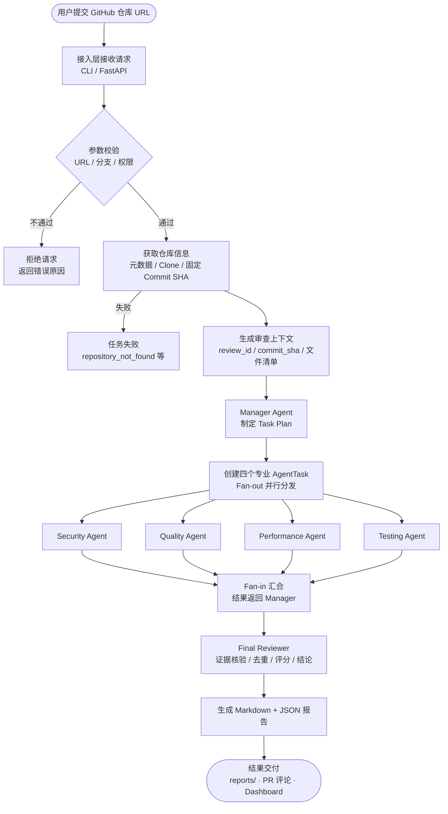

### 1.3 步骤总表

| 步骤 | 执行者 | 输入 | 输出 | 失败处理 | 阶段 |
| --- | --- | --- | --- | --- | --- |
| 1 提交请求 | 用户 | 仓库 URL、分支 | 请求 | — | 1 |
| 2 接收请求 | CLI / FastAPI | 请求 | 审查请求对象 | 参数错误直接拒绝 | 1 |
| 3 校验与仓库获取 | ReviewService / 仓库工具 | URL、分支 | 审查上下文（固定 Commit SHA） | 不可重试错误直接失败；网络错误有限重试 | 1 |
| 4 任务规划 | Manager | 审查上下文 | Task Plan | 规划失败则整体失败 | 2 |
| 5 任务分发 | Manager / LangGraph | Task Plan | 四个 `AgentTask` | — | 2 |
| 6 并行审查 | 四个专业 Agent | `AgentTask` | 四个 `AgentResult` | 见第 3、4 章 | 2 |
| 7 结果汇合 | Manager / LangGraph | 四个 `AgentResult` | 结果集合 + 执行统计 | 允许部分失败 | 2 |
| 8 核验与汇总 | Final Reviewer | 结果集合、代码快照 | `ReviewReport` | 见第 8 章 | 2 |
| 9 报告生成 | Final Reviewer / 报告模块 | `ReviewReport` | `report.md`、`report.json` | Schema 校验失败则报告生成失败；阶段 1 无 `ReviewReport`，`report.md` 由三份结构化数据渲染 | 1（`report.md`）；2 起（`report.json`） |
| 10 结果交付 | 交付层 | 报告 | 文件 / PR 评论 / Dashboard | 评论发布带幂等键 | 1、7 |

### 1.4 职责边界回顾

| 角色 | 在流程中的职责 | 不做 |
| --- | --- | --- |
| Manager | 规划、分发、协调、收集 | 不做代码分析，不生成最终结论 |
| 四个专业 Agent | 各自维度的审查，返回统一 `AgentResult` | 不互相覆盖；不下最终结论 |
| Final Reviewer | 核验证据、去重、评分、结论、报告 | 不派发新的审查任务；不拥有仓库写权限 |

**固定四个核心评分维度**：Security、Quality、Performance、Testing 是**固定的四个核心评分维度**；SubAgent 和外部 A2A Agent 是执行扩展，不自动改变核心评分结构（`ReviewReport` 的 `dimension_scores` 与 `agent_results` 始终是这四个维度）。

---

## 2. 正常执行流程

### 2.1 时序图

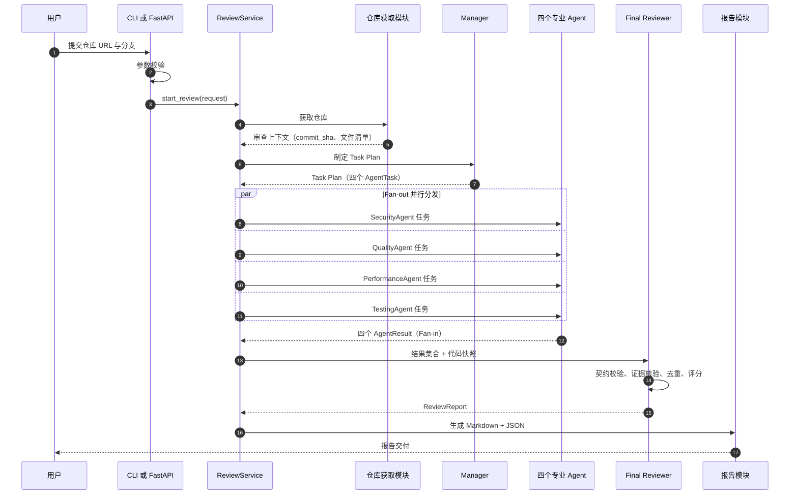

### 2.2 各步骤说明

#### 步骤 1～2：提交与接收

- 阶段 1～3：用户通过 CLI 提交（主要验收入口）；FastAPI 的 `POST /api/reviews` 为受控同步入口（阶段 1 必做最小实现，与 CLI 共用 `ReviewService`），请求体示例：

```json
{
  "repository_url": "https://github.com/owner/repository",
  "branch": "main"
}
```

- 阶段 4 起：FastAPI 完成校验、幂等检查、创建任务记录后，将作业放入 Redis 队列，返回 `202 Accepted` 与 `review_id`，由 ARQ Worker 调用 `ReviewService` 执行。FastAPI **不在请求线程中执行完整 Agent 工作流**。

#### 步骤 3：参数校验与仓库信息获取

```
接收仓库 URL
    ↓
校验 URL 与仓库地址
    ↓
获取仓库元数据
    ↓
Clone 仓库
    ↓
固定 Commit SHA
    ↓
遍历并过滤文件，生成审查上下文
```

| 检查项 | 规则 |
| --- | --- |
| URL | 仅允许 HTTPS 的 GitHub 仓库地址；限制域名与端口；拒绝本地路径、非 GitHub 地址、带凭据的 URL。 |
| 资源限制 | 仓库大小、文件数量、单文件大小、下载时间均设上限（阈值在阶段 1 确定）。 |
| 固定 Commit | Clone 后解析分支末端的完整 40 位 Commit SHA，后续所有行号均对应该 SHA。 |
| 文件收集 | 遍历源码，识别语言（第一版只审查 Python），过滤二进制、大文件及 `.git`、`node_modules`、`.venv`，记录路径、语言、行数、大小。 |
| 敏感文件 | `.env`、私钥、凭证等文件不得作为 LLM 上下文。 |
| 工作区 | 默认只读，防止分析工具修改原始代码。 |
| 不可信代码 | 不执行仓库中的安装、构建、测试脚本（可信测试仓库除外）。 |

输出的**审查上下文**包含：`review_id`、`repository`、`branch`、`commit_sha`、`repository_path`（工作区内路径）、文件清单、语言范围、仓库可信级别（可信 / 不可信，决定 Testing 是否可执行）。

#### 步骤 4：Manager 制定 Task Plan

Manager 依据审查上下文确定本次需要执行哪些审查任务，输出 Task Plan。Task Plan 至少决定：

| 内容 | 说明 |
| --- | --- |
| 任务清单 | 阶段 2 固定为四个专业任务（Security、Quality、Performance、Testing）；阶段 6 起可加入外部架构审查任务。 |
| 目标文件 | 每个任务的 `target_files`（缺省为全仓库中语言匹配的文件）。 |
| 执行约束 | 超时、最大重试次数、优先级。 |
| 测试执行许可 | 仓库为外部不可信时，Testing 任务标记为“仅静态评估，测试状态 `not_executed`”。 |

Task Plan 的每个任务都是一个符合 `task_contracts.md` 的 `AgentTask`；Manager 不在此步骤进行任何代码分析。

#### 步骤 5：创建四个专业审查任务并分发

- Manager 创建根任务（`ManagerAgent` / `review_orchestration`，深度 0），再创建四个深度 1 的专业任务，`parent_task_id` 指向根任务，状态均为 `pending`。**Final Reviewer 不在任务树中**，它是四个专业 Agent 之后的工作流汇总节点，不创建 `AgentTask`（见 `task_contracts.md` §3.1）。
- 阶段 2～3 中 Manager 创建专业任务时设置 `max_retries = 0`；阶段 4 起恢复为默认的 2。
- 通过 LangGraph 的 `Send` 或固定并行分支实现 Fan-out。
- **每个 Worker 只接收自己对应的 `AgentTask`**，而不是完整的共享 State 与所有敏感上下文。

#### 步骤 6：四个专业 Agent 并行执行

每个专业 Agent 的内部流程一致：

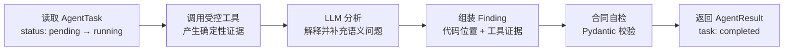

| Agent | 主要工具证据 | LLM 的作用 |
| --- | --- | --- |
| Security | Bandit（阶段 1）、Semgrep、Gitleaks、依赖扫描 | 解释风险、补充工具无法发现的安全逻辑问题 |
| Quality | Ruff、Radon | 解释异味、补充可读性与设计问题 |
| Performance | Radon、静态模式识别 | 识别算法与 I/O 层面的性能风险 |
| Testing | Pytest、Coverage.py（仅可信仓库） | 归纳失败原因，提出补测建议；**不猜测覆盖率** |

并行性约束：

- Security 节点只更新 `security_result`，Quality 节点只更新 `quality_result`，以此类推；**不得每个节点都返回整个共享 State**，否则可能产生 `InvalidUpdateError`。
- `completed_tasks`、`failed_tasks` 等列表型状态使用 Reducer（`Annotated[list, operator.add]`）合并。
- 每个 Agent 的开始/结束时间必须被记录，用来证明四路确实是并行而不是串行。

#### 步骤 7：结果返回 Manager（Fan-in）

Manager 收集四个 `AgentResult`，并做**完整性检查**（不做内容判断）：

| 检查 | 结果 |
| --- | --- |
| 四个任务是否都进入终态 | 未进入终态的任务（超时未返回）视为 `failed`；被取消的任务生成 `failed` 且 `error_type = cancelled` 的结果。**`agent_results` 必须始终包含四个维度的记录**，不得因失败而缺失（RP-15） |
| 每个 `AgentResult` 是否通过合同校验 | 校验失败视为 `failed`，`error_type = invalid_input` 或 `internal` |
| 汇总执行统计 | 任务总数、完成/部分/失败/取消数量、各 Agent 耗时 |

Manager 把结果集合与执行统计交给 Final Reviewer，**自己不生成最终审查结论**。

#### 步骤 8～9：Final Reviewer 汇总并生成报告

详见第 8 章。

#### 步骤 10：结果交付

| 渠道 | 阶段 | 说明 |
| --- | --- | --- |
| `reports/<review_id>/` 目录 | 1 起 | 阶段 1：`metadata.json`、`static_analysis.json`、`test_report.json`、`report.md`；阶段 2 起增加 `report.json` |
| API / CLI 输出 | 1 起 | 返回报告路径与摘要 |
| GitHub PR 评论 | 7 | 受控的发布模块，带幂等键 |
| Streamlit Dashboard | 7 | 展示执行过程与报告 |

---

## 3. 专业 Agent 执行失败与部分完成处理（阶段 2 实现）

### 3.0 阶段边界：哪些现在做，哪些留到后面

| 能力 | 实现阶段 | 说明 |
| --- | --- | --- |
| Agent 异常捕获 | **阶段 2** | Agent 内部异常被捕获并转换为 `AgentResult(status = failed)`，携带分类后的 `ErrorInfo`，不向上抛出未分类异常。 |
| 保留其他 Agent 已完成的结果 | **阶段 2** | 一个 Agent 失败不影响其他 Agent 的结果与汇合。 |
| 生成 `partial` 报告 | **阶段 2** | 存在 `partial` / `failed` 的结果时，`report_status = partial`。 |
| 子任务局部失败 | 阶段 3 | Security Agent 内部子任务失败时保留其他子任务结果，父结果为 `partial`。 |
| 有限重试与指数退避 | 阶段 4 | 见第 4 章，**设计预留**。 |
| 服务重启后的任务恢复 | 阶段 4 | 依赖 PostgreSQL 与 Checkpointer，见 §4.4。 |

**阶段 2 的行为约定：**

- 专业任务**首次失败即终态**：`running → failed`，不使用 `failed → pending`；`max_retries = 0`，`retry_count` 保持 0。
- 阶段 2 **不实现**：重试循环、退避等待、持久化的失败记录、Redis / ARQ、服务重启恢复。
- 工具与模型调用自身的超时沿用阶段 1 的设置；**Agent 级的超时调度与超时重试**属于阶段 4。

### 3.1 失败处理原则

1. **单个 Agent 失败不得导致整个系统崩溃。**
2. 失败必须**显式表达**：任务进入 `failed`，Agent 返回 `AgentResult(status = failed/partial)` 并带 `ErrorInfo`。
3. 不得用空 Finding 列表冒充成功，不得伪造测试结果。
4. 其他 Agent 的结果必须被保留。
5. 最终报告必须标记 `partial` 并说明缺失的维度与原因。
6. **失败的 Agent 也必须有记录**：失败的 Agent 返回合法的 `AgentResult(status = failed)`，不得从结果集合中删除。这样 Final Reviewer 才能区分“执行成功但无发现”“执行失败”“任务被取消、未执行”三种业务含义完全不同的情形（见 `task_contracts.md` §9.3）。

### 3.2 流程图

实线为**阶段 2 实际实现**的流程；虚线为**设计预留，阶段 4 实现**，阶段 2 不得提前实现。

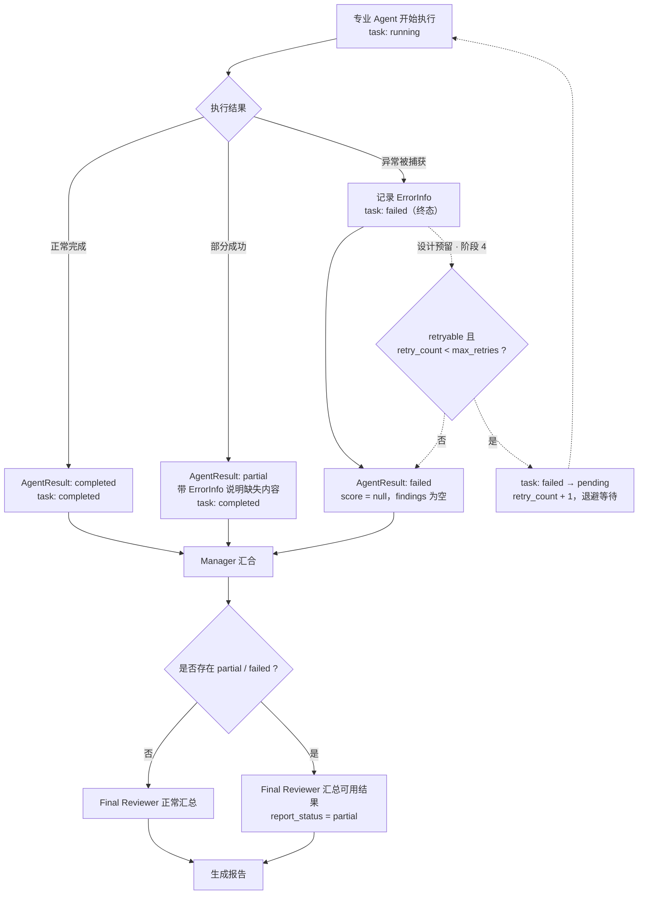

### 3.3 不同失败场景的处理

> 阶段 2 中，凡是涉及“重试”的描述，均等价于“首次失败即终态”；“重试用尽”的情形在阶段 4 引入重试后才会出现。

| 场景 | AgentResult | 对报告的影响 |
| --- | --- | --- |
| Security Agent 执行失败（异常或超时；阶段 4 起为重试用尽后） | `failed`，如 `error_type = timeout` | `report_status = partial`；Security 维度评分为 `null`；结论不得为 `APPROVE`；报告说明“安全维度未完成”。 |
| Testing Agent 的 pytest 执行成功，coverage 失败 | `partial`，`error_type = tool_error` | Testing 维度评分按已有结果计算或置 `null`（以 `review_rules.yaml` 为准）；`report_status = partial`。 |
| 外部仓库 Testing 未执行（沙箱未建立） | `completed`，`test_summary.execution_status = not_executed` | 这是**预期状态而非故障**：`reason` 必须说明；Testing 维度评分为 `null`（附 `reason`），因此 `report_status = partial`（RP-04）；结论不得为 `APPROVE`。 |
| 某个 Finding 不满足证据合同 | 该 Finding 被 Agent 自检丢弃或整个结果被 Final Reviewer 拒收 | Finding 不进入最终 `findings`；必要时进入 `rejected_findings` 供审计。 |
| 四个 Agent 全部失败 | 四个 `failed`（仍各有一条 `AgentResult` 记录） | 仍输出报告：四个维度评分均为 `null`，`overall_score = null`，`report_status = partial`，结论 `COMMENT`（唯一例外：存在已核验的 `critical` Finding 时按 RP-06 为 `REQUEST_CHANGES`），`verdict_reasons` 说明没有可用的审查结果（RP-16，示例见 `task_contracts.md` §9.5）。 |
| Manager 规划失败 | 无 Agent 结果 | 整次审查失败，任务 `failed`，错误信息返回给调用方，不生成评分报告。 |

### 3.4 评分处理（有维度缺失时）

- **有效维度**指评分非 `null` 的维度。仅对有效维度计算综合分，并将其权重按比例**归一化**；缺失维度在报告中保留 `null` 并附 `reason`，**不得用 0 或默认高分填补**。
- 一个维度即使有部分 Finding，只要评分规则无法可靠计算，也将该维度评分置为 `null`，而不是默认填 0。
- **所有维度评分均为 `null`** 时没有有效维度，不执行除法（避免分母为 0）：`overall_score = null`、`report_status = partial`、结论 `COMMENT`，`verdict_reasons` 必须说明没有可用的审查结果（合同规则 RP-16）。唯一例外：存在已核验的 `critical` 发现时，结论仍按 RP-06 为 `REQUEST_CHANGES`。
- 只要存在 `null` 维度，`report_status` 就是 `partial`，且不论综合分多高，结论不得为 `APPROVE`（RP-04、RP-05、RP-14）。
- 若存在已核验的 `critical` 发现，结论仍然是 `REQUEST_CHANGES`（RP-06）。

---

## 4. 超时与重试流程（设计预留，阶段 4 实现）

> **本章整体为设计预留。** 阶段 2、3 不实现重试循环、退避、Agent 级超时重试、持久化失败记录与重启恢复；阶段 3 的 SubAgent 局部失败只做到“保留其他子任务结果并汇总为 `partial`”。

### 4.1 流程图（设计预留，阶段 4 实现）

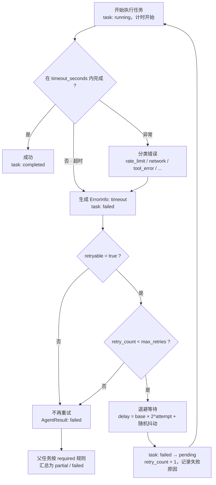

### 4.2 规则

| 项目 | 规则 |
| --- | --- |
| 单次超时 | 每个任务有 `timeout_seconds`（缺省使用系统默认），工具与模型调用另有独立超时；任何外部调用都必须设置超时。 |
| 重试次数 | `max_retries` 默认 2，总执行次数最多 `max_retries + 1`。 |
| 退避策略 | 指数退避加随机抖动：`delay = base × 2^attempt + jitter`，并设上限。第一版示例为 `2 ** attempt` 秒，正式版加入抖动与上限。 |
| 可重试 | `rate_limit`、`timeout`、`network`；`tool_error` 视情况；`token_limit` 需先缩小上下文。 |
| 不可重试 | `invalid_input`、`repository_not_found`、`evidence_invalid`、`internal`。 |
| 失败留痕 | 每次失败的错误原因都必须保存（阶段 4 落到 PostgreSQL），合同中只保留最近一次 `last_error`。 |
| 人工重跑 | 重试用尽后的失败任务，支持人工触发重跑：创建新任务，而不是重开旧任务（`failed` 终态不可逆）。 |
| 幂等 | 同一任务重复执行（如 Worker 中断后 ARQ 重新执行）不得产生重复结果：以 `review_id` + `task_id` 为幂等键，数据库唯一约束兜底。 |
| 重复副作用 | 阶段 4 保证重试不产生重复的审查作业与报告；GitHub 评论发布的幂等（评论发布幂等键）属于阶段 7 的 PR 集成，不在本阶段实现。 |

### 4.3 异常到处理方式的对应

| 异常 | 处理方式 |
| --- | --- |
| 模型接口限流 | 退避重试 |
| 网络超时 | 有限重试 |
| 参数格式错误 | 修正输入或直接失败 |
| 仓库不存在 | 直接失败 |
| 工具执行错误 | 根据错误类型决定是否重试 |
| Token 超出限制 | 切分任务或缩小上下文 |

### 4.4 异步作业层面的服务重启恢复（阶段 4）

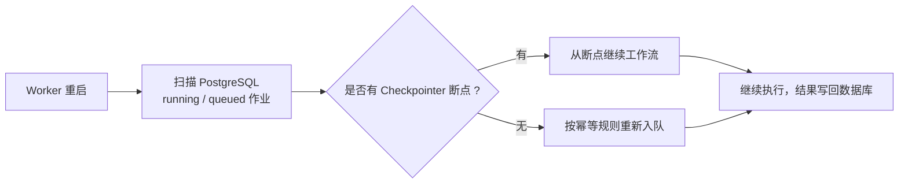

恢复时必须先检查任务状态，已完成的任务不得再次执行。

---

## 5. SubAgent 二级任务流程（阶段 3 实现，设计如下）

### 5.1 适用范围

先以 **Security Agent** 构建两层结构，其他三个专业 Agent 暂不创建 SubAgent。

| SubAgent | `agent_name` | 执行方式 |
| --- | --- | --- |
| Dependency Scanner | `DependencyScannerSubAgent` | 确定性工具调用（依赖漏洞扫描） |
| Secret Scanner | `SecretScannerSubAgent` | Gitleaks 等工具 |
| Code Security Reviewer | `CodeSecurityReviewerSubAgent` | LLM + 静态分析证据 |

> SubAgent 不一定都调用 LLM；确定性工具 Worker 也可以作为父 Agent 内部的执行单元。

### 5.2 流程

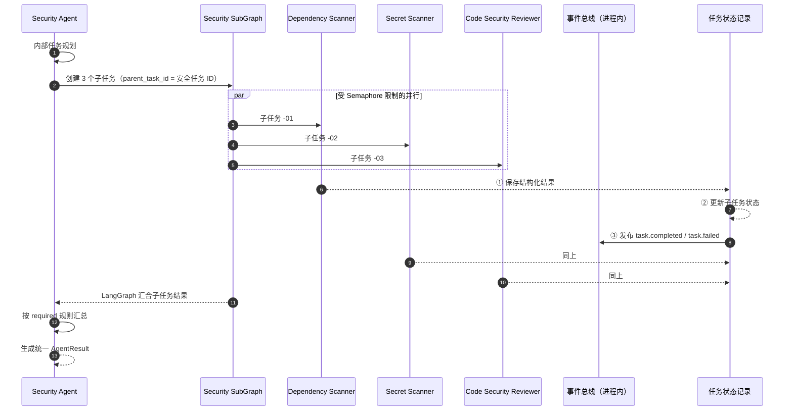

### 5.3 关键规则

| 编号 | 规则 |
| --- | --- |
| SW-1 | 子任务有唯一 `task_id` 与 `parent_task_id`；子任务不再创建子任务（最大深度 2）。 |
| SW-2 | **执行顺序**：生成结构化结果 → 更新任务状态 → 发布事件。事件发布前，结果必须已保存。 |
| SW-3 | **职责划分**：LangGraph 负责子任务的执行控制、并行调度与汇合；事件机制负责记录与通知。**二者不得重复实现调度逻辑**；父 Agent 不得仅依靠事件监听判断 SubGraph 是否完成。 |
| SW-4 | 并发由 `asyncio.Semaphore` 限制。可复现的**初始测试配置**为 `security_subagents: 2`（Security 内部同时最多 2 个 SubAgent）与 `global_subagents: 4`（全局同时最多 4 个 SubAgent），数值不是生产环境的最终性能参数（见 `architecture.md` §10.2）。阶段 3 实现 Security 的局部 Semaphore，全局限制只完成设计，阶段 4 才实现全局并发限制，防止多个 Agent 或多个审查叠加后超出资源上限。 |
| SW-5 | 单个子任务失败时，保留其他子任务的结果。 |
| SW-6 | 父任务汇总规则：所有 `required` 子任务完成 → `completed`；有必需子任务失败但存在可用结果 → `partial`；所有必需子任务失败 → `failed`。父任务不得在必需子任务终态之前被标记为成功。 |
| SW-7 | 汇总时 Finding 的 `agent_name` 统一为 `SecurityAgent`，来源子任务记录在 `AgentResult.metadata`。 |
| SW-8 | 阶段 3 使用进程内异步事件机制与内存状态；阶段 4 升级为持久化、可确认消费的事件机制（Redis Streams）。不将普通 Pub/Sub 当作可靠通知存储。 |
| SW-9 | **任务树拓扑与派生权限校验（阶段 3 编排层）**：最大深度为 2（深度 0 根任务、深度 1 专业任务、深度 2 SubAgent，深度 3 禁止创建）；父任务必须存在且 `review_id` 一致；父子关系不得成环；仅 Manager 可创建深度 1 任务、Security Agent 可创建深度 2 任务，深度 2 的 SubAgent 不得再创建子任务。上述规则是多任务对象之间的拓扑/权限约束，不是阶段 0 的单个 `AgentTask` Schema 校验，也不通过新增 `task_depth` 字段实现。 |

### 5.4 父子任务示例

```
Parent Task: task-security-001
    ├── Child Task: task-security-001-01  (Dependency Scanner)
    ├── Child Task: task-security-001-02  (Secret Scanner)
    └── Child Task: task-security-001-03  (Code Security Reviewer)
```

可通过 `parent_task_id = 'task-security-001'` 查询所有子任务。

---

## 6. MCP 工具调用流程（阶段 5 实现，设计如下）

### 6.1 时序图

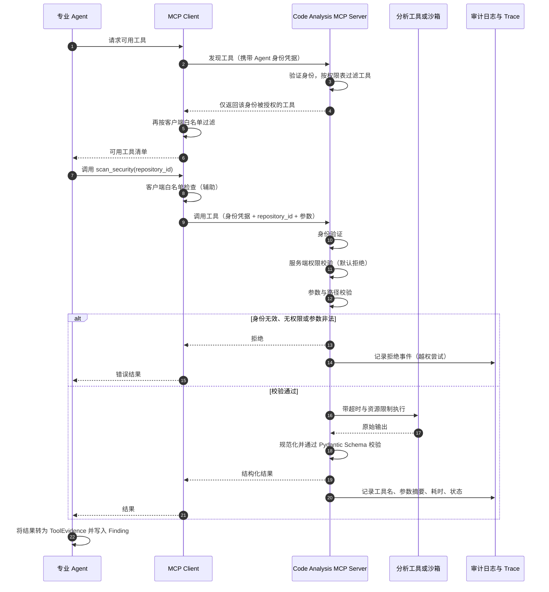

> 两层校验的职责：**客户端白名单负责减少误用，服务端授权负责真正阻止越权。** 详见 `architecture.md` §9.3。

### 6.2 权限矩阵（由服务端强制执行）

| Agent | 允许调用的 MCP 工具 |
| --- | --- |
| Security | `scan_security`、`get_file_content` |
| Quality | `check_quality`、`analyze_complexity` |
| Performance | `analyze_complexity`、受控性能测试 |
| Testing | `run_tests`、`get_coverage` |

### 6.3 规则

| 编号 | 规则 |
| --- | --- |
| MC-1 | 工具通过 **`repository_id`**（已登记的工作区）引用仓库，而不是传递任意路径。 |
| MC-2 | 所有工具必须校验仓库 ID、路径与执行参数，防止路径穿越。 |
| MC-3 | `run_tests` 必须在受限容器内执行，不得让 MCP Server 以高权限直接运行不可信仓库代码。 |
| MC-4 | 工具返回结果必须符合 Pydantic Schema，不合规视为 `tool_error`。 |
| MC-5 | 未授权调用被**服务端**拒绝并记录事件；即使绕过 MCP Client 直接向 MCP Server 发请求，也必须被服务端的身份验证与权限校验拦截。客户端白名单只是辅助，不构成安全边界。 |
| MC-6 | 工具原始输出保存为证据文件，Finding 的 `tool_evidence.raw_output_ref` 指向它。 |
| MC-7 | MCP 只负责工具接入，不参与任务规划与 Agent 协作。 |
| MC-8 | 服务端以已验证的凭据确定调用方身份，不信任请求体中自报的 `agent_name`；权限表默认拒绝。 |
| MC-9 | 凭据由客户端代码注入，不进入 LLM 上下文；工具参数中不接受身份或权限字段。 |
| MC-10 | 允许与拒绝的调用都写入审计日志，越权尝试单独标记为安全事件。 |

---

## 7. A2A 外部 Agent 通信流程（阶段 6 实现，设计如下）

### 7.1 外部 Agent 的定位

**External Architecture Review Agent** 独立部署（如 `http://localhost:9000`），主系统在 `http://localhost:8000`，二者不共享 Python Runtime。它负责模块依赖关系、架构设计问题、API 兼容性、设计模式合理性、跨文件业务逻辑问题，用来弥补四个本地 Agent 的盲区，而不是重复它们的工作。

### 7.2 时序图

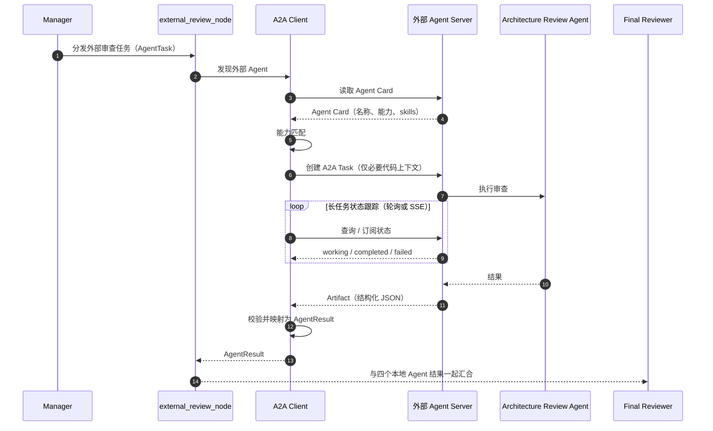

### 7.3 失败与降级

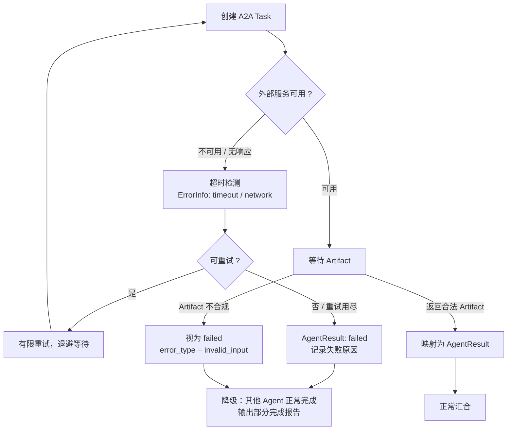

### 7.4 规则

| 编号 | 规则 |
| --- | --- |
| A2A-1 | Agent Card 按所选 SDK 版本的 Schema 生成，不把示意 JSON 当作完整标准实现。 |
| A2A-2 | A2A Task 的状态管理属于 A2A Server；Manager 管理自己发起的外层任务。 |
| A2A-3 | A2A 的 Task / Message / Part / Artifact 与内部 `AgentTask` / `AgentResult` 必须有明确映射（见 `task_contracts.md` §13.3）。 |
| A2A-4 | A2A Server 不暴露其内部 SubAgent。 |
| A2A-5 | 外部 Agent 只获得必要的代码上下文，不获得凭证与其他审查数据。 |
| A2A-6 | 第一版使用 SDK 支持的轮询或 SSE；异步回调（Webhook）作为后续选项。 |
| A2A-7 | 外部 Agent 不可用时，主系统记录失败并按策略重试或降级，**其他 Agent 不受影响**。 |
| A2A-8 | 外部 Agent 返回的 Finding 同样必须满足证据合同，并经过 Final Reviewer 核验。 |
| A2A-9 | 外部 Agent 的结果放入 `ReviewReport.external_agent_results`，不进入 `agent_results` 与 `dimension_scores`；外部失败时保留 `failed` 记录，`report_status = partial`。 |
| A2A-10 | 外部 Finding 经核验、去重后可进入最终 `findings` 并参与结论规则，但**不参与四个核心维度的加权评分**。 |

---

## 8. 最终报告生成流程

Final Reviewer 是 Manager 之后的**独立审查节点**，负责证据核验、Finding 去重、综合评分和最终报告生成。

### 8.1 流程图

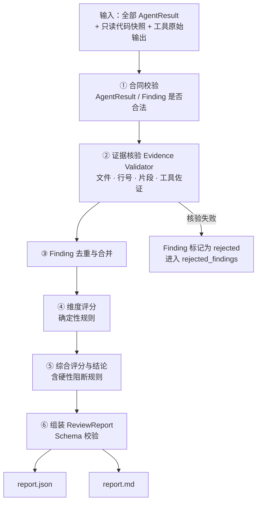

### 8.2 ① 合同校验

对每个 `AgentResult` 与其 Finding 进行 Pydantic 校验与规则检查（`task_contracts.md` 的 RS / FD 规则）；校验失败的结果视为 `failed`（`invalid_input`），不进入后续步骤。

### 8.3 ② 证据核验（Evidence Validator）

不得让 Agent 想报什么就报什么。对每个 Finding 依次检查：

| 编号 | 检查 | 失败后果 |
| --- | --- | --- |
| V1 | 文件是否存在于固定 Commit 的工作区中 | `rejected` |
| V2 | 路径是否位于工作区内（无路径穿越、无指向工作区外的符号链接） | `rejected` |
| V3 | 行号是否有效（`1 ≤ start_line ≤ end_line ≤ 文件总行数`） | `rejected` |
| V4 | 证据片段是否与对应行内容匹配（忽略空白差异） | 在邻近行内唯一定位成功则修正行号并记录；否则 `critical / high` 判定为 `rejected`，其余维持 `unverified` 并降低可信度 |
| V5 | 工具佐证：`tool_evidence.raw_output_ref` 是否可解析，且其文件与行号和 Finding 一致 | 无佐证则维持 `unverified` |
| V6 | 是否疑似误报（如测试代码、示例代码、已有防护） | 记录说明，必要时降级严重级别 |
| V7 | 涉及密钥的证据是否已脱敏 | 未脱敏则脱敏后写入；无法处理则拒绝 |

核验结论：

| `verification_status` | 条件 |
| --- | --- |
| `verified` | V1～V4 通过，且有工具佐证（V5 通过） |
| `unverified` | V1～V3 通过，但缺少工具佐证或 V4 未完全匹配（如纯 LLM 语义发现）；保留并在报告中标注 |
| `rejected` | V1～V3 任一失败，或 `critical / high` 的 V4 失败 |

> 以上核验策略是阶段 2 的**初始策略**，可根据评估体系（Precision / Recall / 误报率）调整。

### 8.4 ③ Finding 去重与合并

| 项目 | 规则 |
| --- | --- |
| 去重键 | 规范化 `file_path` + 行号范围（有重叠）+ 问题类别（同类或同一类别组）。无文件位置的项目级发现用（`category`、`tool_name`）。 |
| 合并规则 | 保留严重级别最高者；描述采用置信度最高者；合并 `tool_evidence`；`merged_from` 记录被合并的原始 `finding_id`。 |
| 职责重叠 | 按“职责边界矩阵”优先归属主责 Agent（例如硬编码密钥归 Security）。 |
| 留痕 | 原始结果保留在 `agent_results`，合并后的结果进入 `findings`。 |

### 8.5 ④ 维度评分

- 评分由**确定性规则**计算，不由 LLM 自由打分；规则与权重放在可配置的 `review_rules.yaml`（后续阶段建立），不得硬编码。
- 初始规则（仅为项目初始配置，**不代表行业标准**，将通过测试样例集校准）：

| 严重级别 | 扣分 |
| --- | --- |
| critical | 25 |
| high | 15 |
| medium | 5 |
| low | 2 |
| info | 0 |

`维度评分 = max(0, 100 − Σ 非 rejected Finding 的扣分)`。

- 维度失败、未执行，或评分规则无法可靠计算时，评分为 `null` 并附 `reason`（见 3.4），**不得默认填 0**。
- 测试维度的失败用例、低覆盖率等以 `test_failure`、`low_coverage` 等 Finding 的形式参与扣分；覆盖率数字本身来自 Coverage.py 的真实输出。

### 8.6 ⑤ 综合评分与结论

**初始维度权重（可配置）：**

| 维度 | 初始权重 |
| --- | --- |
| Security | 35% |
| Quality | 25% |
| Performance | 20% |
| Testing | 20% |

`综合评分 = Σ(wᵢ·Sᵢ) / Σwᵢ`，保留一位小数。求和仅包含**有效维度**（评分 `Sᵢ` 非 `null`）：缺失维度不参与综合评分，剩余有效维度的权重只在公式内部重新归一化；报告中存储的四个 `DimensionScore.weight` 始终是原始配置值，不因评分缺失而改变。

权重规则（与 `task_contracts.md` RP-11 一致）：

- 四个核心维度的配置权重都必须满足 `0 < w ≤ 1`，且之和为 `1`；加载 `review_rules.yaml` 时必须校验，不合法则报错，不得静默修正。
- **不参与评分的维度用 `score = null` 表示，不得通过把权重设为 0 来表示。**
- 除零风险：每个 `wᵢ > 0`，因此只要至少有一个有效维度，`Σwᵢ > 0`；**没有任何有效维度时不执行除法**，直接 `overall_score = null`。

**结论规则（初始配置，按优先级从高到低）：**

| 优先级 | 条件 | 结论 |
| --- | --- | --- |
| 1 | 存在 `verified` 的 `critical` Finding | `REQUEST_CHANGES`（**硬性阻断**，不允许被其他维度的高分抵消） |
| 2 | 存在 `verified` 的 `high` Finding，或综合评分 < 60 | `REQUEST_CHANGES` |
| 3 | 全部四个维度均有评分，无非 rejected 的 `critical / high`，且综合评分 ≥ 80 | `APPROVE` |
| 4 | 所有维度评分均为 `null`（没有可用的审查结果，且未命中优先级 1） | `COMMENT`，`overall_score = null`，`verdict_reasons` 必须说明原因 |
| 5 | 其他情况（含存在 `unverified` 的高危发现、维度缺失、`report_status = partial`） | `COMMENT` |

`verdict_reasons` 必须写明触发的规则，保证结论可解释。

### 8.7 ⑥ 报告生成

- 先生成 `ReviewReport`（`report.json`），再**由同一份对象渲染** `report.md`，保证两者内容一致，Markdown 中不得出现 JSON 中没有的信息。
- `report.json` 必须通过 Schema 校验；校验失败视为报告生成失败。
- 报告输出目录：

```
reports/
    <review_id>/
        metadata.json          # 审查元数据（仓库、分支、Commit SHA、时间）
        static_analysis.json   # 静态分析原始/规范化输出
        test_report.json       # 测试与覆盖率原始输出（或 `not_executed` 说明）
        report.json            # ReviewReport
        report.md              # 由 ReviewReport 渲染的 Markdown 报告
```

> **阶段 1 补充（2026-11-10）**：阶段 1 只生成 `metadata.json`、`static_analysis.json`、`test_report.json`、`report.md` 四件；`report.md` 由三份结构化数据渲染，不依赖 `ReviewReport`。`report.json` 自阶段 2 起由 Final Reviewer 生成。

Markdown 报告结构：

| 区块 | 内容 |
| --- | --- |
| 标题与结论 | 综合评分、`APPROVE / COMMENT / REQUEST_CHANGES`、结论理由 |
| 部分完成提示 | 若 `partial`，明确列出缺失维度与原因 |
| 维度评分表 | 维度、评分、Finding 数量、状态 |
| 重点风险 | 按严重级别排序，列出标题、严重级别、`文件:行号` |
| 各维度详情 | Finding 的描述、证据、建议 |
| 测试摘要 | 通过/失败/覆盖率，或 `not_executed` 及原因 |
| 执行统计 | 任务数、各 Agent 耗时、重试情况 |
| 成本统计 | Token 与成本（阶段 7 前为 0） |

> 报告中的示意数据必须标注为示意；实际结果必须来自真实代码分析与模型调用。

---

## 9. 三个必须通过的端到端场景

| 场景 | 流程 | 验证目的 | 关联阶段 |
| --- | --- | --- | --- |
| **测试 A：正常执行** | 真实仓库提交 → 并行审查 → 结果汇总 → 最终报告 | 主流程闭环 | 2 起 |
| **测试 B：局部失败** | Security Agent 内部一个 SubAgent 失败 → 重试 → 事件通知 → Security Agent 汇总 → 最终报告 | 父子任务、重试与部分完成 | 3～4 |
| **测试 C：跨服务失败** | 外部 A2A Agent 不可用 → 超时检测 → 重试或降级 → 其他 Agent 正常完成 → 输出部分完成报告 | 跨服务容错 | 6 |

---

## 10. 各阶段工作流形态一览

| 阶段 | 工作流形态 |
| --- | --- |
| 0 | 无运行时工作流；阶段 0 冻结本文档与数据合同，并交付数据合同 Schema 与单元测试 |
| 1 | 线性流程：获取仓库 → 文件解析 → 静态分析（及可信仓库的测试）→ 单 Agent 基础报告；CLI 与 FastAPI 共用 `ReviewService`；**阶段 1 不引入 LangGraph** |
| 2 | LangGraph Supervisor-Worker：Manager → 四路并行 → Final Reviewer（汇总节点，不在任务树中）；进程内编排；Agent 异常捕获、保留已完成结果、`partial` 报告，**无重试** |
| 3 | 在 Security Agent 内增加 SubGraph：三个子任务并行，事件通知，父子任务汇总；子任务局部失败时保留其他结果，**无重试** |
| 4 | 入口改为入队：FastAPI → Redis → ARQ Worker → `ReviewService` → LangGraph；增加重试、超时、幂等、状态持久化与断点恢复 |
| 5 | 各 Agent 的工具调用统一经由 MCP Client 与权限检查 |
| 6 | 增加 `external_review_node`，通过 A2A 与四个本地 Agent 并行 |
| 7 | 全链路 Trace 与 Token 统计；GitHub PR Webhook 触发与评论回写；Dashboard |

---

## 11. 流程中的关键状态与事件

| 流程节点 | 任务状态变化 | 产生的事件（阶段 3 起） |
| --- | --- | --- |
| Manager 创建任务 | 无 → `pending` | — |
| Agent 开始执行 | `pending → running` | — |
| Agent 成功 | `running → completed` | `task.completed` |
| Agent 失败（阶段 2～3：直接终态） | `running → failed` | `task.failed`（阶段 3 起，仅 SubAgent） |
| Agent 失败（可重试，**阶段 4 起**） | `running → failed → pending`（`retry_count + 1`） | `task.failed` |
| Agent 失败（不可重试 / 重试用尽） | `running → failed`（终态） | `task.failed` |
| 取消 | `pending/running → cancelled` | — |

状态迁移规则的权威定义见 `task_contracts.md` §6；阶段 4 的 `queued`、`retrying` 等扩展状态属于作业/编排层，不进入 `AgentTask.status`。

---

## 修订记录

| 项目 | 内容 |
| --- | --- |
| 修订日期 | 2026-11-09 |
| 修订类型 | v1.0 冻结前跨文档一致性修订（D-1、D-3、D-4、D-8） |
| 修订内容 | ① 明确阶段 0 不要求运行时 Agent/工作流编排/业务执行代码，但 Pydantic Schema 与单元测试属于阶段 0 交付物（D-8）；② 补充阶段 3 编排层负责任务树深度、父任务存在性、环检测与派生权限校验（SW-9），且不新增 `task_depth` 字段（D-4）；③ 对“四个 Agent 全部失败”的全 null 报告补充已核验 `critical` 例外（D-1）；④ 明确综合分公式内部归一化不改变报告存储的配置权重（D-3）。 |
| 修订日期 | 2026-11-10 |
| 修订类型 | v1.1 阶段 1 实施基线修订 |
| 修订内容 | ① §8.7 补充阶段 1 四件产物口径，明确 `report.json` 自阶段 2 起生成；② §10 明确阶段 1 不引入 LangGraph，由 `ReviewService` 直接编排工具链；③ §2、§6、§7 同步阶段 1 交付物与 FastAPI 最小同步入口口径。 |
| 影响 | AC-1-14、AC-1-15；Stage 1.6；不改变阶段 2 起的工作流设计。 |
| 数据合同权威顺序 | `task_contracts.md` 是数据合同唯一权威；本文档不得与其冲突。 |
| 阶段归属 | 任务树拓扑与派生权限属于阶段 3；失败重试、持久化与调度属于阶段 4。 |
| 架构影响 | 未改变整体系统架构、阶段划分与核心业务方向。 |
