# Stage 2.0 修订版 R1：阶段 2 实施前架构审计与实施计划

> 修订依据：2026-11-11 人工审核意见（B-1、B-2 裁定；问题 A～D；D-3、D-4、D-5、D-7、D-11、D-12 决策）  
> 修订范围：只读审计与计划修订；**未修改任何项目文件、未安装依赖、未执行 Git 写操作、未调用真实 LLM、未执行外部仓库代码**。  
> 本版替代上一版中与人工审核意见冲突的内容；未变更的代码事实沿用上一版审计证据。

---

## 1. 审计结论摘要

### 1.1 审核意见落实情况

| 人工意见                                                     | 本版处理                                                     | 结论                                        |
| ------------------------------------------------------------ | ------------------------------------------------------------ | ------------------------------------------- |
| **B-1** 接受 LangGraph 被动传递依赖例外，禁止直接导入、Tracing、环境变量、API Key、网络上报；2.3 前明确批准 | 依赖政策改为“允许被动存在、禁止主动使用”；增加静态扫描与运行时环境守卫；2.3 安装前保留签批门禁 | **政策阻断已关闭，安装门禁保留**            |
| **B-2** 采用方案 A：`report.json` 存精确归一化值；Markdown/CLI 一位小数；不改 Schema | 评分实现改为“精确值计算与存储、展示层格式化”；阈值比较使用精确值 | **阻断已关闭**                              |
| **问题 A** Final Reviewer 不能读取尚未写盘的工具报告         | Final Reviewer 改为校验 State 中已构建的 `ArtifactData` 内存对象；JSON Pointer 只是稳定键；报告生成器写同一份数据 | **设计已修订**                              |
| **问题 B** 项目级 Finding 不应强制文件/行号                  | 区分“代码位置型”与“工具报告型” Finding；后者只用 JUnit/Coverage 报告引用核验，不伪造位置 | **设计已修订**                              |
| **问题 C** 不得预设 B107/B608 为 critical                    | 严重级别来自工具原始结果 + `review_rules.yaml` 映射；E2E 验证“发现+证据”，AC-2-12 用独立构造的 verified critical 单元测试验证 | **设计已修订**                              |
| **问题 D** 真实 LLM 调用时不能把成本伪装成 0                 | 默认 Fake 路径零消耗为真；真实 LLM 路径保留 Token usage，但 `CostSummary` 无“未知”表达，列为开放合同缺口 O-1；不修改 Schema | **默认路径不阻塞；真实 LLM smoke 另行裁定** |
| **D-3** 真实临时 Git 仓库生成 Fixture commit SHA             | 固定文件内容/模式、Git 身份、提交时间、提交信息；重复构建断言 SHA 相同 | **采纳**                                    |
| **D-4** 生产默认 Stage 2，旧测试显式 `multi_agent=False`；先盘点所有调用方 | 已完成全仓调用方盘点（见 §2.5）；修正上一版“17+2”的不准确表述 | **采纳**                                    |
| **D-5** 默认 Fake/Mock；真实 LLM Smoke 独立运行、独立记录    | 默认测试无网络/无真实 LLM；真实 smoke 单独审批、单独记录，不纳入默认验收 | **采纳**                                    |
| **D-7** Stage 2.1 明确加入 PyYAML，保留 Stage 1 锁文件       | `environment.yml` 增加 `pyyaml==6.0.3`；`environment.lock.yml` 不改 | **采纳**                                    |
| **D-11** 工具成功、LLM 失败 → `partial`，保留工具结果；是否评分按规则判断 | 工具证据完整且可评分时保留维度分；证据不完整/不可靠时 null；结果状态 `partial` | **采纳**                                    |
| **D-12** 外部仓库 Testing 未执行 → `completed` + Testing `score=null` + 报告 partial | 与 `workflow.md`、RP-04 一致；不把 `completed` 伪装成有评分  | **采纳**                                    |

### 1.2 当前是否具备进入阶段 2 的条件

**具备开始 Stage 2.1 的条件。**

- B-1 的政策例外已由人工审核明确；Stage 2.3 安装 LangGraph 前仍需提交确切版本、传递闭包、探针变更和安装命令，取得安装批准。
- B-2 已按方案 A 解决，不需要修改冻结 Schema。
- 问题 A～C 已转化为可实现的设计约束，纳入 Stage 2.3/2.4/2.5/2.6。
- 问题 D 不阻塞默认 Fake 路径；真实 LLM smoke 的报告成本语义仍为开放合同缺口 O-1，未解决前不得宣称该 smoke 的 `cost_summary` 验收通过。

### 1.3 阶段 1 能否保持原有行为

**可以，但必须显式盘点并修改所有调用方，不能只改已知测试。**

已盘点结果：

- 生产调用方：`src/code_review/cli.py`、`src/code_review/api/app.py`。
- 单元测试：`tests/unit/test_review_service.py` 中 **17 个** `review()` 调用点、**2 个** `review_trusted_fixture()` 调用点；3 处 `ReviewService(...)` 构造。
- 集成测试：`tests/integration/test_stage1_6_review.py` 中 **1 个** `review()`、**1 个** `review_trusted_fixture()`；2 处 `ReviewService(...)` 构造。
- `tests/unit/test_cli.py`、`tests/unit/test_api.py` 使用 Fake service，仅实现 `review()`，不构造真实 `ReviewService`；只要 `review()` 签名不变即可继续工作，响应字段变化时仅调整断言。

上一版写“17+2 个测试”不够准确：实际是 **17 个单元 `review()` + 1 个集成 `review()`**，另有 **3 个 `review_trusted_fixture()`** 调用。本版以全仓盘点为准。

兼容方案：

- `ReviewService(..., multi_agent: bool = True)`；生产默认 Stage 2。
- 上述 Stage 1 单元测试 harness、`test_stage1_6_review.py` 的 `build_external_service()` 显式传 `multi_agent=False`。
- `review_trusted_fixture()` 保持 Stage 1 四件产物与 `commit_sha=None`。
- 新增 `review_stage2_fixture()`（名称待负责人最终确认）用于五件产物 E2E。
- CLI/API 仍然只调用 `ReviewService`，不复制评审逻辑；默认自动进入 Stage 2。

### 1.4 尚未关闭的开放问题

**O-1：`CostSummary` 无法表达“成本未知”。**

- `CostSummary.total_input_tokens`、`total_output_tokens`、`estimated_cost` 都是非空数值，`currency` 只允许 `CNY/USD`，没有 `null` 或 `UNKNOWN`。
- `docs/task_contracts.md` §9.2 又写“阶段 7 前保持默认值”，与“真实 LLM 调用时不得伪装零成本”的人工意见存在张力。
- 默认 Stage 2 使用 Fake LLM，没有实际模型调用，`cost_summary` 全 0 是真实的；因此不阻塞默认路径。
- 真实 LLM smoke 如果发生实际调用，只能保留真实 Token usage；`estimated_cost` 无法可靠计算时，不能填 0 冒充“零成本”。本阶段不修改 Schema；该 smoke 的 `cost_summary` 验收暂不纳入通过条件，待负责人另定。

---

## 2. 当前代码库真实状态

### 2.1 Git 状态

| 项目           | 实际状态                                                     |
| -------------- | ------------------------------------------------------------ |
| 分支 / HEAD    | `main` / `65af76e feat(stage1): complete single-agent code review foundation` |
| 远程           | `https://github.com/Fightming98/multi-agent-code-review.git` |
| 已删除但受跟踪 | `Stage1实施前人工决策.md`、`阶段1_Prompt.md`                 |
| 未跟踪         | `reports/stage1-20261110T120331Z-d8333a8c/`、`阶段2_Prompt.md` |
| `.gitignore`   | `Prompt/*` 忽略；`# reports/*` 仍为注释                      |

阶段 2 提交前必须处理删除文档的追溯问题、`reports/` 是否纳入版本控制、`阶段2_Prompt.md` 是否跟踪；本次未做 Git 写操作。

### 2.2 目录与模块

当前真实存在 `schemas/`、`tools/`、`services/`、`reporting/`、`api/`、`cli.py`、`config/settings.py`、`tests/`；**不存在** `agents/`、`graph/`、`prompts/`、`config/review_rules.yaml`、`tests/fixtures/stage2_sample_repo/`。

| 模块                             | 职责                                                         |
| -------------------------------- | ------------------------------------------------------------ |
| `schemas/`                       | 四个核心合同；冻结                                           |
| `tools/`                         | 克隆、巡检、Ruff/Bandit/Radon、TestRunner/Coverage、可信 Fixture |
| `services/review_service.py`     | 阶段 1 线性编排、工作区生命周期、错误映射、报告生成          |
| `services/evidence_validator.py` | V1～V4 路径/存在性/行号/片段                                 |
| `services/llm_client.py`         | `OpenAICompatibleClient`，已有 usage 字段                    |
| `services/redaction.py`          | 密钥/Token/路径脱敏                                          |
| `reporting/`                     | 阶段 1 四件产物、模型、Markdown                              |
| `api/`、`cli.py`                 | 阶段 1 同步入口                                              |

### 2.3 测试基线（本次重新运行）

| 命令                       | 结果                                     |
| -------------------------- | ---------------------------------------- |
| `pytest --collect-only -q` | 839 collected                            |
| `pytest tests/unit -q -rs` | 820 passed, 4 skipped, 1 warning, 14.62s |
| `pytest -q`                | 831 passed, 8 skipped, 1 warning, 34.26s |

4 个单元 skip 为 Windows 符号链接权限；其余 4 个为 3 个 `real_network` + 1 个 `llm_smoke` 门控。当前无 failure/error/xfail。

`CLAUDE.md` 仍写“204 条”“阶段 1 尚未开始”，为过时文档；应在 Stage 2.1 前更新。

### 2.4 依赖状态

- 已安装：基础 8 包、`ruff`、`bandit`、`radon`、`coverage`、`pyyaml==6.0.3`。
- 未安装：`langgraph`、`langchain-core`、`langsmith`、`langchain-openai`、`redis`、`arq`、`mcp`、`a2a-sdk`、`streamlit`。
- `environment.yml` 未声明 `pyyaml`、未声明 `langgraph`。
- `environment.lock.yml` 是 Stage 1 快照，顶部明确“Stage 2 不得覆盖，应生成新快照”。
- 仓库无 `requirements.txt`、`pyproject.toml`、`setup.py`；依赖入口是 `environment.yml` + `environment.lock.yml`。

### 2.5 D-4 调用方盘点

| 调用方           | 位置                                                         | 调用                                                         | 阶段 2 处理                                                  |
| ---------------- | ------------------------------------------------------------ | ------------------------------------------------------------ | ------------------------------------------------------------ |
| CLI              | `src/code_review/cli.py:69`、`:71`                           | `ReviewService(settings)`、`.review(...)`                    | 默认 Stage 2；无需复制逻辑                                   |
| FastAPI          | `src/code_review/api/app.py:63`、`:107`                      | `ReviewService(...)`、`.review(...)`                         | 默认 Stage 2；响应增加 verdict/维度分/报告路径               |
| 单元服务测试     | `tests/unit/test_review_service.py`                          | 17 个 `.review()`；2 个 `.review_trusted_fixture()`；构造于 `:170`、`:517`、`:525` | harness 显式 `multi_agent=False`；fixture 路径不变           |
| Stage 1 集成     | `tests/integration/test_stage1_6_review.py:111`、`:129`、`:200`、`:210` | 1 个 `.review()`；1 个 `.review_trusted_fixture()`           | `build_external_service()` 显式 `multi_agent=False`；fixture 测试不变 |
| CLI/API 单元测试 | `tests/unit/test_cli.py`、`test_api.py`                      | Fake service 的 `.review()`                                  | 签名不变则无需改；响应字段变化时调整断言                     |
| 其他             | 未发现其他生产/测试调用方                                    | —                                                            | —                                                            |

**结论**：D-4 的“先盘点所有调用方”已完成。不能只改 17+2 个测试；还必须覆盖 CLI、API、集成 fixture 路径和 Fake service 响应断言。

---

## 3. 阶段 1 能力复用分析

| 模块                                     | 现有实现                                                     | 阶段 2 复用方式                                              | 是否需要修改                                     | 风险                                   |
| ---------------------------------------- | ------------------------------------------------------------ | ------------------------------------------------------------ | ------------------------------------------------ | -------------------------------------- |
| `schemas/task.py`                        | `AgentTask`、`ErrorInfo`、状态机                             | 根任务 + 四任务；`max_retries=0`                             | 否（冻结）                                       | 不得新增 depth 字段                    |
| `schemas/result.py`                      | `Finding`、`ToolEvidence`、`AgentResult`                     | 四 Agent 统一结果                                            | 否（冻结）                                       | `critical/high` 必须有代码位置         |
| `schemas/report.py`                      | `ReviewReport`、`DimensionScore`、`TestSummary`、`CostSummary` | Final Reviewer 构建并校验                                    | 否（冻结）                                       | B-2 已裁定；O-1 成本缺口               |
| `CodeEvidenceValidator`                  | V1～V4                                                       | 代码位置型 Finding 复用                                      | 小改：`failure_kind`                             | 不改变既有行为                         |
| `redaction.py`                           | 密钥/Token/路径脱敏                                          | V7 与报告写入                                                | 否                                               | 新字段需覆盖                           |
| `tools/base.py`                          | `ToolFinding`、`ToolExecutionResult`                         | 工具证据来源                                                 | 否                                               | `metadata` 可变，需复制                |
| Ruff/Bandit/Radon 工具                   | 真实静态分析                                                 | 三个 Worker 直接复用                                         | 否                                               | 并发需独立实例                         |
| `test_runner.py`                         | Pytest/Coverage，Fixture 门控                                | 仅 TestingAgent                                              | 计划不改；通过 Settings 副本配置 Stage 2 Fixture | 只支持一个 fixture 名                  |
| `trusted_fixture.py`                     | `trusted_fixture_v1` 批准名单                                | 增加 Stage 2 自有 Fixture 名                                 | 是（安全敏感）                                   | 不得放宽任意路径/URL                   |
| `repository_manager.py` / `inspector.py` | 克隆、固定 SHA、巡检                                         | 服务在入图前完成                                             | 否                                               | Worker 不得克隆/清理                   |
| `workspace_snapshot.py`                  | Fixture 快照/只读校验                                        | TestingAgent                                                 | 否                                               | 仅 Testing 使用                        |
| `llm_client.py`                          | OpenAI-compatible，含 usage                                  | 四个 Agent 复用                                              | 否                                               | 并发客户端生命周期                     |
| `llm_analyzer.py`                        | Stage 1 非 Agent 分析                                        | 概念复用；新建 `agents/llm_support.py`                       | 否（阶段 1 文件不改）                            | API 绑定 Stage 1 聚合结果              |
| `finding_aggregator.py`                  | 硬编码 `Stage1Analyzer`                                      | **不复用其写死逻辑**                                         | 否                                               | 直接改会破坏 Stage 1                   |
| `report_generator.py`                    | 固定四件产物                                                 | 新建 Stage 2 五件生成器                                      | 否                                               | 旧测试断言四件                         |
| `artifact_models.py`                     | Stage 1 模型；`TestReportArtifact` 可复用                    | 新建 metadata/static 模型                                    | 否（Stage 1 模型不改）                           | Stage 1 静态模型强制 `Stage1Analyzer`  |
| `markdown_renderer.py`                   | Stage 1 三模型                                               | 新建 Stage 2 renderer                                        | 否                                               | 不能塞 `ReviewReport`                  |
| `review_service.py`                      | 线性 pipeline                                                | 增加 `multi_agent`、图、五件产物、Stage 2 Fixture            | 是（核心）                                       | 必须保留 Stage 1 路径                  |
| `cli.py` / `api/app.py`                  | 阶段 1 响应                                                  | 增加 verdict/维度分/`report.json`                            | 是                                               | 响应模型 `extra="forbid"`              |
| `settings.py`                            | 并发/重试/Fixture/LLM                                        | 新增规则路径、Stage 2 Fixture 配置                           | 是                                               | 不得把 `max_retry_attempts` 用于 Agent |
| `tests/stage1_helpers.py`                | Stage 1 Fake                                                 | 增加 Stage 2 Fake Agent/LLM；旧 harness 加 `multi_agent=False` | 是                                               | 不能把 Stage 1 Fake 当 Agent           |
| `tests/fixtures/trusted_repo/`           | Stage 1 Fixture                                              | **不改**                                                     | 否（禁止）                                       | 修改破坏回归哈希                       |
| `pytest.ini`                             | 路径/标记                                                    | 直接复用                                                     | 否                                               | 全量测试约 34s                         |
| 五份核心文档                             | v1.1 合同                                                    | 只读依据                                                     | 否（禁止修改）                                   | 新增裁定另行记录                       |

---

## 4. 阶段 2 目标架构与调用链

### 4.1 Mermaid 流程图（修订）

```mermaid
flowchart TD
    A[CLI / FastAPI] --> B[ReviewService]
    B --> C[URL 校验 + 仓库获取 + 固定 commit SHA]
    C --> D[Inspector + Settings + ReviewRules]
    D --> E[LangGraph StateGraph.ainvoke]

    E --> F[Manager Planning]
    F --> G{Send Fan-out / 四个固定任务}
    G --> H[Security Worker]
    G --> I[Quality Worker]
    G --> J[Performance Worker]
    G --> K[Testing Worker]

    H --> L[Manager Aggregate / Fan-in]
    I --> L
    J --> L
    K --> L

    L --> M[构建 ArtifactData 内存对象]
    M --> N[Final Reviewer]
    N --> O[ReviewReport 内存对象]
    O --> P[Stage2ReportGenerator]

    M --> P
    P --> Q[metadata.json]
    P --> R[static_analysis.json]
    P --> S[test_report.json]
    P --> T[report.json]
    P --> U[report.md]

    B --> V[清理工作区 / ReviewOutcome]
```



### 4.2 职责边界

| 角色                      | 负责                                                         | 不负责                                                       |
| ------------------------- | ------------------------------------------------------------ | ------------------------------------------------------------ |
| **ReviewService**         | 请求校验、仓库获取、固定 SHA、工作区、依赖装配、调用图、调用生成器、清理 | 不实现 Agent 推理；不计算评分；不重复 Fig 逻辑               |
| **Manager**               | Task Plan、根任务 + 四任务、Fan-in 汇总、完整性检查、构建 `ArtifactData` | 不分析代码、不扫描漏洞、不执行测试、不改 Finding、不评分、不生成结论/报告 |
| **四个 Worker**           | 各自维度的工具、LLM、Finding、证据；只返回自己的键           | 不做其他维度；不评分；不写仓库                               |
| **Final Reviewer**        | 合同校验、V1～V7、去重、评分、硬阻断、构建 `ReviewReport`    | 不创建 AgentTask；不写仓库/文件；不读取尚未写盘的报告文件    |
| **Stage2ReportGenerator** | 从 `ArtifactData` 写 static/test；从 `ReviewReport` 写 report.json/report.md；净化 | 不评分；不重建证据数据                                       |
| **LangGraph**             | State、节点、边、Reducer、并发                               | 不承载业务规则；不写报告                                     |

### 4.3 关键修订：ArtifactData 在内存中构建

问题 A 的解决方式：

```text
四个 Worker 返回 WorkerEvidence
        ↓
Manager Aggregate 汇总为 ArtifactData
  ├─ static_analysis：按 Agent/Tool/Findings 组织
  ├─ test_report：pytest/coverage 真实结果
  └─ resolve(pointer)：在内存 dict 上解析 JSON Pointer
        ↓
Final Reviewer 的 V5 只在 ArtifactData 上解析指针
        ↓
Stage2ReportGenerator 将同一个 ArtifactData 写入
static_analysis.json / test_report.json
```

- JSON Pointer 是**未来报告中的稳定键**，但验证对象是内存中的 `ArtifactData`，不是磁盘文件。
- `ArtifactData` 由 Manager Aggregate 构建后视为只读快照；Final Reviewer 与生成器都不得修改。
- V5 不会因为“报告还没写”而失败，也不会读取旧报告/其他审查目录。
- 生成器写出的 `static_analysis.json`/`test_report.json` 必须能按同一 Pointer 解析到同一记录；测试同时验证内存与落盘。

---

## 5. LangGraph 设计方案

### 5.1 ReviewState

| 字段                   | 类型                                          | 初始值         | 写入节点                                 | Reducer        | 只读上下文 | 并行 Worker 独立输出 |
| ---------------------- | --------------------------------------------- | -------------- | ---------------------------------------- | -------------- | ---------- | -------------------- |
| `review_id`            | `str`                                         | 服务生成       | ReviewService                            | 无             | 是         | 否                   |
| `trace_id`             | `str`                                         | 服务生成       | ReviewService                            | 无             | 是         | 否                   |
| `commit_sha`           | `str`                                         | 40 位固定 SHA  | ReviewService                            | 无             | 是         | 否                   |
| `repository`           | `RepositoryContext`                           | 服务构造       | ReviewService                            | 无             | 是         | 否                   |
| `workspace_path`       | `str`                                         | 工作区绝对路径 | ReviewService                            | 无             | 是         | 否                   |
| `allowed_files`        | `tuple[str, ...]`                             | Inspector 结果 | ReviewService                            | 无             | 是         | 否                   |
| `inventory`            | `InventorySummary`                            | Inspector 结果 | ReviewService                            | 无             | 是         | 否                   |
| `rules`                | `ReviewRules`                                 | YAML 加载      | ReviewService                            | 无             | 是         | 否                   |
| `task_plan`            | `TaskPlan`                                    | `None`         | Manager Planning                         | 无             | 否         | 否                   |
| `root_task`            | `AgentTask`                                   | `None`         | Manager Planning；Manager Aggregate 终态 | 无（顺序写）   | 否         | 否                   |
| `agent_tasks`          | `list[AgentTask]`                             | `[]`           | Manager Planning                         | 无             | 否         | 否                   |
| `security_task`        | `AgentTask | None`                            | `None`         | Security Worker                          | 无             | 否         | 是                   |
| `quality_task`         | `AgentTask | None`                            | `None`         | Quality Worker                           | 无             | 否         | 是                   |
| `performance_task`     | `AgentTask | None`                            | `None`         | Performance Worker                       | 无             | 否         | 是                   |
| `testing_task`         | `AgentTask | None`                            | `None`         | Testing Worker                           | 无             | 否         | 是                   |
| `security_result`      | `AgentResult | None`                          | `None`         | Security Worker                          | 无             | 否         | 是                   |
| `quality_result`       | `AgentResult | None`                          | `None`         | Quality Worker                           | 无             | 否         | 是                   |
| `performance_result`   | `AgentResult | None`                          | `None`         | Performance Worker                       | 无             | 否         | 是                   |
| `testing_result`       | `AgentResult | None`                          | `None`         | Testing Worker                           | 无             | 否         | 是                   |
| `security_evidence`    | `WorkerEvidence | None`                       | `None`         | Security Worker                          | 无             | 否         | 是                   |
| `quality_evidence`     | `WorkerEvidence | None`                       | `None`         | Quality Worker                           | 无             | 否         | 是                   |
| `performance_evidence` | `WorkerEvidence | None`                       | `None`         | Performance Worker                       | 无             | 否         | 是                   |
| `testing_evidence`     | `WorkerEvidence | None`                       | `None`         | Testing Worker                           | 无             | 否         | 是                   |
| `completed_tasks`      | `Annotated[list[str], operator.add]`          | `[]`           | 四个 Worker                              | `operator.add` | 否         | 是                   |
| `failed_tasks`         | `Annotated[list[str], operator.add]`          | `[]`           | 四个 Worker                              | `operator.add` | 否         | 是                   |
| `worker_timings`       | `Annotated[list[WorkerTiming], operator.add]` | `[]`           | 四个 Worker                              | `operator.add` | 否         | 是                   |
| `warnings`             | `Annotated[list[str], operator.add]`          | `[]`           | 四个 Worker / Aggregate                  | `operator.add` | 否         | 是                   |
| `agent_results`        | `dict[str, AgentResult]`                      | `{}`           | Manager Aggregate                        | 无（单写者）   | 否         | 否                   |
| `artifact_data`        | `ArtifactData | None`                         | `None`         | Manager Aggregate                        | 无（单写者）   | 否         | 否                   |
| `usage_summary`        | `UsageSummary | None`                         | `None`         | Manager Aggregate                        | 无（单写者）   | 否         | 否                   |
| `execution_summary`    | `ExecutionSummary`                            | `None`         | Manager Aggregate                        | 无（单写者）   | 否         | 否                   |
| `review_report`        | `ReviewReport`                                | `None`         | Final Reviewer                           | 无（单写者）   | 否         | 否                   |
| `review_statistics`    | `dict`（JSON-safe）                           | `{}`           | Final Reviewer                           | 无（单写者）   | 否         | 否                   |
| `review_status`        | `str`                                         | `"running"`    | Final Reviewer                           | 无             | 否         | 否                   |

**关键变化**：

- 原 `tool_evidence_index` 被 `artifact_data` 取代；`ArtifactData` 同时包含 static/test artifact 数据与 `resolve(pointer)`，避免“内存索引”和“写盘数据”两套来源。
- `usage_summary` 记录实际 LLM 调用次数、输入/输出 Token；用于 O-1 的诚实处理，不进入 Schema。
- 四个 Worker 仍然只返回自己的 `*_task`、`*_result`、`*_evidence` 和 reducer 列表键。
- `agent_results`、`artifact_data`、`usage_summary`、`execution_summary` 只由 Manager Aggregate 写，避免并行字典写冲突。
- `review_report` 只由 Final Reviewer 写。

### 5.2 节点与边

| 节点                 | 输入                                    | 输出状态键                                                   | 职责                                      | 异常边界                                          |
| -------------------- | --------------------------------------- | ------------------------------------------------------------ | ----------------------------------------- | ------------------------------------------------- |
| `manager_plan`       | 初始只读上下文                          | `task_plan`、`root_task`、`agent_tasks`                      | 确定性生成根任务 + 四任务                 | 失败 → 抛出，整次失败                             |
| `security_worker`    | `WorkerDispatch(security_task)`         | security 四键 + reducers                                     | 调 SecurityAgent                          | 捕获普通异常 → failed AgentResult                 |
| `quality_worker`     | `WorkerDispatch(quality_task)`          | quality 四键 + reducers                                      | 调 QualityAgent                           | 同上                                              |
| `performance_worker` | `WorkerDispatch(performance_task)`      | performance 四键 + reducers                                  | 调 PerformanceAgent                       | 同上                                              |
| `testing_worker`     | `WorkerDispatch(testing_task, runtime)` | testing 四键 + reducers                                      | 调 TestingAgent；唯一执行 Fixture 测试    | 同上                                              |
| `manager_aggregate`  | 四个结果/证据/timings                   | `agent_results`、`artifact_data`、`usage_summary`、`execution_summary`、`root_task` 终态 | Fan-in、完整性检查、构建内存 ArtifactData | 缺失结果 → 合成 failed + warning；不可恢复 → 抛出 |
| `final_reviewer`     | 聚合状态（只读）                        | `review_report`、`review_statistics`、`review_status`        | V1～V7、去重、评分、结论                  | 自身失败 → 抛出；不得伪造 partial 报告            |

**边**：

```text
START → manager_plan
manager_plan → conditional dispatch_workers
  → Send(security_worker)
  → Send(quality_worker)
  → Send(performance_worker)
  → Send(testing_worker)
四个 worker → manager_aggregate（四路 fan-in）
manager_aggregate → final_reviewer
final_reviewer → END
```

**无独立 Report Generation 节点**：Final Reviewer 只产生 `ReviewReport` 与 `ArtifactData` 引用；`Stage2ReportGenerator` 在 graph 之后写盘，符合 DR-9，并保证 Markdown/JSON 使用同一对象。

### 5.3 Fan-out / Fan-in 选择

| 方案                  | 结论                                                         |
| --------------------- | ------------------------------------------------------------ |
| `Send` 动态分发       | **推荐**。每个 Worker 只收到自己的 `AgentTask` + 最小 `WorkerRuntime`；Fan-in 明确 |
| 固定四条并行边        | 可用但任务与边硬编码，隔离证据较弱                           |
| 手写 `asyncio.gather` | 不满足 LangGraph 编排要求；仅作为对照                        |

**并行证明**：固定延迟 Fake Agent 0.30～0.40s，断言四个起止窗口重叠且总耗时 `< 串行和 × 0.75`；不能只凭使用了 `Send` 就宣称并行。

### 5.4 并行安全

1. 每个 Worker 独立工具实例；工具 `cwd=workspace`、`shell=False`。
2. 只有 TestingAgent 执行测试；其他 Agent 只读源码。
3. RepositoryManager 的克隆/清理不在 Worker 中。
4. 证据校验只读工作区；Final Reviewer 无写权限。
5. LLM 客户端由工厂按 Agent 注入；设置超时、无重定向、响应大小上限。
6. `ToolFinding.metadata` 复制后使用，避免共享可变对象。
7. 日志不记录工作区路径、secrets；只记录 task/agent/time/status。
8. 同步工具通过 `asyncio.to_thread`；ReviewService 用 `asyncio.run`，禁止在运行中的 loop 内嵌套；API 保持同步路由。

### 5.5 异常与汇总

| 位置                     | 处理                                                 | 结果                           |
| ------------------------ | ---------------------------------------------------- | ------------------------------ |
| Manager Planning 失败    | 抛出                                                 | 整次失败，无报告               |
| 单 Worker 异常           | 捕获 → failed `AgentResult` + `ErrorInfo`            | 该维度 null；其他保留；partial |
| 工具成功、LLM 失败       | `partial`，保留工具结果；证据完整则可评分，否则 null | D-11                           |
| Manager Aggregate 缺结果 | 合成 failed + warning                                | partial；不丢失其他结果        |
| Final Reviewer 失败      | 抛出                                                 | 整次失败；不伪造 partial       |
| 报告生成失败             | 清理未完成目录；映射 reporting 错误                  | 整次失败；无残缺报告           |

---

## 6. Agent 设计方案

### 6.1 统一 BaseAgent

- `async execute(WorkerDispatch) -> AgentExecution`。
- 生命周期：`running → completed/partial/failed`。
- 捕获普通异常，转换合法 `AgentResult(status="failed")`；不捕获 `BaseException`。
- 校验 `AgentResult`/Finding 合同；不自行标记 `verified`。
- 错误、summary、Finding 文本经 `redact_sensitive_text`。
- 不读完整 State；不写仓库；不重试（`max_retries=0`）。

### 6.2 职责、工具、输入、输出、Prompt、测试

| Agent           | 工具                 | 输入                         | 输出                                                         | Prompt                   | 测试重点                                               |
| --------------- | -------------------- | ---------------------------- | ------------------------------------------------------------ | ------------------------ | ------------------------------------------------------ |
| **Manager**     | 无                   | ReviewContext                | TaskPlan；AggregatedResults + ArtifactData                   | **无**（确定性 Python）  | 根任务/四任务、`max_retries=0`、不调工具、不评分       |
| **Security**    | Bandit、安全静态结果 | Security Task + 最小上下文   | `AgentResult(agent_name="SecurityAgent")` + WorkerEvidence   | `prompts/security.md`    | Bandit 映射、语义补充、类别隔离、失败                  |
| **Quality**     | Ruff、Radon          | Quality Task                 | `AgentResult(agent_name="QualityAgent")`                     | `prompts/quality.md`     | Ruff/Radon、复杂度、错误处理、类别隔离                 |
| **Performance** | Radon、源码          | Performance Task             | `AgentResult(agent_name="PerformanceAgent")`                 | `prompts/performance.md` | 静态推断、禁止 benchmark 伪造、类别隔离                |
| **Testing**     | TestRunner/Coverage  | Testing Task + WorkerRuntime | `AgentResult(agent_name="TestingAgent")` + TestExecutionResult | `prompts/testing.md`     | 真实计数/覆盖率、not_executed、pytest成功+coverage失败 |

### 6.3 Manager

- `plan()`：确定性创建根任务与四个任务；根任务 `ManagerAgent/review_orchestration`，四任务 `SecurityAgent/security_review` 等；`parent_task_id=root`；`max_retries=0`。
- `aggregate()`：检查四结果完整性；构建 `agent_results`、`ArtifactData`、`usage_summary`、`ExecutionSummary`；更新根任务终态。
- Manager 不分析代码、不扫描漏洞、不执行测试、不修改 Finding、不评分、不生成报告。
- 不创建 `prompts/manager.md`，避免 LLM 规划任务。

### 6.4 四个 Agent 的差异化

- 工具体系、Finding 类别白名单、Prompt、测试均独立。
- 不能四个类共用同一个通用 LLM 函数。
- 共享代码只在 `BaseAgent`、`llm_support`、证据/脱敏工具中。

### 6.5 严重级别来源（问题 C）

- `ToolFinding` 的原始 severity 来自工具输出。
- `FlowFinding` 的 severity 由 `review_rules.yaml` 的 `severity_mapping` 映射；不得在 Agent 代码中硬编码 `critical`。
- Bandit B107/B608 **不预设 critical**；E2E 只验证“被 SecurityAgent 发现 + 工具证据真实”。
- `critical/high` 受 Schema FD-02 约束，必须有代码位置；项目级工具报告型 Finding 不能是 critical/high。
- AC-2-12 的硬阻断用独立构造的、证据有效的 `verified critical` Finding 在 Final Reviewer 单元测试中验证，不依赖样例仓库的 severity。

### 6.6 测试与 LLM 失败（D-11）

| 情形                | AgentResult                                    | 维度评分                                  |
| ------------------- | ---------------------------------------------- | ----------------------------------------- |
| 工具成功、LLM 失败  | `partial` + ErrorInfo；保留工具 findings       | 工具证据完整且可评分 → 非 null；否则 null |
| 工具失败、LLM 成功  | `partial`/`failed`；LLM findings 可 unverified | 缺少确定性证据 → null + reason            |
| 全成功              | `completed`                                    | 正常评分                                  |
| 外部 Testing 未执行 | `completed`                                    | Testing null；报告 partial（D-12）        |

---

## 7. Final Reviewer 设计方案

### 7.1 两类 Finding 与 V1～V7

| Finding 类型   | 条件                                              | 核验规则                                          | 允许严重级别                                        |
| -------------- | ------------------------------------------------- | ------------------------------------------------- | --------------------------------------------------- |
| **代码位置型** | `file_path` + `start_line` 存在                   | V1～V4；有工具证据时加 V5（代码/工具引用）        | info/low/medium/high/critical                       |
| **工具报告型** | 无 `file_path`/`start_line`，但有 `tool_evidence` | 只做 V5（JUnit/Coverage 报告引用）；V1～V4 不适用 | info/low/medium（Schema 禁止 critical/high 无位置） |

> 不得为了通过 V1～V4 给 `low_coverage` 伪造文件或行号。`low_coverage` 的 `file_path=None`、`start_line=None`，用 `test_report.json#/coverage` 证据；`Finding` 的 FD-01 允许“工具证据”作为追溯依据。

### 7.2 Evidence Validator V1～V7

| 规则            | 检查                                                         | 失败处理                                    |
| --------------- | ------------------------------------------------------------ | ------------------------------------------- |
| **V1** 文件存在 | 代码位置型：文件存在且为普通文件                             | 拒绝                                        |
| **V2** 路径安全 | POSIX 相对路径、无 `..`/反斜杠/盘符、不越界/不跟随符号链接   | 拒绝                                        |
| **V3** 行号范围 | `1 ≤ start ≤ end ≤ 文件总行数`                               | 拒绝                                        |
| **V4** 代码片段 | 与固定 commit 源码匹配；邻域唯一匹配可调整；critical/high 失败拒绝，其他降级 | 拒绝/降级                                   |
| **V5** 工具证据 | 在 **内存 `ArtifactData`** 上解析 JSON Pointer；工具/规则/文件/行/指标一致 | 无证据 → unverified；引用无效/不一致 → 拒绝 |
| **V6** 误报启发 | 测试/示例代码、已有保护等；记录并降级                        | 降级                                        |
| **V7** 脱敏     | 文本/证据/错误中的密钥、Token、路径                          | 脱敏后保留                                  |

**V5 的引用类型**：

```text
代码/工具证据：
static_analysis.json#/agents/security/tools/bandit/findings/0
static_analysis.json#/agents/quality/tools/ruff/findings/2
static_analysis.json#/agents/performance/tools/radon/findings/1

工具报告证据：
test_report.json#/records/0
test_report.json#/coverage
test_report.json#/counts
```

- 指针的解析对象是 `ArtifactData.static_analysis` / `ArtifactData.test_report`，**不是磁盘文件**。
- `ArtifactData` 由 Manager Aggregate 在 Final Reviewer 之前构建；Final Reviewer 只读。
- `Stage2ReportGenerator` 将同一份 `ArtifactData` 寫入 `static_analysis.json` / `test_report.json`；测试必须验证“内存指针解析结果 == 落盘后指针解析结果”。

### 7.3 验证状态

| 状态         | 条件                                                         |
| ------------ | ------------------------------------------------------------ |
| `verified`   | 代码位置型：V1～V4 通过 + V5 真实工具证据一致；工具报告型：V5 报告引用有效且指标/类别一致 |
| `unverified` | 位置型 V1～V3 通过但无工具支持；或 V4 不完整（非 critical/high）；或 V6 降级 |
| `rejected`   | V1～V3 失败；critical/high 的 V4 失败；V5 引用无效/不一致    |

- LLM 自我确认不能产生 `verified`。
- `rejected_findings` 只含 rejected；`findings` 不含 rejected。
- V6 记录在 `review_statistics["false_positive_checks"]`，不新增 Finding 字段。

### 7.4 Finding 去重

- 依据：规范化路径 + 行号范围重叠 + 类别/类别组；项目级按 `(category, tool_name)`。
- 合并：最高严重级别；最高 confidence 的标题/描述/证据/建议；合并工具证据并集；`merged_from` 记录来源 ID；主 Agent 按责任矩阵；最终 ID 唯一。
- 原始四个 `AgentResult.findings` 不修改。
- 不能只按标题去重。

### 7.5 评分规则与 B-2

`config/review_rules.yaml`：

```yaml
schema_version: "1.0"
weights:
  security: 0.35
  quality: 0.25
  performance: 0.20
  testing: 0.20
deductions:
  critical: 25
  high: 15
  medium: 5
  low: 2
  info: 0
verdict:
  approve_min_score: 80
  request_changes_below: 60
testing:
  min_coverage_percent: 80
complexity:
  high_rank: "D"
  very_high_rank: "E"
severity_mapping:
  bandit:
    HIGH: high
    MEDIUM: medium
    LOW: low
  radon:
    D: medium
    E: high
  testing:
    test_failure: medium
    low_coverage: medium
```

- 四权重必须存在，`0 < w <= 1`，和为 1（`1e-6` 容差）；非法直接报错，不静默修正。
- 维度分：`max(0, 100 - Σ扣分)`；只统计非 rejected；失败/未执行/不可靠 → null + reason。
- 存储的 `DimensionScore.weight` 始终是配置值；缺失维度不改权重。
- 综合分：`Σ(wᵢ×Sᵢ)/Σwᵢ`，只对有效维度；0 个有效 → null；1～3 个按有效权重归一化；4 个全参与。
- **B-2 方案 A**：
  - `report.json.overall_score` 存 Schema 要求的**精确归一化值**。
  - `report.md`、CLI、人类摘要显示**一位小数**。
  - verdict 阈值比较使用**精确值**；例如精确 79.96 显示 80.0，但不得 `APPROVE`，`verdict_reasons` 说明精确值。
  - 不修改 `schemas/report.py`。
- 测试：`87.9375` 在 3 维有效时 JSON 存 `87.9375`、Markdown 显示 `87.9`；Schema 通过。

### 7.6 结论与失败

优先级：

1. 任意维度 verified critical → `REQUEST_CHANGES`（硬阻断）。
2. verified high 或精确综合分 `< 60` → `REQUEST_CHANGES`。
3. 四维均有分、无非 rejected critical/high、精确分 `>= 80` → `APPROVE`。
4. 四维全 null、无 verified critical → `COMMENT`。
5. 其他（unverified 高危、维度缺失、partial）→ `COMMENT`。

| 场景                        | 结果                                                         |
| --------------------------- | ------------------------------------------------------------ |
| 1/2 个 Agent 失败           | failed 结果保留；对应维度 null；partial；不 APPROVE；不重试  |
| 4 个全失败                  | 四个 failed；全 null；overall null；partial；无 verified critical → COMMENT |
| pytest 成功 + coverage 失败 | Testing partial；计数保留；coverage null；Testing null；partial |
| 外部 Testing 未执行         | Testing completed；Testing null；partial；不 APPROVE         |
| 伪造/越界证据               | rejected；不计分；不硬阻断                                   |
| Final Reviewer 自身失败     | 整次审查失败；无 partial 报告                                |

### 7.7 ReviewReport 与五件产物

- 构建 `ReviewReport` → `model_validate` → 同一对象写 `report.json` → 同一对象渲染 `report.md`。
- `metadata.json` 来自上下文；`static_analysis.json`/`test_report.json` 来自同一个 `ArtifactData`；不是重新从 AgentResult 拼装。
- 五件：`metadata.json`、`static_analysis.json`、`test_report.json`、`report.json`、`report.md`。
- 阶段 1 `ReportGenerator` 仍只写四件。

### 7.8 O-1：cost_summary 的真实语义

- `CostSummary` 当前字段全部非空（`src/code_review/schemas/report.py:141-149`），无 `null/UNKNOWN`。
- 默认 Stage 2 Fake LLM：`actual_llm_calls=0`，`total_input_tokens=0`、`total_output_tokens=0`、`estimated_cost=0` 是真实值，符合“未发生实际调用才可记零”。
- 真实 LLM smoke：
  - 从 `LLMCompletion.usage` 聚合真实输入/输出 Token，写入 `CostSummary.total_*`（Schema 允许）。
  - `estimated_cost` 无法可靠计算时，Schema 不允许 `null`；**不得静默填 0**。
  - 本阶段不修改 Schema；`Stage2ReportGenerator` 对 `actual_llm_calls > 0` 且无获批成本口径的情况应拒绝生成“成本已统计”的验收报告，或将该 smoke 排除在默认验收之外。
- `TokenUsage` 是阶段 7 预留模型，本阶段不实现。

---

## 8. 依赖与技术选型

### 8.1 B-1 的落实口径

人工审核已接受：

- `langgraph` 可安装；`langchain-core`、`langsmith` 作为被动传递依赖存在。
- 禁止项目代码直接 `import langsmith`、禁止 `from langsmith import ...`。
- 禁止 LangSmith tracing、`LANGCHAIN_TRACING_V2`、`LANGSMITH_TRACING`、`LANGSMITH_API_KEY`、`LANGCHAIN_API_KEY`。
- 禁止任何 LangSmith 网络上报。
- `langchain-core` 的被动导入不算主动使用；项目源代码静态扫描不得出现 `langsmith` 导入/tracing 配置。

**Stage 2.3 安装门禁**：安装前提交 `langgraph==1.2.19`、完整传递闭包、探针变更、安装命令与回滚方案，取得明确安装批准；未批准不得安装。

### 8.2 新增/复用依赖

| 包                                        | 状态         | 阶段 2                      | 理由                               |
| ----------------------------------------- | ------------ | --------------------------- | ---------------------------------- |
| `langgraph`                               | 未安装       | **`==1.2.19`（建议）**      | 阶段 2 编排核心                    |
| `langchain-core`                          | 未安装       | 被动出现                    | LangGraph 依赖；不直接使用         |
| `langsmith`                               | 未安装       | 被动出现                    | 禁止主动使用/tracing               |
| `langchain-openai`                        | 未安装       | **不引入**                  | 现有 `OpenAICompatibleClient` 足够 |
| `pyyaml`                                  | 已安装 6.0.3 | **在 environment.yml 声明** | `review_rules.yaml`                |
| `redis`/`arq`/`mcp`/`a2a-sdk`/`streamlit` | 未安装       | 不引入                      | 阶段 4～7                          |
| `ruff`/`bandit`/`radon`/`coverage`        | 已安装       | 复用                        | 工具证据                           |

### 8.3 版本兼容性

| 项              | 结论                                                         |
| --------------- | ------------------------------------------------------------ |
| Python 3.12.16  | LangGraph 要求 `>=3.10`；元数据兼容，**运行时未验证**        |
| Pydantic 2.14.3 | LangGraph 要求 `>=2.7.4`；元数据兼容，**未验证**             |
| Windows         | 纯 Python 包；`asyncio.to_thread`/子进程需实测               |
| `httpx` 0.28.1  | 现有客户端使用；安装后验证无冲突                             |
| 版本选择        | 首选 `1.2.19`（约 12 天）；备选 `1.2.18`；不选 6 天的 `1.2.20` 作为首个版本 |
| 锁文件          | 新建 `environment.lock.stage2.yml`；**不得覆盖** `environment.lock.yml` |

### 8.4 依赖探针修订

```text
允许被动存在：
  langgraph, langgraph-checkpoint, langgraph-prebuilt, langgraph-sdk,
  langchain-core, langsmith

仍禁止安装：
  redis, arq, mcp, a2a-sdk, streamlit

项目源码静态扫描禁止：
  import langsmith / from langsmith
  LANGCHAIN_TRACING / LANGSMITH_TRACING / LANGSMITH_API_KEY / LANGCHAIN_API_KEY
```

运行时测试：

- `import langgraph` 成功；不触发 LangSmith tracing。
- 环境变量未设置/不被读取。
- 不创建 LangSmith client，不发网络请求。
- 依赖探针输出如实记录被动包，不宣称“没有 langsmith”。

### 8.5 安装时机

- Stage 2.1：只加 PyYAML，不装 LangGraph。
- Stage 2.2：不装 LangGraph。
- Stage 2.3：B-1 安装批准后安装 `langgraph==1.2.19`；跑 import + 最小图 + 探针；生成新快照。
- Stage 2.4～2.6：不新增核心依赖。

---

## 9. 文件级修改计划

### 9.1 新增文件

| 文件路径                                                | 当前状态 | 操作           | 职责                                                         | 依赖模块                   | 对应验收                |
| ------------------------------------------------------- | -------- | -------------- | ------------------------------------------------------------ | -------------------------- | ----------------------- |
| `config/review_rules.yaml`                              | 不存在   | 新增           | 权重/扣分/阈值/严重级别映射                                  | PyYAML                     | AC-2-11、问题 C         |
| `config/review_rules.py`                                | 不存在   | 新增           | 加载、校验、不可变规则                                       | PyYAML                     | AC-2-11                 |
| `src/code_review/agents/__init__.py`                    | 不存在   | 新增           | 导出                                                         | —                          | AC-2-06                 |
| `src/code_review/agents/contracts.py`                   | 不存在   | 新增           | `WorkerDispatch`、`WorkerRuntime`、`WorkerEvidence`、`WorkerTiming`、`AgentExecution`、`ArtifactData`、`UsageSummary` | schemas、tools.base        | AC-2-04/05/06、问题 A/D |
| `src/code_review/agents/base.py`                        | 不存在   | 新增           | 生命周期、异常转换、结果校验、脱敏                           | contracts、schemas         | AC-2-06/13              |
| `src/code_review/agents/manager.py`                     | 不存在   | 新增           | Task Plan、根任务、四任务、Aggregate、ArtifactData           | schemas、contracts         | AC-2-02/16              |
| `src/code_review/agents/security.py`                    | 不存在   | 新增           | Security 工具 + LLM + Finding                                | base、bandit               | AC-2-07                 |
| `src/code_review/agents/quality.py`                     | 不存在   | 新增           | Quality 工具 + LLM + Finding                                 | base、ruff、radon          | AC-2-07                 |
| `src/code_review/agents/performance.py`                 | 不存在   | 新增           | Performance 静态推断 + LLM                                   | base、radon                | AC-2-07                 |
| `src/code_review/agents/testing.py`                     | 不存在   | 新增           | Testing 真实测试/覆盖率、工具报告型 Finding                  | base、test_runner          | AC-2-07/08、问题 B      |
| `src/code_review/agents/reviewer.py`                    | 不存在   | 新增           | 合同、V1～V7、去重、评分、结论、ReviewReport                 | schemas、evidence、scoring | AC-2-09/10/11/12/14/18  |
| `src/code_review/agents/evidence.py`                    | 不存在   | 新增           | `ArtifactData` 指针解析、代码/工具报告两类核验、V6/V7        | contracts、redaction       | AC-2-09、问题 A/B       |
| `src/code_review/agents/scoring.py`                     | 不存在   | 新增           | 维度扣分、精确综合分、verdict                                | review_rules、schemas      | AC-2-11/12/18、B-2      |
| `src/code_review/agents/llm_support.py`                 | 不存在   | 新增           | Prompt 安全、JSON 解析、usage 汇总                           | llm_client、redaction      | AC-2-06、问题 D         |
| `src/code_review/prompts/security.md`                   | 不存在   | 新增           | Security 边界/输出                                           | —                          | AC-2-07                 |
| `src/code_review/prompts/quality.md`                    | 不存在   | 新增           | Quality 边界/输出                                            | —                          | AC-2-07                 |
| `src/code_review/prompts/performance.md`                | 不存在   | 新增           | Performance 边界/非 benchmark                                | —                          | AC-2-07                 |
| `src/code_review/prompts/testing.md`                    | 不存在   | 新增           | Testing 真实数字约束                                         | —                          | AC-2-08                 |
| `src/code_review/graph/__init__.py`                     | 不存在   | 新增           | 图导出                                                       | —                          | AC-2-01                 |
| `src/code_review/graph/state.py`                        | 不存在   | 新增           | `ReviewState`、Reducer、ArtifactData 字段                    | agents.contracts           | AC-2-05                 |
| `src/code_review/graph/nodes.py`                        | 不存在   | 新增           | 七个节点、Worker 隔离                                        | agents、state              | AC-2-01/03/04/05        |
| `src/code_review/graph/workflow.py`                     | 不存在   | 新增           | `StateGraph`、Send、fan-in                                   | langgraph                  | AC-2-03/05              |
| `src/code_review/services/stage2_factory.py`            | 不存在   | 新增           | 装配 Agent/LLM/工具/规则/校验器                              | agents、tools、services    | AC-2-06/15              |
| `src/code_review/reporting/stage2_models.py`            | 不存在   | 新增           | Stage 2 metadata/static 模型                                 | pydantic、artifact_models  | AC-2-14                 |
| `src/code_review/reporting/stage2_report_generator.py`  | 不存在   | 新增           | 从 ArtifactData 写 static/test；从 ReviewReport 写 JSON/MD；成本守卫 | ArtifactData、ReviewReport | AC-2-14、问题 A/D       |
| `src/code_review/reporting/stage2_markdown_renderer.py` | 不存在   | 新增           | 同一 ReviewReport 渲染 Markdown                              | ReviewReport               | AC-2-14                 |
| `src/code_review/tools/stage2_fixture.py`               | 不存在   | 新增（2.6）    | 固定内容/模式/身份/时间构建临时 Git 仓库                     | trusted_fixture、git       | D-3                     |
| `tests/stage2_helpers.py`                               | 不存在   | 新增           | FakeAgent/FakeLLM/延迟 Agent/ArtifactData 工厂               | tests                      | TC-2-02/03              |
| `tests/fixtures/stage2_sample_repo/*`                   | 不存在   | 新增（2.6）    | 自有 Fixture + manifest                                      | —                          | AC-2-07                 |
| `tests/unit/test_agent_base.py`                         | 不存在   | 新增           | 生命周期/失败/partial/不重试                                 | —                          | AC-2-06/13              |
| `tests/unit/test_manager_agent.py`                      | 不存在   | 新增           | Task Plan/根任务/四任务/总任务数                             | —                          | AC-2-02/16              |
| `tests/unit/test_security_agent.py`                     | 不存在   | 新增           | Security 工具/LLM/类别                                       | —                          | AC-2-07                 |
| `tests/unit/test_quality_agent.py`                      | 不存在   | 新增           | Quality 工具/LLM/类别                                        | —                          | AC-2-07                 |
| `tests/unit/test_performance_agent.py`                  | 不存在   | 新增           | 性能推断/非 benchmark                                        | —                          | AC-2-07                 |
| `tests/unit/test_testing_agent.py`                      | 不存在   | 新增           | 真实计数/覆盖率/工具报告型 Finding                           | —                          | AC-2-07/08、问题 B      |
| `tests/unit/test_graph_state.py`                        | 不存在   | 新增           | 字段/Reducer/InvalidUpdateError                              | —                          | AC-2-05                 |
| `tests/unit/test_graph_workflow.py`                     | 不存在   | 新增           | 节点/边/Send/Fan-in/日志                                     | —                          | AC-2-01/03/05           |
| `tests/unit/test_graph_parallel.py`                     | 不存在   | 新增           | 固定延迟并行证明                                             | —                          | AC-2-03/TC-2-03         |
| `tests/unit/test_review_rules.py`                       | 不存在   | 新增           | 权重/阈值/严重级别映射校验                                   | —                          | AC-2-11、问题 C         |
| `tests/unit/test_evidence_registry.py`                  | 不存在   | 新增           | ArtifactData 内存指针、落盘后同指针一致                      | —                          | 问题 A                  |
| `tests/unit/test_evidence_validator_v5.py`              | 不存在   | 新增           | 代码位置型/工具报告型/V5/V6/V7                               | —                          | AC-2-09、问题 B         |
| `tests/unit/test_final_reviewer.py`                     | 不存在   | 新增           | 合同/证据/去重/评分/阻断/失败                                | —                          | AC-2-09/10/11/12/18     |
| `tests/unit/test_scoring.py`                            | 不存在   | 新增           | 精确值/一位小数显示/阈值                                     | —                          | AC-2-11/12、B-2         |
| `tests/unit/test_stage2_report_generator.py`            | 不存在   | 新增           | 五件产物/一致性/成本守卫                                     | —                          | AC-2-14、O-1            |
| `tests/integration/test_stage2_pipeline.py`             | 不存在   | 新增           | 图 + Fake Agent                                              | —                          | AC-2-01/03/13           |
| `tests/integration/test_stage2_e2e.py`                  | 不存在   | 新增（2.6）    | E2E、Ground Truth、基线                                      | —                          | AC-2-07/08/TC-2-04/05   |
| `environment.lock.stage2.yml`                           | 不存在   | 新增（2.3 后） | Stage 2 环境快照                                             | —                          | 依赖证据                |

### 9.2 修改文件

| 文件路径                                         | 当前状态                | 操作               | 职责                                                        | 对应验收      |
| ------------------------------------------------ | ----------------------- | ------------------ | ----------------------------------------------------------- | ------------- |
| `src/code_review/services/review_service.py`     | Stage 1 线性            | 修改               | `multi_agent`、图、五件产物、Stage 2 Fixture 入口、错误阶段 | AC-2-13/14/15 |
| `src/code_review/services/evidence_validator.py` | V1～V4                  | 小改               | 增加 `failure_kind`；行为不变                               | AC-2-09       |
| `src/code_review/tools/trusted_fixture.py`       | 仅 `trusted_fixture_v1` | 小改（安全敏感）   | 增加 Stage 2 自有 Fixture 批准名                            | D-3、AC-2-07  |
| `src/code_review/cli.py`                         | 阶段 1 响应             | 修改               | verdict/维度分/五件产物；一位小数展示                       | AC-2-14、B-2  |
| `src/code_review/api/app.py`                     | 阶段 1 响应             | 修改               | 增加 verdict/dimensions/report_json；错误阶段               | AC-2-14/15    |
| `config/settings.py`                             | 阶段 1 配置             | 修改               | `review_rules_path`、Stage 2 Fixture；不用于 Agent 重试     | AC-2-11       |
| `src/code_review/reporting/__init__.py`          | 阶段 1 导出             | 修改               | 导出 Stage 2                                                | AC-2-14       |
| `environment.yml`                                | 阶段 1 依赖             | 修改               | `pyyaml==6.0.3`、`langgraph==1.2.19`（待安装批准）          | D-7、B-1      |
| `tests/stage1_helpers.py`                        | Stage 1 harness         | 修改               | `multi_agent=False`                                         | D-4、TC-2-01  |
| `tests/integration/test_stage1_6_review.py`      | Stage 1 集成            | 修改               | `build_external_service` 显式 legacy                        | D-4、TC-2-01  |
| `CLAUDE.md` / `README.md`                        | 过时                    | 修改（负责人确认） | 阶段状态、测试数、命令                                      | 文档一致性    |
| `tests/unit/test_cli.py` / `test_api.py`         | 阶段 1 断言             | 视响应模型调整     | 不改变 Fake service 语义                                    | TC-2-01       |

### 9.3 仅复用、不修改

- 三个核心 Schema（冻结）。
- 五份核心文档（冻结）。
- `tools/base.py`、Ruff/Bandit/Radon、RepositoryManager/Inspector、UrlValidator、FileFilters、ProcessRunner、WorkspaceSnapshot。
- `services/redaction.py`、`services/llm_client.py`。
- `services/llm_analyzer.py`、`services/finding_aggregator.py`（阶段 1 保留，不用于 Stage 2）。
- 阶段 1 `report_generator.py`、`artifact_models.py`、`markdown_renderer.py`。
- `tests/fixtures/trusted_repo/`（禁止修改）。
- `pytest.ini`。

### 9.4 禁止修改

- `src/code_review/schemas/task.py`
- `src/code_review/schemas/result.py`
- `src/code_review/schemas/report.py`
- `docs/requirements.md`、`architecture.md`、`workflow.md`、`task_contracts.md`、`acceptance.md`
- `environment.lock.yml`
- `tests/fixtures/trusted_repo/` 全部文件
- `.env`、密钥/token
- 阶段 1 本地 `reports/stage1-...`
- 阶段 3～7 目录/依赖：`orchestration/`、`workers/`、`storage/`、`mcp/`、`a2a/`、Redis、ARQ、PostgreSQL、MCP、A2A、Streamlit、LangSmith tracing
- 任何 LangGraph checkpointer/持久化文件

### 9.5 需要负责人确认

- `review_service.py` 的 `multi_agent=True` 默认行为。
- `trusted_fixture.py` 增加 Stage 2 Fixture 批准名。
- `environment.yml` 增加 `langgraph`（2.3 安装前）。
- `pyyaml` 声明。
- Stage 1 测试 harness 的 `multi_agent=False`。
- `review_stage2_fixture()` 命名。
- B-2 展示/阈值口径已在审核中确认；实现前仍建议在 2.4 验收记录中留痕。
- O-1 真实 LLM smoke 的成本表达。

---

## 10. 子阶段实施计划

> 每个子阶段完成后停止，提交测试证据并由负责人审核；不得连续执行后续子阶段。

### Stage 2.1：Agent 基础、合同、Prompt、规则加载

1. **目标**：统一 `BaseAgent`、Worker 合同、`ArtifactData`/`UsageSummary` 数据结构、四 Prompt、规则加载与严重级别映射。
2. **任务**：新增 `contracts.py`、`base.py`、`llm_support.py`；新增四 Prompt；新增 `review_rules.yaml`/loader；显式声明 PyYAML；新增 Fake 基础设施。
3. **允许文件**：`agents/{__init__,contracts,base,llm_support}.py`；`prompts/*`；`config/review_rules.{yaml,py}`；`tests/stage2_helpers.py`；`test_agent_base.py`、`test_stage2_contracts.py`、`test_review_rules.py`、`test_llm_support.py`；`environment.yml`（仅 PyYAML）。
4. **禁止文件**：三个 Schema；五份文档；具体 Agent；`graph/`；`review_service.py`；阶段 1 报告/聚合器；`trusted_repo`；`environment.lock.yml`。
5. **前置**：阶段 1 全测试通过；D-4 盘点完成；D-7 批准。
6. **交付**：合同、规则、Prompt、单元测试证据。
7. **测试**：`pytest tests/unit/test_agent_base.py tests/unit/test_stage2_contracts.py tests/unit/test_review_rules.py tests/unit/test_llm_support.py -v`；`pytest tests/unit -q`。
8. **验收**：BaseAgent 失败转换合法；不标 verified；规则非法报错；严重级别映射可配置；无 LangGraph；Stage 1 不回归。
9. **风险**：Prompt/JSON 格式；浮点权重；PyYAML 版本。
10. **真实 LLM**：否，全部 Fake。
11. **负责人检查**：合同是否支持问题 A/B/D；规则是否覆盖问题 C；是否进入 2.2。

### Stage 2.2：Manager 与四个专业 Agent

1. **目标**：实现确定性 Manager、四个差异化 Agent、Aggregate 与 `ArtifactData` 构建；不接图。
2. **任务**：Manager.plan/aggregate；四 Agent 工具/类别/Prompt/LLM；工具成功+LLM失败 → partial；Testing 工具报告型 Finding。
3. **允许文件**：`agents/manager.py`、`security.py`、`quality.py`、`performance.py`、`testing.py`；四 Prompt 微调；对应单元测试；`tests/stage2_helpers.py`。
4. **禁止文件**：Schema；五份文档；`graph/`；`review_service.py`；阶段 1 聚合/报告；`trusted_repo`；不装 LangGraph。
5. **前置**：2.1 通过。
6. **交付**：Manager、四 Agent、ArtifactData、测试证据。
7. **测试**：五个 Agent 测试；`pytest tests/unit -q`。
8. **验收**：根+四任务；`max_retries=0`；Manager 不调工具；四 Agent 类别隔离；Testing 不估算计数；partial/失败合法。
9. **风险**：四 Agent 同质化；工具输出到 Finding 的映射；项目级 Finding 误加行号。
10. **真实 LLM**：否。
11. **负责人检查**：Agent 差异化；问题 B/C 落实；是否进入 2.3 并批准安装。

### Stage 2.3：LangGraph StateGraph 与并行 Fan-out / Fan-in

1. **目标**：实现 State、七节点、Send、fan-in、Reducer、异常隔离；证明并行。
2. **任务**：state 包含 `artifact_data`/`usage_summary`；Manager Aggregate 构建 ArtifactData；四 Worker 独立返回；固定延迟测试；安装 LangGraph + 探针 + 新快照。
3. **允许文件**：`graph/*`；`test_graph_state.py`、`test_graph_workflow.py`、`test_graph_parallel.py`；`test_stage2_pipeline.py`；`environment.yml`；`environment.lock.stage2.yml`；`tests/stage2_helpers.py`。
4. **禁止文件**：Schema；五份文档；`review_service.py`；阶段 1 报告；`trusted_repo`；Redis/ARQ/MCP/A2A/checkpointer。
5. **前置**：2.2 通过；**B-1 安装批准**；版本/闭包/探针提交。
6. **交付**：可运行图、并行证据、依赖探针。
7. **测试**：图测试 + 集成；`pytest tests/unit -q`；最小图/import。
8. **验收**：四 Worker 窗口重叠、总耗时 < 串行和×0.75；只写自己的键；无 `InvalidUpdateError`；一失败不丢其他结果。
9. **风险**：Windows/async；Reducer；LangGraph 版本；依赖闭包。
10. **真实 LLM**：否。
11. **负责人检查**：并行证据；State 隔离；B-1 探针；是否进入 2.4。

### Stage 2.4：Final Reviewer、证据、去重、评分

1. **目标**：实现合同校验、ArtifactData 内存 V5、两类 Finding、去重、评分、硬阻断、ReviewReport。
2. **任务**：`ArtifactData.resolve`；代码位置型/工具报告型；V5 不读盘；严重级别映射；精确分/展示分；AC-2-12 独立 critical 测试；全失败/partial。
3. **允许文件**：`agents/reviewer.py`、`evidence.py`、`scoring.py`；`graph/nodes.py` 仅接线；`test_evidence_registry.py`、`test_evidence_validator_v5.py`、`test_final_reviewer.py`、`test_scoring.py`；`tests/stage2_helpers.py`。
4. **禁止文件**：Schema；五份文档；阶段 1 报告；`review_service.py`；`trusted_repo`；不得改 `report.py`。
5. **前置**：2.3 通过；B-2 方案 A 确认；问题 A/B/C 设计确认。
6. **交付**：Final Reviewer、证据/去重/评分/ReviewReport。
7. **测试**：四个测试文件 + `pytest tests/unit -q`。
8. **验收**：内存指针有效；工具报告型无伪造行号；伪造 rejected；去重/merged_from；权重非法报错；精确 87.9375 + 显示 87.9；任意维度 critical 硬阻断；全失败/partial。
9. **风险**：ArtifactData 与落盘不一致；V5 指针；严重级别映射；partial 评分。
10. **真实 LLM**：否。
11. **负责人检查**：问题 A/B/C；B-2；是否进入 2.5。

### Stage 2.5：ReviewService 集成、五件报告、CLI/API

1. **目标**：图接入服务；保留 Stage 1；五件产物；CLI/API 展示。
2. **任务**：`multi_agent`；Stage2 factory；生成器从同一 ArtifactData 写 static/test；ReviewReport 写 JSON/MD；CLI/API；Stage 1 harness 显式 legacy；成本守卫（O-1）。
3. **允许文件**：`review_service.py`、`stage2_factory.py`；`reporting/stage2_*`、`reporting/__init__.py`；`cli.py`、`api/app.py`；`settings.py`；`tests/stage1_helpers.py`、`test_stage1_6_review.py`；`test_stage2_report_generator.py`；CLI/API 测试断言。
4. **禁止文件**：Schema；五份文档；阶段 1 报告/模型；`trusted_repo`；`environment.lock.yml`。
5. **前置**：2.4 通过；D-4 已盘点；`multi_agent` 默认批准。
6. **交付**：服务入口、五件产物、CLI/API、Stage 1 回归。
7. **测试**：服务/生成器/CLI/API + Stage 1 集成 + 全量。
8. **验收**：五件产物；`report.json` 通过 Schema；JSON/Markdown 一致；Stage 1 四件不回归；真实 LLM 成本守卫不伪造零。
9. **风险**：默认行为；API `extra=forbid`；报告路径；清理时序。
10. **真实 LLM**：否；Fake。
11. **负责人检查**：Stage 1 兼容；五件产物；O-1 处理；是否进入 2.6。

### Stage 2.6：样例仓库、E2E、基线、最终验收

1. **目标**：自有 Fixture；E2E；基线；全量回归；验收证据。
2. **任务**：创建 `stage2_sample_repo` + manifest；固定内容/模式/身份/时间构建临时 Git 仓库并重复验证 SHA；扩展 Fixture 批准名单；E2E 检测 Ground Truth；记录基线；全量回归；新快照。
3. **允许文件**：`tests/fixtures/stage2_sample_repo/*`；`tools/stage2_fixture.py`；`trusted_fixture.py`（仅批准名单）；`tests/stage2_helpers.py`；`test_stage2_e2e.py`；`environment.lock.stage2.yml`；`CLAUDE.md`/`README.md`（确认）。
4. **禁止文件**：Schema；五份文档；`trusted_repo`；阶段 1 报告；`environment.lock.yml`；不得执行任意外部仓库测试。
5. **前置**：2.5 通过；D-3 批准；B-1/B-2 已落实；O-1 对真实 smoke 的处理确认。
6. **交付**：Fixture、E2E、五件产物、基线、回归、快照、验收记录。
7. **测试**：E2E + `pytest tests/unit -q` + `pytest -q` + 重复 SHA 测试。
8. **验收**：GT 被对应 Agent 发现；真实计数/覆盖率；五件一致；基线完整；全量 0 failure/error；无新增未解释 skip。
9. **风险**：工具版本行号；覆盖率波动；Git SHA 重复性；E2E 耗时；真实 LLM 不确定性。
10. **真实 LLM**：默认否；真实 smoke 独立审批/记录，成本受 O-1 限制。
11. **负责人检查**：GT 归属；问题 B/C；基线只记录不设阈值；是否批准阶段 2 验收。

---

## 11. AC / TC 验收映射矩阵

### 11.1 样例仓库 Ground Truth（修订）

| GT           | 问题         | 证据位置                         | 预期 Agent       | 预期类别                 | 严重级别                                                | 证据来源      | 预期核验                           |
| ------------ | ------------ | -------------------------------- | ---------------- | ------------------------ | ------------------------------------------------------- | ------------- | ---------------------------------- |
| GT-1         | 硬编码密钥   | `app/config.py` 默认参数         | SecurityAgent    | `hardcoded_secret`       | **由 Bandit 原始 severity + 映射决定；不预设 critical** | Bandit B107   | verified（工具）                   |
| GT-2         | SQL 注入风险 | `app/db.py` 字符串拼接 SQL       | SecurityAgent    | `sql_injection`          | **由 Bandit 原始 severity + 映射决定；不预设 critical** | Bandit B608   | verified（工具）                   |
| GT-3         | 高复杂度函数 | `app/processor.py` 独立函数      | QualityAgent     | `high_complexity`        | 由 Radon rank + 映射（D→medium，E→high）                | Radon CC      | verified（工具）                   |
| GT-4         | 缺少错误处理 | `app/processor.py` 文件读取/解析 | QualityAgent     | `error_handling`         | 由规则映射（默认 medium）                               | 受控 Fake LLM | unverified                         |
| GT-5         | 存在失败测试 | `tests/test_app.py` 失败用例     | TestingAgent     | `test_failure`           | 由规则映射（默认 medium）                               | Pytest JUnit  | verified（test_report 工具报告型） |
| GT-6         | 覆盖率不足   | 项目级                           | TestingAgent     | `low_coverage`           | 由规则映射（默认 medium）                               | Coverage.py   | verified（test_report 工具报告型） |
| GT-7（可选） | O(n²)        | `app/processor.py` 独立函数      | PerformanceAgent | `algorithmic_complexity` | 由规则映射（默认 medium）                               | 受控 Fake LLM | unverified                         |

**问题 C 的验收拆分**：

- **E2E（AC-2-07）**：只验证 GT-1/GT-2 等被对应 Agent 发现、工具证据真实、归属不重叠；不断言 `critical`，不把 Bandit 结果人为升级。
- **Final Reviewer 单元测试（AC-2-12）**：单独构造一个证据有效、代码位置有效、工具证据有效的 `verified critical` Finding，验证任意维度硬阻断；与样例仓库 severity 解耦。
- **项目级 Finding**：GT-6 的 `Finding.file_path=None`、`start_line=None`，只用 `test_report.json#/coverage` 证据；不得为了 V1～V4 伪造位置。

**基线口径（TC-2-05）**：

- TP/FP/FN 按“文件 + 类别 + 行号范围/函数”匹配；`low_coverage` 按项目级类别匹配。
- `Precision = TP/(TP+FP)`，`Recall = TP/(TP+FN)`；分母 0 记 null。
- 误报率记录 `FP/(TP+FP)`（false discovery rate）并同时记录原始 FP；明确说明不是 `FP/(FP+TN)`。
- 记录图执行墙钟、四 Agent execution_time、总审查耗时。
- **只记录基线，不设通过阈值**。

### 11.2 AC / TC 矩阵

| 验收编号 | 验收要求                                                     | 对应模块                                      | 对应测试                                                     | 验收证据                                                     | 计划子阶段      |
| -------- | ------------------------------------------------------------ | --------------------------------------------- | ------------------------------------------------------------ | ------------------------------------------------------------ | --------------- |
| AC-2-01  | 完整日志序列：Review Started → Manager Planning → Task Dispatch → 四 Agent Running → All Workers Completed → Final Reviewer → Report Generated | `graph/nodes.py`、`review_service.py`、生成器 | `test_graph_workflow.py::test_log_sequence`、`test_stage2_pipeline.py` | 事件序列/计数；无缺阶段                                      | 2.3/2.5         |
| AC-2-02  | Manager 生成 Task Plan + 四个合法 AgentTask；不分析代码、不生成结论 | `agents/manager.py`                           | `test_manager_agent.py`                                      | 根+四任务字段；工具调用 0；无 verdict/report                 | 2.2             |
| AC-2-03  | 四 Agent 真正并行；独立起止；总耗时明显小于串行和            | `graph/workflow.py`、`nodes.py`               | `test_graph_parallel.py`、`test_stage2_pipeline.py`          | 四个 timings；窗口重叠；总耗时 < 串行和×0.75                 | 2.3             |
| AC-2-04  | Worker 只接收自己的 AgentTask 与最小上下文                   | `graph/nodes.py`、`agents/contracts.py`       | `test_graph_workflow.py::test_worker_payload_is_minimal`     | 捕获的 WorkerDispatch；无完整 state/secrets                  | 2.3             |
| AC-2-05  | 只更新自己的字段；Reducer 正确；无 `InvalidUpdateError`      | `graph/state.py`、`workflow.py`               | `test_graph_state.py`、`test_graph_workflow.py`              | 四结果齐全；列表累加；无异常                                 | 2.3             |
| AC-2-06  | 统一 `AgentResult` 与 Finding 合同                           | `agents/base.py`、四 Agent                    | `test_agent_base.py`、各 Agent 测试                          | 每个结果通过 Schema；Finding 合同                            | 2.1/2.2         |
| AC-2-07  | 样例已知问题被对应 Agent 发现，归属不重叠                    | 四 Agent、Fixture                             | `test_stage2_e2e.py::test_ground_truth_detection`            | GT 匹配；**不预设 critical**；工具证据真实                   | 2.6             |
| AC-2-08  | 测试数量/覆盖率来自真实工具，不由 LLM 估算                   | `agents/testing.py`、TestRunner               | `test_testing_agent.py`、E2E                                 | `TestSummary` 与真实输出一致；伪造计数被忽略                 | 2.2/2.6         |
| AC-2-09  | 拒绝伪造/越界/片段不匹配 Finding，进入 `rejected_findings`   | `agents/evidence.py`、`reviewer.py`           | `test_evidence_validator_v5.py`、`test_final_reviewer.py`    | V1～V4 失败样例；工具报告引用失败样例；rejected 不入 findings | 2.4             |
| AC-2-10  | 去重并保留 `merged_from`                                     | `reviewer.py`、`scoring.py`                   | `test_final_reviewer.py::test_dedup_*`                       | 合并规则；ID 唯一；原始结果保留                              | 2.4             |
| AC-2-11  | 权重可配置；0<w≤1；和为 1；非法报错；缺失维度归一化；权重存储不变；无除零 | `review_rules.py`、`scoring.py`               | `test_review_rules.py`、`test_scoring.py`                    | 合法/非法权重；配置权重；1～3 维归一化；全 null 无除法；精确值/显示值 | 2.1/2.4         |
| AC-2-12  | 任意维度 verified critical → REQUEST_CHANGES 硬阻断          | `scoring.py`、`reviewer.py`                   | `test_scoring.py::test_any_dimension_critical_blocks`        | 独立构造的 verified critical；四维度各一组；**不复用样例 severity** | 2.4             |
| AC-2-13  | 一 Agent 失败：failed 结果、其他保留、partial、不 APPROVE、max_retries=0、无重试 | `base.py`、`nodes.py`、`review_service.py`    | `test_agent_base.py`、`test_final_reviewer.py`、`test_stage2_pipeline.py` | 失败结果合法；其他三维保留；调用一次                         | 2.1/2.3/2.4/2.5 |
| AC-2-14  | JSON/Markdown 报告；report.json 通过 Schema；内容一致        | `stage2_report_generator.py`、renderer        | `test_stage2_report_generator.py`、E2E                       | 五件产物；反序列化；关键字段一致；同一 ArtifactData          | 2.5/2.6         |
| AC-2-15  | Final Reviewer 无写权限；进程内；不引入 Redis/ARQ/MCP/A2A；LangSmith 仅被动 | `reviewer.py`、factory、依赖探针              | `test_final_reviewer.py::test_no_write_tools`、`test_dependency_boundary.py` | 无写工具；写文件 spy；禁止包探针；无 langsmith 主动使用      | 2.3/2.4/2.5     |
| AC-2-16  | Final Reviewer 不创建 AgentTask；仅根+四任务；total_tasks=4  | `manager.py`、`reviewer.py`                   | `test_manager_agent.py`、`test_final_reviewer.py::test_no_task_creation` | 任务工厂 5 次；Reviewer 0；report total=4                    | 2.2/2.4         |
| AC-2-17  | 不实现重试/退避/`failed→pending`/持久化/恢复                 | `base.py`、`graph/*`、`review_service.py`     | `test_agent_base.py::test_no_retry`、源码扫描                | max_retries=0；调用一次；无状态回退；无 checkpointer         | 2.1/2.3/2.4     |
| AC-2-18  | 四维始终存在；失败保留；全失败→null/partial/COMMENT（或 verified critical→REQUEST_CHANGES）；reasons 解释 | `reviewer.py`、冻结 Schema                    | `test_final_reviewer.py::test_all_failed_*`、`test_scoring.py` | 四键完整；全 null；partial；verdict/reasons                  | 2.4             |
| TC-2-01  | 阶段 0、1 全部测试回归通过                                   | 全仓                                          | `pytest -q`；Stage 1 harness legacy                          | 839 基线 + 新增；0 failure/error；既有 skip 保持             | 2.1～2.6        |
| TC-2-02  | Fake/Mock LLM 对 Manager、各 Agent、Final Reviewer 单元测试  | `stage2_helpers.py`、各测试                   | 各 Agent/Reviewer 测试                                       | 无网络/真实 LLM；覆盖评分/去重/证据/阻断/partial/权重/null   | 2.1/2.2/2.4     |
| TC-2-03  | 固定延迟 Fake Agent 并行测试                                 | `test_graph_parallel.py`                      | `test_four_workers_overlap`                                  | 延迟 0.30～0.40s；窗口重叠；总耗时 < 串行和×0.75             | 2.3             |
| TC-2-04  | 端到端测试 A（正常执行）                                     | `test_stage2_e2e.py`                          | `test_e2e_normal_pipeline`                                   | 自有 Fixture；五件产物；流程完成；无异常                     | 2.6             |
| TC-2-05  | 记录 Precision、Recall、误报率、耗时基线；不设阈值           | E2E/基线                                      | `test_baseline_metrics_recorded`                             | TP/FP/FN、Precision、Recall、FDR、duration；无硬阈值         | 2.6             |

**完整性**：AC-2-01～AC-2-18 共 18 项；TC-2-01～TC-2-05 共 5 项；全部出现，AC-2-18 保留原编号。

---

## 12. 风险与待决策事项

### 12.1 已关闭的阻断项（保留追溯）

| 编号 | 原问题                                                | 裁定                                                         | 当前状态                       |
| ---- | ----------------------------------------------------- | ------------------------------------------------------------ | ------------------------------ |
| B-1  | LangGraph → langchain-core → langsmith 与禁止依赖冲突 | 接受被动传递依赖；禁止直接导入/tracing/env/API key/网络上报；2.3 前安装批准 | **政策阻断关闭；安装门禁保留** |
| B-2  | 精确归一化值 vs 一位小数                              | 方案 A：JSON 精确值；Markdown/CLI 一位小数；不改 Schema      | **关闭**                       |

### 12.2 当前阻断项

**无阻断 Stage 2.1 的问题。**

- B-1 的 Stage 2.3 安装批准是子阶段门禁，不是审计阻断。
- O-1 只影响真实 LLM smoke 的 `cost_summary` 验收，不影响默认 Fake 路径。

### 12.3 高风险问题

| 编号 | 问题                                           | 证据                                                      | 影响                              | 建议                                                         | 阻塞 |
| ---- | ---------------------------------------------- | --------------------------------------------------------- | --------------------------------- | ------------------------------------------------------------ | ---- |
| H-1  | Fixture commit SHA 与 `ReviewReport` 40 位要求 | `review_trusted_fixture()` 设 `None`；Schema 要求 40 hex  | Stage 2 fixture 报告无法构建      | D-3：固定内容/模式/身份/时间构建临时 Git；重复 SHA 测试；manifest SHA 另记 | 否   |
| H-2  | 阶段 1 调用方遗漏                              | D-4 盘点：17 单元 + 1 集成 `review()`；3 fixture；CLI/API | 默认 Stage 2 可能破坏旧测试/入口  | 全部 Stage 1 harness 显式 `multi_agent=False`；CLI/API 默认 Stage 2；不改签名 | 否   |
| H-3  | 五件产物 vs 旧四件断言                         | 旧测试断言四件、无 report.json                            | 改旧生成器会破坏 Stage 1          | 新建 Stage 2 生成器；旧生成器不动                            | 否   |
| H-4  | `agents/` 不能 import `services/`              | 架构分层                                                  | 层次倒置                          | `contracts.py` Protocol + factory 注入 LLM/Validator/Redaction | 否   |
| H-5  | V5 引用未来文件                                | 问题 A                                                    | Final Reviewer 读不到尚未写盘文件 | `ArtifactData` 内存对象 + `resolve(pointer)`；生成器写同一数据；落盘一致性测试 | 否   |
| H-6  | 项目级 Finding 无行号                          | 问题 B                                                    | 为过 V1～V4 伪造位置              | 两类 Finding；工具报告型只用 V5/JUnit/Coverage；Schema FD-01 允许工具证据 | 否   |
| H-7  | 严重级别人为拔高                               | 问题 C                                                    | 为触发 AC-2-12 扭曲工具结果       | 工具原始 severity + 配置映射；E2E 只验检测；AC-2-12 独立构造 critical | 否   |
| H-8  | langgraph 运行时未验证                         | 未安装                                                    | 安装后可能版本冲突                | 2.3 安装门禁；1.2.19；失败回退 1.2.18；新快照                | 否   |

### 12.4 一般风险与开放问题

| 编号 | 问题                                 | 证据                                                         | 影响                                         | 建议                                                         | 阻塞                             |
| ---- | ------------------------------------ | ------------------------------------------------------------ | -------------------------------------------- | ------------------------------------------------------------ | -------------------------------- |
| O-1  | `CostSummary` 无法表达未知成本       | `report.py:141-149` 非空字段；task_contracts §9.2；workflow §8.7 | 真实 LLM smoke 无法诚实记录 `estimated_cost` | 默认 Fake 零消耗；真实 smoke 保留 tokens，不伪造成本；本阶段不改 Schema；smoke 验收另定 | 否（默认）/是（真实 smoke 报告） |
| G-1  | Git 工作区不干净                     | 两个受跟踪文档删除；两个未跟踪                               | 提交边界/追溯                                | 提交前负责人处理                                             | 否                               |
| G-2  | `CLAUDE.md` 过时                     | 204 条/阶段 1 未开始                                         | 误导实施                                     | 2.1 前更新                                                   | 否                               |
| G-3  | PyYAML 未声明                        | environment.yml 无；lock 有 6.0.3                            | 重建环境失败                                 | 2.1 声明                                                     | 否                               |
| G-4  | Stage 1 锁文件不可覆盖               | lock 文件头                                                  | 丢失基线                                     | 新建 stage2 快照                                             | 否                               |
| G-5  | 全量测试约 34s；无 socket guard      | 测试基线                                                     | E2E 变慢/误联网                              | 默认 Fake/本地 Fixture；保持门控                             | 否                               |
| G-6  | `reports/stage1-...` 未完整扫描      | 仅读 metadata                                                | 误提交泄露                                   | 提交前扫描；默认不提交                                       | 否                               |
| G-7  | 阶段 1 聚合器硬编码 Stage1Analyzer   | `finding_aggregator.py`                                      | 污染四 Agent                                 | Stage 2 新建逻辑                                             | 否                               |
| G-8  | 无 lint/type-check                   | 仓库无配置                                                   | 风格/类型问题                                | 不新增工具；代码审查                                         | 否                               |
| G-9  | `settings.max_retry_attempts=2` 误用 | settings.py:42-43                                            | 违反 AC-2-13/17                              | Manager 写 0；测试 settings=5 仍为 0                         | 否                               |
| G-10 | 报告净化新字段                       | Stage 1 净化存在                                             | 泄露路径/secret                              | V7 + 生成器净化测试                                          | 否                               |

### 12.5 需要负责人裁定的技术决策

| 编号    | 决策                   | 推荐                                          | 状态                     |
| ------- | ---------------------- | --------------------------------------------- | ------------------------ |
| D-1/B-1 | LangGraph 被动依赖例外 | 允许被动；禁止主动使用                        | **已批准，2.3 安装门禁** |
| D-2/B-2 | 综合分存储/展示        | JSON 精确；展示一位小数；不改 Schema          | **已批准**               |
| D-3     | Fixture commit SHA     | 固定内容/模式/身份/时间临时 Git；重复验证     | **已采纳**               |
| D-4     | `review()` 默认        | 生产 Stage 2；旧测试显式 legacy；全调用方盘点 | **已采纳，盘点完成**     |
| D-5     | 真实 LLM E2E           | 默认 Fake；真实 smoke 独立                    | **已采纳**               |
| D-7     | PyYAML                 | 2.1 声明 6.0.3                                | **已采纳**               |
| D-11    | 工具成功、LLM 失败     | partial；保留工具结果；按规则评分             | **已采纳**               |
| D-12    | 外部 Testing 未执行    | completed + null + partial                    | **已采纳**               |
| O-1     | 真实 LLM 成本未知      | 默认 Fake；真实 smoke 报告成本另定            | **开放**                 |

---

## 13. 最终实施建议

### 13.1 推荐顺序

```text
Gate 0：B-1 安装版本/闭包/探针方案；O-1 真实 smoke 范围确认
  ↓
Stage 2.1：Agent 基础/合同/规则/Prompt（不装 LangGraph）
  ↓ 负责人审核
Stage 2.2：Manager + 四 Agent + ArtifactData
  ↓ 负责人审核
Stage 2.3：LangGraph 安装批准 + StateGraph + Send/Fan-in + 并行证据
  ↓ 负责人审核
Stage 2.4：Final Reviewer + 内存 V5 + 两类 Finding + 去重/评分
  ↓ 负责人审核
Stage 2.5：ReviewService + 五件报告 + CLI/API + Stage 1 回归
  ↓ 负责人审核
Stage 2.6：样例 Fixture + 确定性 SHA + E2E + 基线 + 全量回归
  ↓
阶段 2 验收
```

### 13.2 依赖安装时机

- 2.1：只加 PyYAML；不装 LangGraph。
- 2.2：不装 LangGraph。
- 2.3：提交安装批准包后安装 `langgraph==1.2.19`；执行 import、最小图、探针、快照。
- 2.4～2.6：不新增核心依赖；不引入 `langchain-openai`。

### 13.3 验收门槛

| 子阶段 | 门槛                                                         |
| ------ | ------------------------------------------------------------ |
| 2.1    | BaseAgent/规则/Prompt 测试；无 LangGraph；Stage 1 不回归     |
| 2.2    | Manager 不越界；四 Agent 差异化；ArtifactData 可构建；无图   |
| 2.3    | 并行时间线；只写自己字段；无 InvalidUpdateError；B-1 探针    |
| 2.4    | 内存 V5；两类 Finding；去重；权重；精确分/展示分；任意维度 critical；失败语义 |
| 2.5    | 五件产物；JSON Schema；同一 ArtifactData；Stage 1 四件不回归；成本守卫 |
| 2.6    | GT 检测；真实计数/覆盖率；确定 SHA；基线；全量 0 failure/error |

### 13.4 最终建议

1. 立即可以开始 **Stage 2.1**；不要等 LangGraph 安装。
2. Stage 2.3 前必须提交 `langgraph==1.2.19` 的版本、闭包、探针和安装/回滚方案，取得安装批准；不能把“政策接受”当成“已安装”。
3. 问题 A 的实现优先级最高：先做 `ArtifactData.resolve(pointer)` 和落盘一致性测试，再写 V5；否则 Final Reviewer 会依赖不存在的文件。
4. 问题 B 必须在 TestingAgent 和 V5 中同时落实：`low_coverage` 不填文件/行号，只用 Coverage 引用；不要为了过 V1～V4 造假。
5. 问题 C：样例仓库的 B107/B608 只验证发现与证据，不预设 critical；AC-2-12 用独立构造的 verified critical 测试，不要为了硬阻断改工具 severity。
6. 问题 D：默认 Fake 路径的零成本是真实值；真实 LLM smoke 不伪造 `estimated_cost`，在 O-1 解决前不纳入默认验收。
7. 全量测试默认保持 Fake/本地 Fixture；真实 LLM 只作为独立 smoke，单独审批、单独记录。
8. 每个子阶段完成后停止并提交证据，经负责人确认后再推进。

---

## 14. 最终状态

READY_FOR_STAGE_2_IMPLEMENTATION