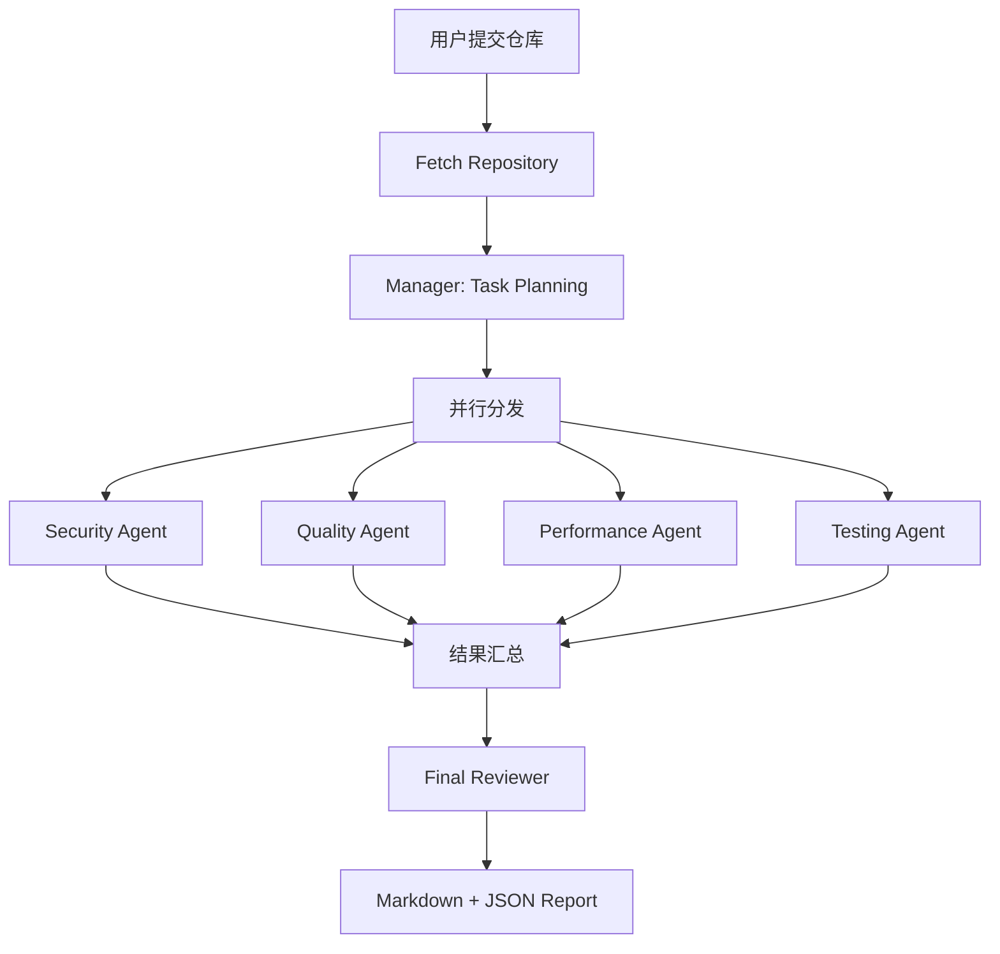

# Multi-Agent Code Review System：从 0 到 1 工程实战总规划

这次我们不把它做成一个简单的 LangGraph 多 Agent Demo，而是把它当作一个真正可以运行、测试、演示、部署，并且能够写进 AI Agent 开发岗位简历的工程项目。

目前最重要的任务不是构建一个拥有所有高级技术的多 Agent 系统，而是先做出一个真正能够运行、能够证明结果正确的工程项目。

我建议采用 分阶段、可验收、渐进式增加架构复杂度 的方式开发。

整个项目的核心目标是：

> 用户输入一个 GitHub 仓库 URL，系统自动获取代码，Manager Agent 负责任务规划和编排，多个专业 Agent 并行执行代码审查，通过结构化任务通信、完成事件通知、失败恢复等机制协作，最后由 Final Reviewer 生成结构化审查报告，并将结果回写到 GitHub PR。

这里有一个重要的工程设计原则：

先实现一个可靠的单进程多 Agent 系统，再逐步演进为分布式多 Agent 系统。

不要第一天就同时引入 LangGraph、A2A、MCP、Redis、Docker、Webhooks 和多个独立服务。否则，一旦系统出现问题，很难判断是 Agent 推理、任务调度、通信协议还是基础设施导致的。

我们将采用以下演进路线：

## 项目架构演进路线

1. 阶段 1：单 Agent 工程基础

   GitHub 仓库获取、代码解析、基础分析工具、结构化报告。

2. 阶段 2：Supervisor-Worker 多 Agent

   Manager 规划任务，Security、Quality、Performance、Testing 并行执行，Manager 汇总。

3. 阶段 3：SubAgent 分层编排

   专业 Agent 内部创建专用 SubAgent，实现二级任务拆解、局部管理和结果汇总。

4. 阶段 4：异步任务管理与失败恢复

   Redis 队列、Announce 完成事件、重试、超时、最大并发限制、任务状态持久化。

5. 阶段 5：MCP 工具接入

   将代码分析、测试、依赖检查等能力封装成 MCP Server。

6. 阶段 6：A2A 跨服务协作

   独立部署外部 Code Review Agent，通过 A2A 发现、委派任务、跟踪状态、接收 Artifact。

7. 阶段 7：可观测性与产品化

   统一 Trace、Token 成本、日志、Web UI、Docker Compose、GitHub PR 评论。


我建议最终项目不要只停留在图片中的架构，而是实现图片中没有完整体现的工程能力：任务状态持久化、幂等处理、权限隔离、超时控制、证据可追溯和结果验收。

# 一、项目总体架构设计

## 1.1 先明确系统的业务流程

整个系统可以分为三个部分：

- 接入层：接收 GitHub 仓库 URL 或 PR Webhook。
- 编排执行层：Manager、各专业 Agent、SubAgent、MCP、A2A。
- 基础设施层：FastAPI、Redis、数据库、Trace、Docker。

整体架构如下：

## Multi-Agent PR Review System

① 接入层

GitHub Webhook、FastAPI REST API

负责仓库 URL、PR Number、Commit SHA、鉴权与参数校验

② 任务调度层

Redis Queue / Job Dispatcher

负责任务入队、去重、并发限制、后台 Worker 调度

③ LangGraph 编排层

Manager Agent / Supervisor

负责任务规划 · 拆解 · 分配 · 状态管理 · 结果汇总

​			↓

Security Agent

负责漏洞与风险分析

SubAgent：依赖扫描、代码安全检查

Quality Agent

代码质量分析

SubAgent：复杂度、规范、重复代码

Performance Agent

性能问题分析

SubAgent：热点、算法复杂度、资源分析

Testing Agent

测试与验证

SubAgent：测试执行、覆盖率、结果核验

​			↓

Final Reviewer Agent

证据交叉验证 · 风险去重 · 综合评分 · 最终报告

④ 结果交付层

Markdown Report、JSON Report、GitHub PR Comment、Web Dashboard

⑤ 横向基础设施

Redis · PostgreSQL · MCP Server · A2A Server · OpenTelemetry · Docker

注意，这是一张最终目标架构图，并不是第一阶段就需要全部实现的架构。

## 1.2 六个核心 Agent 的职责定义

这里必须先把职责划分清楚，否则后续会出现多个 Agent 重复分析同一件事情、相互覆盖结果的问题。

| Agent          | 核心职责                                       | 主要输入                            | 主要输出                                |
| -------------- | ---------------------------------------------- | ----------------------------------- | --------------------------------------- |
| Manager        | 任务规划、任务分配、执行协调、结果收集         | 仓库信息、审查目标                  | Task Plan、任务执行状态、Agent 结果集合 |
| Security       | 安全审查                                       | 代码、依赖、配置                    | 安全漏洞、风险等级、代码证据            |
| Quality        | 代码质量审查                                   | 源代码、静态检查结果                | 代码异味、复杂度、可维护性问题          |
| Performance    | 性能分析                                       | 源代码、性能分析结果                | 性能瓶颈、性能风险、优化建议            |
| Testing        | 测试执行与验证                                 | 仓库、测试配置、测试环境            | 测试结果、覆盖率、失败原因              |
| Final Reviewer | 证据核验、Finding 去重、综合评分、最终报告生成 | 四个专业 Agent 的结果、工具执行证据 | Final Review Report、审查结论、合并建议 |

Final Reviewer 作为 Manager 之后的独立审查节点，负责对专业 Agent 的结果进行统一验证、去重、评分和报告生成。

第一版不需要将 Final Reviewer 部署为独立服务，也不需要为其创建独立运行时，可以直接将其实现为 LangGraph 工作流中的一个独立 Node。

Manager 不负责生成最终审查报告，其主要职责是任务规划、任务协调和结果收集。所有专业 Agent 完成任务后，由 Final Reviewer 统一生成最终审查结论。

这样既能保持职责清晰，又能避免过早引入额外的 Agent 运行环境。

## 1.3 技术栈选型

我建议先固定技术栈，避免开发过程中不断切换框架。

| 层次       | 技术选型                     | 作用                           |
| ---------- | ---------------------------- | ------------------------------ |
| 开发语言   | Python 3.12                  | 核心开发语言                   |
| Web API    | FastAPI                      | 提供 REST API、Webhook         |
| Agent 编排 | LangGraph                    | Supervisor、并行执行、状态管理 |
| 模型接入   | LangChain Chat Models        | 统一模型调用接口               |
| LLM        | OpenAI / Anthropic 兼容接口  | Agent 推理                     |
| 任务队列   | Redis + ARQ（幂等机制）      | 后台异步任务                   |
| 数据持久化 | PostgreSQL                   | 任务、结果、Trace 元数据       |
| 工具协议   | MCP                          | 代码分析工具接入               |
| Agent 通信 | A2A Python SDK               | 跨服务 Agent 协作              |
| 代码分析   | Ruff、Bandit、Semgrep、Radon | 静态分析                       |
| 测试       | Pytest、Coverage.py、        | 测试执行与覆盖率               |
| 可观测性   | OpenTelemetry + LangSmith    | Trace、调用链追踪              |
| 容器化     | Docker Compose               | 多服务部署                     |
| 前端       | Streamlit（可选）            | 展示执行过程与报告             |

**这里有几个选型细节：**

1.ARQ 用于本项目的 Python 异步后台任务队列，Redis 负责任务调度和消息传递；不要把 Redis 本身误认为完整的任务执行引擎。

2.LangGraph 的并行执行和状态管理先在进程内部完成，后续再增加 Redis 外部任务队列。这样能够清楚区分 Agent 编排与分布式任务调度。

3.ARQ 的任务可能重复执行。官方文档明确说明，Worker 中断后，任务可能重新执行，最后可能产生两条重复执行结果，因此要设计幂等机制。

因此需要：

- `review_id` 唯一标识。
- `delivery_id` 防止 Webhook 重复处理。
- 评论发布幂等键。
- 数据库唯一约束。
- 任务执行状态校验。

4.建议明确区分：

- PostgreSQL：业务任务和结果的权威持久化存储。
- LangGraph Checkpointer：工作流执行状态和断点恢复。
- Redis：队列、缓存及必要的消息传递。

不要将三者混成一个状态管理系统。


# 二、项目目录结构设计

在正式编码之前，先确定工程目录。

建议采用模块化架构，把 Agent、Graph、MCP、A2A、任务队列和基础设施分开。

以下是最终规划目录，后续我们会分阶段逐步创建，不要求第一天全部实现。

```
multi-agent-code-review/
│
├── README.md
├── pyproject.toml
├── .env.example
├── .gitignore
├── docker-compose.yml
├── Dockerfile
│
├── config/
│   ├── settings.py
│   ├── agents.yaml
│   ├── tools.yaml
│   └── review_rules.yaml
│
├── src/
│   └── code_review/
│       │
│       ├── main.py
│       │
│       ├── api/
│       │   ├── routes.py
│       │   ├── webhook.py
│       │   └── schemas.py
│       │
│       ├── agents/
│       │   ├── base.py
│       │   ├── manager.py
│       │   ├── security.py
│       │   ├── quality.py
│       │   ├── performance.py
│       │   ├── testing.py
│       │   └── reviewer.py
│       │
│       ├── prompts/
│       │   ├── manager.md
│       │   ├── security.md
│       │   ├── quality.md
│       │   ├── performance.md
│       │   ├── testing.md
│       │   └── reviewer.md
│       │
│       ├── graph/
│       │   ├── state.py
│       │   ├── nodes.py
│       │   ├── edges.py
│       │   ├── workflow.py
│       │   └── subgraphs/
│       │       ├── security_graph.py
│       │       ├── quality_graph.py
│       │       └── testing_graph.py
│       │
│       ├── schemas/
│       │   ├── task.py
│       │   ├── result.py
│       │   ├── finding.py
│       │   └── report.py
│       │
│       ├── tools/
│       │   ├── github.py
│       │   ├── repository.py
│       │   ├── static_analysis.py
│       │   ├── security_scan.py
│       │   ├── performance.py
│       │   └── testing.py
│       │
│       ├── mcp/
│       │   ├── server.py
│       │   └── client.py
│       │
│       ├── a2a/
│       │   ├── client.py
│       │   ├── server.py
│       │   ├── agent_card.py
│       │   └── external_agent.py
│       │
│       ├── orchestration/
│       │   ├── dispatcher.py
│       │   ├── announce.py
│       │   ├── retry.py
│       │   ├── concurrency.py
│       │   └── task_manager.py
│       │
│       ├── workers/
│       │   ├── arq_worker.py
│       │   └── jobs.py
│       │
│       ├── observability/
│       │   ├── tracing.py
│       │   ├── token_usage.py
│       │   ├── cost.py
│       │   └── logging.py
│       │
│       ├── storage/
│       │   ├── database.py
│       │   ├── models.py
│       │   └── repositories.py
│       │
│       └── reporting/
│           ├── generator.py
│           ├── markdown.py
│           └── github_comment.py
│
├── external_agents/
│   └── code_audit_agent/
│       ├── server.py
│       ├── agent.py
│       ├── card.py
│       └── requirements.txt
│
├── tests/
│   ├── unit/
│   ├── integration/
│   ├── e2e/
│   └── fixtures/
│
├── scripts/
│   ├── run_review.py
│   ├── run_mcp_server.py
│   ├── run_a2a_server.py
│   └── seed_test_repo.py
│
├── reports/
│
└── docs/
    ├── architecture.md
    ├── requirements.md
    ├── workflow.md
    ├── task_contracts.md
    ├── security.md
    └── acceptance.md
```

目录设计的三个重点：

- `agents/` 负责 Agent 的角色定义和推理逻辑。
- `graph/` 负责 Agent 之间的工作流编排。
- `orchestration/` 负责跨节点任务生命周期、事件通知、重试和并发管理。

不要把所有业务逻辑都塞进 `manager.py`，也不要把 LangGraph 的节点定义、模型调用和工具实现混在一个文件中。

# 三、核心数据结构设计：先定义任务合同，再写 Agent

这是整个工程中非常重要的一步。

多 Agent 系统最容易出现的问题不是模型不会推理，而是：

- Manager 给 Security 的输入格式与 Security 实际需要的不一致。
- Agent 返回的结果格式不统一。
- 并行执行时多个节点同时修改共享 State。
- Final Reviewer 无法判断某个结论是否有真实证据。
- 子任务失败后无法准确知道应该重试哪一个任务。

因此，我们必须先定义统一的数据合同（Task Contract）。

## 3.1 定义统一任务结构

每一个 Agent 接收到的任务都应该具有明确的任务 ID、执行者、输入、预期输出和状态。

例如 `schemas/task.py`：

```
from typing import Any, Literal
from pydantic import BaseModel, Field
from datetime import datetime
from uuid import uuid4


class AgentTask(BaseModel):
    task_id: str = Field(default_factory=lambda: str(uuid4()))

    parent_task_id: str | None = None

    agent_name: str

    task_type: str

    description: str

    input_data: dict[str, Any]

    expected_output: dict[str, Any]

    priority: Literal["low", "medium", "high"] = "medium"

    status: Literal[
        "pending",
        "running",
        "completed",
        "failed",
        "cancelled"
    ] = "pending"

    retry_count: int = 0

    max_retries: int = 2

    created_at: datetime = Field(default_factory=datetime.utcnow)
```

其中：

- `task_id`：当前任务唯一标识。
- `parent_task_id`：用于构建父子任务关系。
- `agent_name`：任务执行者。
- `input_data`：任务输入。
- `expected_output`：预期交付格式。
- `status`：任务状态。
- `retry_count`：已经重试的次数。

例如：

```
{
  "task_id": "task-security-001",
  "parent_task_id": "task-main-001",
  "agent_name": "SecurityAgent",
  "task_type": "security_review",
  "description": "检查仓库是否存在安全漏洞",
  "input_data": {
    "repository_path": "/workspace/repo",
    "changed_files": [
      "src/auth.py",
      "src/database.py"
    ]
  },
  "expected_output": {
    "findings": [],
    "risk_level": "low",
    "evidence": []
  },
  "status": "pending"
}
```

注意：上面的 `repository_path` 是 Worker 沙箱内的路径，不应该把宿主机任意文件路径开放给 Agent。

## 3.2 定义统一审查结果

所有专业 Agent 必须返回统一的结构化结果。

例如 `schemas/result.py`：

```
from pydantic import BaseModel, Field
from typing import Literal


class Finding(BaseModel):

    finding_id: str

    agent_name: str

    category: str

    severity: Literal[
        "critical",
        "high",
        "medium",
        "low",
        "info"
    ]

    title: str

    description: str

    file_path: str | None = None

    start_line: int | None = None

    end_line: int | None = None

    evidence: str

    recommendation: str

    confidence: float = Field(ge=0, le=1)


class AgentResult(BaseModel):

    task_id: str

    agent_name: str

    status: Literal["completed", "failed", "partial"]

    score: float | None = None

    findings: list[Finding] = []

    summary: str

    execution_time: float = 0

    error_message: str | None = None
```

这里有一个设计细节：

Agent 的结论必须尽可能绑定真实代码证据。

例如：

```
{
  "finding_id": "SEC-001",
  "agent_name": "SecurityAgent",
  "category": "sql_injection",
  "severity": "critical",
  "title": "Potential SQL Injection",
  "description": "SQL 查询直接拼接用户输入",
  "file_path": "src/database.py",
  "start_line": 25,
  "end_line": 25,
  "evidence": "query = f'SELECT * FROM users WHERE id={user_id}'",
  "recommendation": "使用参数化 SQL 查询",
  "confidence": 0.98
}
```

Final Reviewer 应该优先整合有代码证据的发现，而不是简单相信某个 Agent 的自然语言判断。

另外，行号必须对应审查时固定的 Commit SHA，不能在代码发生变化后仍然沿用旧行号。

## 3.3 定义统一报告结构

最终输出建议采用：

```
{
  "review_id": "review-001",
  "repository": "owner/repository",
  "commit_sha": "abc123",
  "overall_verdict": "REQUEST_CHANGES",
  "overall_score": 76.5,
  "summary": "发现若干安全与代码质量问题",
  "agent_results": {
    "security": {},
    "quality": {},
    "performance": {},
    "testing": {}
  },
  "findings": [],
  "test_summary": {
    "passed": 120,
    "failed": 2,
    "coverage": 82.5
  },
  "execution_summary": {
    "total_tasks": 4,
    "completed_tasks": 4,
    "failed_tasks": 0
  },
  "cost_summary": {
    "total_input_tokens": 0,
    "total_output_tokens": 0,
    "estimated_cost_usd": 0
  }
}
```

这里的 Token 数量和费用先定义字段，后续接入统一统计。

重要：测试覆盖率不能由 LLM 猜测。 必须来自实际测试执行和 Coverage.py 等工具输出。

# 四、八个阶段的具体实施计划（阶段 0～7）

下面进入真正的开发任务拆解。

每个阶段都包含：

1. 阶段目标。
2. 具体开发任务。
3. 需要实现的关键技术。
4. 阶段验收标准。
5. 交付文件。

## 阶段 0：工程初始化与需求冻结

第一阶段开发前置工作

目标：建立可维护的 Python 工程，明确项目需求、接口合同和开发环境。

### 任务 0.1：初始化工程

1.创建 GitHub 仓库：

```
multi-agent-code-review
```

2.建立 Conda Python 虚拟环境：

项目统一采用 Conda 管理 Python 开发环境，环境名称为：multi-agent-review

Python 版本统一采用 Python 3.12。

3.先安装基础依赖：

```
python -m pip install \
  fastapi \
  uvicorn \
  pydantic \
  pydantic-settings \
  python-dotenv \
  pytest \
  httpx \
  structlog
```

采用分阶段依赖管理策略，不在阶段 0 一次性安装所有后续阶段的技术依赖，建议按照以下顺序引入：

- 阶段 0：FastAPI、Pydantic、Pytest、HTTPX 等工程基础依赖。
- 阶段 1：根据实际模型 Provider 引入相应的 LLM 模型接入包，例如 langchain-openai。
- 阶段 2：引入 LangGraph，正式实现 Supervisor-Worker 编排。
- 阶段 3：基于 asyncio 和 LangGraph SubGraph 实现 SubAgent。
- 阶段 4：按需引入 Redis、ARQ、PostgreSQL、SQLAlchemy 和相关 Checkpointer。
- 阶段 5：引入 MCP Python SDK。
- 阶段 6：引入 A2A Python SDK。
- 阶段 7：引入 OpenTelemetry、LangSmith 和 Streamlit 等产品化组件。

建议在项目根目录建立environment.yml文件，用于记录 Python 版本、Conda 环境名称和项目依赖。

```yaml
name: multi-agent-review

channels:
  - conda-forge

dependencies:
  - python=3.12
  - pip

  - pip:
      - fastapi
      - uvicorn
      - pydantic
      - pydantic-settings
      - python-dotenv
      - pytest
      - httpx
      - structlog
```

### 任务 0.2：编写项目文档

先建立以下文件：

| 文档              | 内容                 |
| ----------------- | -------------------- |
| requirements.md   | 功能需求、非功能需求 |
| architecture.md   | 整体架构、组件职责   |
| workflow.md       | Agent 工作流程       |
| task_contracts.md | 父子任务输入输出规范 |
| acceptance.md     | 每个阶段的验收标准   |

### 阶段验收

- Python 环境可以正常运行。
- 工程目录结构建立完成。
- `.env.example` 已建立。
- 文档明确了五个 Agent 的职责。
- 任务和结果 Schema 可以通过单元测试。

阶段交付：一个具有明确架构和接口规范的工程骨架。

## 阶段 1：实现单 Agent 代码审查基础能力

必须优先完成

目标：先不引入多 Agent，构建能够真正审查代码的基础工具链。

这一步是整个项目的地基。

### 任务 1.1：实现 GitHub 仓库获取

提供一个接口：

```
POST /api/reviews
```

请求：

```
{
  "repository_url": "https://github.com/owner/repository",
  "branch": "main"
}
```

后端执行：

```
接收仓库 URL
    ↓
校验 URL 和仓库地址
    ↓
获取仓库元数据
    ↓
Clone 仓库
    ↓
固定 Commit SHA
    ↓
生成本次审查上下文
```

推荐使用 GitPython 或受控的 Git CLI 完成 Clone。

这里要特别注意安全问题：

- 只允许 HTTPS GitHub 仓库地址，限制域名和端口。
- 防止 SSRF、恶意 Git URL 和本地路径穿越。
- 设置仓库大小、文件数量、单文件大小和下载时间限制。
- 不读取 `.env`、私钥、凭证等敏感文件作为 LLM 上下文。
- 不执行仓库中的任意安装脚本、构建脚本和测试代码。
- 对静态分析工具设置执行超时、输出大小和资源限制。
- 仓库工作区默认只读，避免审查工具意外修改原始代码。

**阶段 1 的安全执行原则：**

仓库代码本身属于不可信输入。第一阶段优先实现代码获取、文件解析和静态分析，不在宿主机上直接执行外部仓库代码。

对于 Pytest、Coverage.py 等需要实际执行仓库代码的功能：

1. 第一版仅允许对自己编写、完全可控的测试仓库执行。
2. 对外部 GitHub 仓库，暂不执行其测试代码和安装脚本。
3. 后续增加 Docker 隔离执行环境后，再开放外部仓库测试执行能力。
4. Docker 沙箱需要限制 CPU、内存、执行时间、网络访问和文件系统权限。

这样可以先完成代码审查基础能力，同时避免在安全隔离尚未建立时执行不可信代码。

#### 阶段 1～3 的任务执行模式

在阶段 1～3 中，系统采用单进程执行模式，不提前引入 Redis 和 ARQ。

主要通过统一的 ReviewService 承担审查业务逻辑。

建议提供两种执行入口：

1. CLI：作为阶段 1～3 的主要开发和验收入口。
2. FastAPI：作为可选的本地演示和接口测试入口。

两种入口调用同一个 ReviewService，避免 CLI 和 API 出现两套重复的审查逻辑。

阶段 1：
- CLI 直接调用 ReviewService。
- FastAPI 可以同步调用 ReviewService，适用于受控的小型演示任务。
- 不将长时间运行的 Agent 工作流放在 HTTP 请求中执行。

阶段 2～3：
- 继续由 LangGraph 在当前 Python 进程中执行 Agent 工作流。
- CLI 负责主要的执行与验收。
- FastAPI 仅提供必要的调用入口，不负责复杂的后台调度。

这一阶段不要求实现多进程 Worker、任务队列和分布式任务状态管理。

注意：当前执行模式仅用于本地开发和受控演示，不代表生产级后台任务架构。

等阶段 4 引入 Redis + ARQ 后，再将任务执行升级为异步 Worker 模式。

### 任务 1.2：实现代码文件解析

实现：

```
def collect_source_files(repository_path: str):    ...
```

主要工作：

- 遍历源代码文件。
- 识别 Python、JavaScript、TypeScript 等语言。
- 过滤二进制文件。
- 过滤大型文件。
- 排除 `.git`、`node_modules`、`.venv` 等目录。
- 记录文件路径、语言、行数和大小。

输出：

```
{
  "files": [
    {
      "path": "src/main.py",
      "language": "python",
      "lines": 120,
      "size": 3500
    }
  ]
}
```

### 任务 1.3：接入确定性代码分析工具

建议第一阶段先支持 Python 仓库。

| 工具        | 主要用途             |
| ----------- | -------------------- |
| Ruff        | 代码规范、静态检查   |
| Bandit      | Python 安全问题检测  |
| Radon       | 圈复杂度、代码复杂度 |
| Pytest      | 自动化测试           |
| Coverage.py | 测试覆盖率           |

注意：

Ruff、Bandit、Radon 等静态分析工具主要负责对代码进行静态检查，不需要主动运行被审查仓库的业务代码。

Pytest 和 Coverage.py 涉及实际执行代码，必须遵守任务 1.1 中定义的安全执行边界。

阶段 1 仅针对自己编写的可信测试仓库执行测试；对外部不可信仓库，暂时只生成静态分析结果和测试执行状态说明。后续完成 Docker 沙箱后，再开放受控测试执行。

这些工具负责可重复验证的分析任务。

LLM 负责：

- 解释静态分析结果。
- 识别复杂业务逻辑问题。
- 给出修改建议。
- 补充工具无法直接发现的问题。

这样形成：

```
真实代码
  │
  ├── 静态分析工具
  │       └── 结构化检测结果
  │
  └── LLM 分析
          └── 语义理解与解释
                  │
                  ▼
              综合结果
```

### 任务 1.4：生成基础报告

即使还没有多 Agent，也要能够输出：

```
reports/
    review-001/
        metadata.json
        static_analysis.json
        test_report.json
        report.md
```

### 阶段验收

使用一个真实的 Python 仓库进行测试，仓库代码应当是自己编写或经过确认可安全执行的测试样例。

至少验证：

- 可以成功 Clone 指定 GitHub 仓库。
- 能够固定本次审查对应的 Commit SHA。
- 可以正确识别代码文件。
- 能够正确过滤敏感文件和大型文件。
- Ruff 能输出检查结果。
- Bandit 能输出安全检查结果。
- Radon 能输出复杂度分析结果。
- Pytest 能够对可信测试样例执行。
- Coverage.py 能够生成可信测试样例的覆盖率报告。
- 最终 Markdown 报告能够生成。
- 对不可信仓库不会在宿主机上直接执行其测试、安装或构建脚本。

如果外部仓库尚未建立安全执行环境，应明确标注测试执行状态为 NOT_EXECUTED，而不是伪造测试结果。

阶段交付：一个能够真实获取、解析、静态分析并生成结构化报告的单 Agent 基础系统。

## 阶段 2：LangGraph Supervisor-Worker 多 Agent 编排

核心学习阶段

这一阶段是整个项目最重要的部分。

我们正式把单 Agent 系统改造成多 Agent 系统。

### 任务 2.1：定义 LangGraph State

文件：

```
graph/state.py
```

建议使用 TypedDict：

```
from typing import TypedDict, Annotated
import operator


class ReviewState(TypedDict):

    review_id: str

    repository_url: str

    repository_path: str

    commit_sha: str

    task_plan: dict

    security_result: dict

    quality_result: dict

    performance_result: dict

    testing_result: dict

    completed_tasks: Annotated[list, operator.add]

    failed_tasks: Annotated[list, operator.add]

    final_report: dict
```

这里有一个非常重要的 LangGraph 知识点：

并行节点同时更新共享 State 时，必须考虑 Reducer。

例如：

```
completed_tasks: Annotated[list, operator.add]
```

这样多个节点追加完成记录时，可以通过 Reducer 合并。

但是不能让多个并行节点同时无规则地覆盖同一个字段。

比如：

```
return {    "security_result": result}
```

Security 节点只负责更新 `security_result`。

Quality 节点只负责更新 `quality_result`。

不要每个节点都返回整个共享 State，否则可能产生 `InvalidUpdateError`。

这也是你提供的 Medium 项目中专门强调的一个实现坑。

Medium


### 任务 2.2：实现 Manager Agent

Manager 主要有三个职责：

第一：任务规划。

接收仓库信息，确定本次需要执行哪些审查任务。

第二：任务分配。

向专业 Agent 分发任务。

第三：结果汇总。

收集专业 Agent 的执行结果，交给 Final Reviewer。

Manager 不应该自己完成所有代码分析。

### 任务 2.3：实现四个专业 Agent

建议按照统一接口实现：

```
class BaseAgent:

    def __init__(self, llm, tools=None):
        self.llm = llm
        self.tools = tools or []

    async def execute(self, task):
        raise NotImplementedError
```

然后分别实现：

```
class SecurityAgent(BaseAgent):
    async def execute(self, task):
        pass


class QualityAgent(BaseAgent):
    async def execute(self, task):
        pass


class PerformanceAgent(BaseAgent):
    async def execute(self, task):
        pass


class TestingAgent(BaseAgent):
    async def execute(self, task):
        pass
```

四个 Agent 通过不同的 Prompt、工具和输出 Schema 实现专业分工。

特别注意：

- Security Agent 主要负责安全风险。
- Quality Agent 主要负责可维护性。
- Performance Agent 主要负责性能。
- Testing Agent 负责实际测试执行和验证。

Testing Agent 不应该只是让 LLM 阅读测试文件，然后猜测覆盖率。

### 任务 2.4：实现并行 Fan-out / Fan-in

整体工作流：



建议使用 LangGraph 的 `Send` 实现动态 Fan-out，或者使用并行分支实现固定的四路执行。

例如：

```
from langgraph.types import Send


def dispatch_workers(state):

    return [
        Send("security_node", state),
        Send("quality_node", state),
        Send("performance_node", state),
        Send("testing_node", state)
    ]
```

正式实现时，需要将每个 Worker 的输入限制为对应任务合同，而不是直接把完整 State 和所有敏感上下文都传进去。

### 任务 2.5：实现 Final Reviewer

这里建议比参考项目做得更完善。

原文中的 Final Reviewer 主要负责汇总和格式化三个专业 Agent 的报告。我们可以进一步增加证据交叉核验、重复问题合并和测试结果验证。

Final Reviewer 的工作：

1. 收集四个 Agent 的结果。
2. 合并重复 Finding。
3. 检查文件路径和行号。
4. 对关键结论进行证据核验。
5. 生成最终评分。
6. 给出是否建议合并 PR 的结论。

评分权重不要随意拍脑袋，先设计可配置的规则。

例如：

| 维度        | 初始权重 |
| ----------- | -------- |
| Security    | 35%      |
| Quality     | 25%      |
| Performance | 20%      |
| Testing     | 20%      |

这些权重只是项目初始配置，不代表行业标准。

对于 Critical 安全漏洞，建议额外设计硬性阻断规则，不要让其他维度的高分把严重漏洞抵消掉。

### 阶段验收

准备一个包含以下问题的真实测试仓库：

- 硬编码密钥。
- SQL 注入风险。
- 高复杂度函数。
- 缺少错误处理。
- 测试覆盖率不足。
- 存在失败测试。

运行后必须看到：

```
Review Started
    │
    ▼
Manager: Planning
    │
    ▼
Task Dispatch
    ├── Security: Running
    ├── Quality: Running
    ├── Performance: Running
    └── Testing: Running
    │
    ▼
All Workers Completed
    │
    ▼
Final Reviewer
    │
    ▼
Review Report Generated
```

并且要记录四个 Agent 的独立执行时间，证明它们确实是并行执行，而不是串行调用。

阶段交付：可以实际运行的 Supervisor-Worker 多 Agent 系统。

## 阶段 3：SubAgent 两层架构与任务生命周期管理

进阶架构阶段

这一阶段正式把前面学过的父子 Agent 设计应用到代码中。

但是不建议四个专业 Agent 一开始全部创建 SubAgent。

我们先以 Security Agent 为例，构建一个两层结构。

### 任务 3.1：Security Agent 内部任务拆解

Security Agent 接收到主任务后：

```
Security Agent
       │
       ▼
内部任务规划
       │
       ├── Dependency Scanner
       │       └── 检查依赖漏洞
       │
       ├── Secret Scanner
       │       └── 检查硬编码密钥
       │
       └── Code Security Reviewer
               └── 检查代码安全风险
```

三个 SubAgent 可以采用不同的执行方式：

| SubAgent               | 执行方式           |
| ---------------------- | ------------------ |
| Dependency Scanner     | 确定性工具调用     |
| Secret Scanner         | Gitleaks 等工具    |
| Code Security Reviewer | LLM + 静态分析证据 |

这里需要注意：SubAgent 不一定都必须调用 LLM。

一个确定性的工具 Worker 也可以作为父 Agent 内部的执行单元。

### 任务 3.2：建立父子任务关系

例如：

```
Parent Task: SEC-001
    │
    ├── Child Task: SEC-001-01
    │
    ├── Child Task: SEC-001-02
    │
    └── Child Task: SEC-001-03
```

数据库或任务存储中应能查询：

```
SELECT *
FROM tasks
WHERE parent_task_id = 'SEC-001';
```

父任务不能在所有必需子任务完成或进入明确的部分完成状态之前，直接标记为成功。

### 任务 3.3：实现 Announce 等价完成事件

这一任务主要验证 SubAgent 的任务完成通知机制。

需要明确两个不同的职责：

- LangGraph：负责子任务的执行控制、并行调度、状态更新和任务汇合。
- Announce 事件机制：负责记录和通知子任务的完成、失败等执行事件。

二者不应重复实现任务调度逻辑。

#### 第一版实现方式

阶段 3 的 SubAgent 均运行在同一个 Python 进程中。

优先使用 LangGraph SubGraph 或并行节点完成子任务的执行和汇总。

例如：

```
Security Agent
    │
    ▼
Security SubGraph
    │
    ├── Dependency Scanner
    ├── Secret Scanner
    └── Code Security Reviewer
    │
    ▼
LangGraph 汇总子任务结果
    │
    ▼
Security Agent 完成
```

当某个子任务执行完成或失败时，生成对应的任务事件。

事件结构示例：

```python
from datetime import datetime
from typing import Literal
from pydantic import BaseModel

class TaskEvent(BaseModel):
    event_id: str
    task_id: str
    parent_task_id: str
    agent_name: str

    event_type: Literal[
        "task.completed",
        "task.failed"
    ]

    status: Literal[
        "completed",
        "failed"
    ]

    timestamp: datetime
```

SubAgent 执行结束后，发布事件：

```python
async def announce_completion(event, event_bus):
    await event_bus.publish(
        event.event_type,
        event.model_dump(mode="json")
    )
```

事件总线第一版可以使用进程内的异步事件机制。

事件可以用于：

- 记录 Agent 执行完成情况。
- 记录任务失败事件。
- 更新执行日志。
- 为后续 Dashboard 提供状态信息。
- 方便排查 Agent 执行过程中的异常。

注意：事件通知不是任务结果本身，也不能代替 LangGraph 的工作流控制。

父 Agent 不应仅依靠事件监听来判断整个 SubGraph 是否完成。子任务的执行与汇合仍由 LangGraph 工作流负责。

#### 结果存储原则

子任务执行完成后，应先保存结果，再更新相关状态，并发布完成事件。

建议执行顺序：

```
SubAgent 执行
    │
    ▼
生成结构化执行结果
    │
    ▼
更新任务执行状态
    │
    ▼
发布完成或失败事件
    │
    ▼
LangGraph 根据节点结果继续汇总
```

阶段 3 可以先使用内存状态和本地执行记录。

阶段 4 引入 PostgreSQL 后，再完善任务结果持久化。

#### 后续演进

当子任务真正需要跨进程、跨 Worker 执行时，再将进程内事件机制升级为支持持久化和消费确认的事件通信方式。

阶段 4 可以使用 Redis Streams 或其他持久化事件机制。

不建议直接将 Redis Pub/Sub 当成可靠的任务完成通知存储，因为普通 Pub/Sub 不支持消息持久化和消费重放。

最终原则：

LangGraph 管理工作流，事件机制负责通知，数据库负责持久化。

### 任务 3.4：实现最大并发限制

例如：

```
import asyncio

security_semaphore = asyncio.Semaphore(3)


async def run_subagent(agent, task):

    async with security_semaphore:

        return await agent.execute(task)
```

这样可以限制 Security Agent 内部同时运行的 SubAgent 数量。

后续还要增加全局并发限制，防止四个专业 Agent 各自限制三个任务，却导致整个系统同时执行 12 个任务，超出模型或工具资源限制。

### 阶段验收

- Security Agent 能创建三个子任务。
- 子任务具有唯一 ID 和 Parent ID。
- 子任务可以并行执行。

- SubAgent 执行结束后能够生成并发布完成或失败事件。
- 事件能够被记录和查询。
- LangGraph 能够正确接收子任务结果并完成汇总。
- 子任务事件通知与 LangGraph 工作流调度不存在重复职责。
- 单个 SubAgent 失败时，系统能够保留其他子任务的执行结果。
- 所有必需子任务完成或进入明确的部分完成状态后，Security Agent 才能汇总最终结果。

- 并发数量不能超过设定阈值。

阶段交付：一个可以自主拆解、委派和管理内部任务的领域 Agent。

## 阶段 4：Redis + ARQ 异步任务队列与失败恢复

工程可靠性阶段

这一阶段主要解决三个问题：

1. 任务执行时间长怎么办？
2. Agent 执行失败怎么办？
3. 服务重启后任务状态怎么办？

你提供的参考项目采用了 FastAPI 接收 Webhook、Redis 入队、ARQ Worker 后台执行 LangGraph 的架构。这一点非常值得保留。

### 任务 4.1：建立后台任务队列

流程：

```
GitHub Webhook
      │
      ▼
FastAPI
      │
      ├── HMAC 签名校验
      ├── Payload 校验
      ├── 幂等性检查
      │
      ▼
Redis Queue
      │
      ▼
ARQ Worker
      │
      ▼
LangGraph Workflow
```

Webhook 收到请求后：

```
@app.post("/api/github/webhook")
async def github_webhook(request: Request):

    payload = await request.body()

    # 1. 验证 GitHub HMAC-SHA256
    # 2. 解析 Webhook Payload
    # 3. 检查 delivery_id 是否处理过
    # 4. 将任务放入 Redis 队列

    return {
        "status": "accepted"
    }
```

实际响应使用 HTTP 202。

不要在 Webhook 请求线程中直接执行完整的 Agent 工作流。

#### 从单进程模式向异步任务模式演进

阶段 4 是系统执行架构的重要升级。

在阶段 1～3 中，FastAPI 和 CLI 均通过统一的 ReviewService 在当前进程内执行审查任务。

引入 Redis + ARQ 后，FastAPI 不再直接执行完整的审查工作流，而是负责：

- 接收审查任务。
- 校验参数和权限。
- 执行幂等性检查。
- 创建任务记录。
- 将任务提交到 Redis 队列。
- 返回 HTTP 202 Accepted 和 review_id。

ARQ Worker 负责获取后台任务并调用 ReviewService，启动对应的 LangGraph Workflow。

这样可以保持审查业务逻辑不变，只升级任务执行和调度方式。

阶段 4 之后，CLI 和 FastAPI 仍然可以复用统一的 ReviewService，不应重复实现一套 Agent 执行逻辑。

### 任务 4.2：实现任务状态机

建议设计：

```
PENDING
   │
   ▼
QUEUED
   │
   ▼
RUNNING
   │
   ├── COMPLETED
   │
   ├── FAILED
   │
   ├── RETRYING
   │
   └── CANCELLED
```

还可以为 Agent 内部任务增加：

- WAITING_FOR_CHILDREN
- PARTIAL_COMPLETED
- TIMED_OUT

任务状态必须有合法的迁移规则，不能允许 `COMPLETED → RUNNING` 这种没有明确重开逻辑的状态跳转。

### 任务 4.3：实现失败重试

例如：

```
async def execute_with_retry(
    agent,
    task,
    max_retries=2
):

    for attempt in range(max_retries + 1):

        try:

            return await agent.execute(task)

        except Exception as exc:

            if attempt >= max_retries:
                raise

            await asyncio.sleep(
                2 ** attempt
            )
```

这只是第一版实现。

正式版本还需要：

- 区分可重试错误和不可重试错误。
- 设置单次执行超时。
- 使用指数退避和随机抖动。
- 限制最大重试次数。
- 防止重复执行产生重复 GitHub 评论。
- 保存每次失败的错误原因。
- 支持失败任务的人工重跑。

例如：

| 异常           | 处理方式                 |
| -------------- | ------------------------ |
| 模型接口限流   | 退避重试                 |
| 网络超时       | 有限重试                 |
| 参数格式错误   | 修正输入或直接失败       |
| 仓库不存在     | 直接失败                 |
| 工具执行错误   | 根据错误类型决定是否重试 |
| Token 超出限制 | 切分任务或缩小上下文     |

### 任务 4.4：实现最大并发控制

建议分三层：

- 全局 Worker 并发：限制整个系统同时执行多少个审查任务。
- Agent 并发：限制某个专业 Agent 的执行数量。
- 工具并发：限制某个工具的同时调用数量。

例如：

```
concurrency:
  global: 5

  agents:
    security: 3
    quality: 3
    performance: 2
    testing: 2

  tools:
    github_api: 5
    llm: 8
    test_runner: 2
```

实际配置需要根据模型供应商限流、CPU、内存和任务耗时调整。

### 阶段验收

模拟以下情况：

- Security Agent 执行失败一次，第二次成功。
- Performance Agent 超时。
- Redis Worker 重启。
- 同一个 GitHub Webhook 重复发送。
- 多个仓库同时提交审查任务。

最终要求：

- 任务不能因为单个 Agent 失败而直接导致整个系统崩溃。
- 重试次数可控。
- 重复请求不能产生重复报告。
- 任务状态能够查询。
- 超过最大并发限制的任务必须等待。

阶段交付：具有后台异步执行、任务生命周期管理和失败恢复能力的多 Agent 系统。

## 阶段 5：MCP 接入代码分析工具

协议集成阶段

这一步主要验证你对 MCP 的工程应用能力。

之前我们已经学习过 MCP 和 A2A 的区别，现在直接将它们放进同一个项目。

首先，MCP 不负责 Agent 的任务规划，它主要解决 Agent 如何标准化调用外部工具。

### 任务 5.1：独立构建 Code Analysis MCP Server

建议建立：

```
src/code_review/mcp/
    server.py
    tools.py
```

第一版提供以下 Tools：

| MCP Tool             | 功能                  |
| -------------------- | --------------------- |
| `scan_security`      | 调用 Bandit / Semgrep |
| `check_quality`      | 调用 Ruff             |
| `analyze_complexity` | 调用 Radon            |
| `run_tests`          | 执行 Pytest           |
| `get_coverage`       | 获取测试覆盖率        |
| `get_file_content`   | 获取指定代码文件      |

例如：

```
@mcp.tool()
async def scan_security(
    repository_id: str
) -> dict:

    # 获取已登记的仓库工作区
    # 执行安全扫描
    # 返回结构化结果

    return {
        "status": "completed",
        "findings": []
    }
```

这里只是接口设计示意，具体装饰器和 Server 初始化代码以选定 MCP Python SDK 版本为准。

### 任务 5.2：Agent 通过 MCP Client 调用工具

例如：

```
Security Agent
      │
      ▼
MCP Client
      │
      ▼
Code Analysis MCP Server
      │
      ├── scan_security
      ├── get_file_content
      └── analyze_complexity
```

这样就能实现：

- Agent 不需要直接知道 Bandit 如何调用。
- 工具可以独立部署。
- 多个 Agent 可以复用同一个 MCP Server。
- 工具可以统一进行权限管理和日志记录。

### 任务 5.3：实现工具权限隔离

不要让每一个 Agent 都拥有所有 MCP Tools。

例如：

| Agent       | 允许调用                          |
| ----------- | --------------------------------- |
| Security    | scan_security、get_file_content   |
| Quality     | check_quality、analyze_complexity |
| Performance | analyze_complexity、受控性能测试  |
| Testing     | run_tests、get_coverage           |

并且，所有工具都必须校验仓库 ID、路径和执行参数。

对于测试运行，必须在受限容器中执行，不能让 MCP Server 直接以高权限运行不可信仓库代码。

### 阶段验收

- MCP Server 独立启动。
- MCP Client 能成功发现工具。
- Security Agent 可以调用安全扫描工具。
- Testing Agent 可以调用测试工具。
- 工具返回结果符合 Pydantic Schema。
- 未授权 Agent 不能调用不属于自己的工具。

阶段交付：通过 MCP 实现 Agent 与外部代码分析工具的标准化解耦。

## 阶段 6：A2A 接入独立部署的外部代码审查 Agent

跨 Agent 通信阶段

这里是整个项目架构升级的重要一步。

之前所有 Agent 都运行在本地系统中，现在我们增加一个真正独立部署的外部 Agent。

### 任务 6.1：确定外部 Agent 的职责

我建议外部 Agent 不要简单重复 Security、Quality、Performance 的工作。

可以设计成：

External Architecture Review Agent：架构与工程设计审查 Agent。

它负责：

- 模块依赖关系审查。
- 架构设计问题识别。
- API 兼容性分析。
- 设计模式使用合理性分析。
- 跨文件业务逻辑问题检查。

这样它可以弥补四个专业 Agent 的能力盲区。

### 任务 6.2：独立部署外部 Agent

建议单独建立：

```
external_agents/
    code_audit_agent/
        server.py
        agent.py
        card.py
```

其服务独立运行：

```
uvicorn server:app --port 9000
```

主系统运行在：

```
http://localhost:8000
```

外部 Agent 运行在：

```
http://localhost:9000
```

二者不共享 Python Runtime。

### 任务 6.3：实现 Agent Card

外部 Agent 需要暴露 Agent Card，描述自己的能力。

例如：

```
{
  "name": "Architecture Review Agent",
  "description": "Reviews software architecture and module dependencies",
  "url": "http://localhost:9000",
  "version": "1.0.0",
  "capabilities": {
    "streaming": true
  },
  "skills": [
    {
      "id": "architecture_review",
      "name": "Architecture Review",
      "description": "Analyze module dependencies and architectural risks"
    }
  ]
}
```

正式实现时，应按照所选 A2A SDK 对应版本的 Agent Card Schema 生成，而不是直接把这个示意 JSON 当作完整标准实现。

### 任务 6.4：主 Agent 通过 A2A 发送任务

```
Manager Agent
      │
      ▼
A2A Client
      │
      ▼
External Agent Server
      │
      ▼
Architecture Review Agent
      │
      ▼
Task Processing
      │
      ▼
Artifact
      │
      ▼
A2A Client 接收结果
      │
      ▼
Manager Agent
```

需要实现：

1. Agent Card 发现。
2. Agent 能力匹配。
3. A2A Task 创建。
4. Task ID 管理。
5. 长任务状态跟踪。
6. SSE 或其他支持的流式状态更新。
7. 最终 Artifact 接收。
8. 超时与错误处理。

注意：

- A2A Task 的状态管理属于 A2A Server。
- 主系统的 Manager 管理自己发起的外层任务。
- A2A Server 不需要暴露自己的内部 SubAgent。
- A2A 的 Task、Message、Part、Artifact 必须和我们内部的 AgentTask、AgentResult 做清晰的协议映射。

如果需要异步通知，还可以设计 Webhook 或回调机制，但第一版建议先使用 SDK 支持的轮询或 SSE。

### 任务 6.5：把 A2A Agent 纳入 LangGraph

在 LangGraph 中增加：

```
external_review_node
```

让它与四个本地专业 Agent 并行执行：

```
                  Manager
                     │
               Task Dispatch
                     │
       ┌─────────────┼──────────────┐
       │             │              │
       ▼             ▼              ▼
 Local Agents    Local Agents   External A2A
       │             │              │
       └─────────────┼──────────────┘
                     ▼
                Final Reviewer
```

### 阶段验收

- 外部 Agent 可以独立启动。
- 主系统可以读取其 Agent Card。
- 主系统可以通过 A2A 创建任务。
- 外部 Agent 能接收并执行任务。
- 主系统能跟踪任务状态。
- 外部 Agent 能返回结构化 Artifact。
- 外部 Agent 不可用时，主系统能记录失败并按策略处理。

阶段交付：一个真正具备跨服务 Agent 协作能力的系统。

## 阶段 7：统一 Trace、Token 成本统计和产品化部署

最终交付阶段

到这一步，我们已经有了多个 Agent、SubAgent、MCP、A2A 和异步任务队列。

但还有一个很重要的问题：

当整个系统运行一次审查任务时，我们如何知道每个 Agent 做了什么、调用了什么模型、花费了多少 Token、哪里执行失败？

这就是可观测性。

### 任务 7.1：建立统一 Trace ID

一次完整审查对应一个：

```
review_id = review-001
trace_id = trace-001
```

每一个 Agent、SubAgent、MCP 调用、A2A Task 都需要关联这个 Trace。

例如：

```
Trace: trace-001
│
├── Manager Agent
│
├── Security Agent
│   ├── SubAgent: Dependency Scanner
│   ├── SubAgent: Secret Scanner
│   └── MCP: scan_security
│
├── Quality Agent
│   └── MCP: check_quality
│
├── Performance Agent
│   └── MCP: analyze_complexity
│
├── Testing Agent
│   ├── MCP: run_tests
│   └── MCP: get_coverage
│
├── External A2A Agent
│
└── Final Reviewer
```

### 任务 7.2：统一记录 Token 使用情况

建议建立统一数据结构：

```
class TokenUsage:

    trace_id: str

    task_id: str

    agent_name: str

    model_name: str

    input_tokens: int

    output_tokens: int

    total_tokens: int

    estimated_cost: float
```

成本计算：
$$
Cost = \frac{InputTokens}{10^6}\times InputPrice + \frac{OutputTokens}{10^6}\times OutputPrice
$$
这里要注意：

- 不同模型价格不同。
- 输入、输出 Token 单价不同。
- 有些供应商还存在缓存 Token 的不同计价方式。
- 工具调用本身不一定产生 LLM Token。
- 必须使用实际模型响应的 usage 信息，不能单纯按字符数估算后冒充真实 Token 消耗。

### 任务 7.3：建立统一执行日志

例如：

```
{
  "trace_id": "trace-001",
  "task_id": "SEC-001",
  "agent_name": "SecurityAgent",
  "event": "agent_completed",
  "status": "completed",
  "duration_ms": 5200,
  "input_tokens": 3200,
  "output_tokens": 850,
  "retry_count": 1
}
```

建议使用 OpenTelemetry 作为跨服务 Trace 的标准。

LangSmith 可以辅助观察 LangGraph 节点和模型调用。

二者并不冲突：

- LangSmith：侧重 Agent 工作流调试、模型调用和评估。
- OpenTelemetry：侧重跨服务统一 Trace、基础设施和工具调用观测。

### 任务 7.4：实现 Web 展示界面

第一版推荐 Streamlit。

至少包含四个页面：

1. 创建审查任务。
2. 实时查看 Agent 执行状态。
3. 查看各 Agent 的审查结果。
4. 查看最终审查报告和 Token 成本。

### 任务 7.5：Docker Compose 部署

最终服务建议包含：

```
docker-compose.yml

services:

  api:
    # FastAPI

  redis:
    # Redis Queue / Cache

  worker:
    # ARQ + LangGraph

  postgres:
    # Task / Result / Trace Metadata

  mcp-server:
    # Code Analysis MCP

  external-agent:
    # Independent A2A Agent

  dashboard:
    # Streamlit
```

本地开发 GitHub Webhook 时，可以使用 ngrok 建立公网隧道；生产环境则使用正式 HTTPS Endpoint。

### 阶段验收

完成一次真实 PR 审查后，可以查询：

- 本次审查的完整 Trace。
- 每个 Agent 的执行时间。
- 每个 Agent 的输入和输出 Token。
- 每次 MCP 工具调用。
- 外部 A2A Task 的执行状态。
- 失败次数和重试记录。
- 总体模型调用成本。
- 最终 Markdown 和 JSON 报告。

阶段交付：完整可演示、可追踪、可部署的多 Agent 代码审查平台。

# 五、最终完整运行流程：我们要实现的效果

所有阶段完成后，最终的系统应该可以这样运行。

假设用户提交：

```
{
  "repository_url": "https://github.com/owner/demo-project",
  "branch": "main",
  "review_mode": "comprehensive"
}
```

## 一次完整审查任务的执行时间线

1. 接收任务

   FastAPI 接收请求，检查 URL、参数和权限，创建 Review ID。

   202 Accepted

2. 后台调度

   Redis 接收任务，ARQ Worker 获取任务，LangGraph 开始运行。

3. Manager 任务规划

   生成五个顶层审查任务：Security、Quality、Performance、Testing、External Architecture Review。

4. 并行执行

   四个本地 Agent 和一个远程 A2A Agent 同时工作。

5. SubAgent 内部委派

   Security Agent 拆解密钥检查、依赖检查、代码安全检查等子任务。

6. MCP 工具调用

   专业 Agent 调用 Ruff、Bandit、Semgrep、Pytest 等工具。

7. Announce / 任务事件回传

   子任务完成后持久化结果并发布完成事件，父 Agent 更新任务状态。

8. 失败恢复

   遇到超时、限流或可恢复异常，进行有限重试；不可恢复错误进入失败或部分完成状态。

9. Final Reviewer

   合并结果、验证证据、消除重复问题、生成最终评分和审查结论。

10. 报告交付

    保存 Markdown / JSON，必要时向 GitHub PR 发表评论。

最终输出示例：

AI Code Review Report

68.5 / 100、REQUEST CHANGES

示意数据，非真实扫描结果

| 审查维度    | 评分 | 发现问题 |
| ----------- | ---- | -------- |
| Security    | 45   | 3        |
| Quality     | 78   | 8        |
| Performance | 82   | 2        |
| Testing     | 67   | 3        |

**重点风险**：

硬编码敏感凭证、Critical、src/config.py:18

SQL 注入风险、Critical、src/database.py:42

函数圈复杂度过高、Medium、src/service.py:85

**执行统计**：

5 顶层 Agent 任务

3 内部 SubAgent

18.6s 执行时间（示意）

12,500 Token（示意）

这里的评分、问题和执行数据只是最终界面的展示样例，实际结果必须由真实代码分析和模型调用产生。

# 六、项目最终验收标准

为了避免项目出现“代码写了很多，但不知道是否真正实现了 Agent 架构”的问题，我建议建立一套工程验收矩阵。

| 验收模块          | 必须验证的内容        | 验收方式        |
| ----------------- | --------------------- | --------------- |
| GitHub 接入       | 仓库获取、Commit 固定 | 真实仓库测试    |
| Manager           | 任务规划和分发        | 检查 Task Plan  |
| Supervisor-Worker | 四个 Agent 并行       | Trace 时间线    |
| SubAgent          | 二级任务创建和汇总    | 检查 Parent ID  |
| Announce          | 完成事件通知          | 事件日志        |
| 失败恢复          | 重试、超时、部分失败  | 故障注入        |
| 并发控制          | 全局及局部限制        | 并发压力测试    |
| MCP               | 工具发现和调用        | MCP Client 测试 |
| A2A               | 远程 Agent 通信       | 独立服务测试    |
| Token 统计        | 各 Agent 使用量       | 模型 Usage 记录 |
| Trace             | 全链路追踪            | Trace 查询      |
| 报告              | Markdown、JSON        | Schema 校验     |
| GitHub 集成       | PR 评论               | 真实 PR 验收    |
| Docker            | 多服务部署            | Compose 启动    |

我再强调三个必须完成的端到端测试：

测试 A：正常执行

真实仓库提交 → 五个 Agent 执行 → 结果汇总 → 最终报告。

测试 B：局部失败

Security Agent 内部一个 SubAgent 失败 → 重试 → Announce → Security Agent 汇总 → 最终报告。

测试 C：跨服务失败

外部 A2A Agent 不可用 → 超时检测 → 重试或降级 → 其他 Agent 正常完成 → 输出部分完成报告。

如果这三种场景都能跑通，才能说明你真正掌握了多 Agent 工程编排，而不是仅仅调用了几个 LLM。

# 七、开发优先级与时间安排

我建议将项目分成四个开发里程碑。

| 里程碑 | 开发阶段  | 建议投入 | 主要成果             |
| ------ | --------- | -------- | -------------------- |
| M1     | 阶段 0～1 | 3～4 天  | 单 Agent 代码审查    |
| M2     | 阶段 2～3 | 4～6 天  | 多 Agent + SubAgent  |
| M3     | 阶段 4～6 | 5～7 天  | 异步任务 + MCP + A2A |
| M4     | 阶段 7    | 2～4 天  | 可观测性 + 产品化    |

时间为开发规划估算，实际取决于模型接口、环境配置和调试情况。

如果时间有限，我建议按照以下三个优先级管理项目交付范围。

注意：

P0、P1、P2 表示项目能力和交付价值的优先级，不代表开发阶段的先后顺序。

实际开发仍必须遵循阶段 0～7 的依赖关系。即使某个功能被列入 P2，也不意味着可以跳过它所在阶段的基础依赖。

### P0：核心业务能力（必须完成）

对应阶段：阶段 0～2。

目标：完成一个真正可以运行的多 Agent 代码审查系统。

主要内容：

- GitHub 仓库获取和代码解析。
- 确定性代码分析工具接入。
- 单 Agent 审查能力。
- 四个专业 Agent。
- LangGraph Supervisor-Worker 并行编排。
- 统一 Task / Result Schema。
- Final Reviewer。
- Finding 证据校验。
- Markdown / JSON 报告。

验收目标：

输入一个受控的 Python 测试仓库，系统能够获取代码、并行分析不同维度的问题，并生成结构化审查报告。

### P1：Agent 工程化与可靠性能力（重点完成）

对应阶段：阶段 3～6。

目标：证明系统不仅能运行多个 Agent，还具备任务管理、失败恢复、工具标准化和跨服务协作能力。

主要内容：

- SubAgent 二级任务拆解。
- 父子任务管理。
- Announce 完成与失败事件。
- 最大并发控制。
- 超时和失败重试。
- Redis + ARQ 后台任务调度。
- PostgreSQL 任务及结果持久化。
- LangGraph Checkpointer。
- MCP 工具调用和权限控制。
- A2A 外部 Agent 协作。

验收目标：

能够验证子任务委派、部分失败处理、后台任务恢复、MCP 工具调用以及 A2A 跨服务通信。

### P2：可观测性与产品化能力（逐步完善）

对应阶段：阶段 7。

目标：将项目从工程 Demo 提升为可演示、可追踪和可部署的完整应用。

主要内容：

- OpenTelemetry 全链路 Trace。
- LangSmith Agent 工作流调试。
- Token 使用量和成本统计。
- GitHub PR Webhook。
- GitHub PR 评论与结果回写。
- Streamlit Web Dashboard。
- Docker Compose 多服务部署。
- 统一结构化日志。
- Agent Benchmark 和效果对比报告。

验收目标：

完成一次真实的 GitHub PR 审查，能够查询任务状态、Agent 执行过程、工具调用、Trace、Token 成本和最终审查报告。

### 优先级执行原则

1. 优先完成 P0，确保项目具备完整的核心业务闭环。
2. 在 P0 验收通过后，逐步完成 P1 的工程化能力。
3. 最后实现 P2 的可观测性和产品化增强。
4. 不得为了提前展示高级技术而跳过前置阶段的基础验收。
5. 所有阶段均应以实际运行结果、测试记录和可验证交付物作为验收依据。

# 八、我建议额外加入的三个工程亮点

这三个功能不一定是参考文章的原始实现内容，但会显著提升项目的工程完整度。

### 1. Agent 结果可信度验证

不能让 Agent 想报什么就报什么。

例如 Security Agent 声称：

```
src/database.py 第 42 行存在 SQL 注入漏洞。
```

系统应该进一步验证：

- 文件是否存在？
- 行号是否有效？
- 代码证据是否与描述匹配？
- 是否有 Bandit、Semgrep 等工具提供佐证？
- 是否存在误报？

可以设计一个 Evidence Validator 节点。

### 2. Agent 评估体系

不要仅仅以“最终生成了报告”作为项目成功标准。

建立测试样例集，至少包括：

- 明确存在 SQL 注入的代码。
- 明确存在硬编码密钥的代码。
- 存在高复杂度函数的代码。
- 存在性能问题的代码。
- 测试覆盖率不足的项目。

评价指标：

| 指标                | 目的                       |
| ------------------- | -------------------------- |
| Precision           | 检测结果中有多少是真实问题 |
| Recall              | 实际问题有多少被检测出来   |
| False Positive Rate | 误报比例                   |
| Task Success Rate   | Agent 任务成功率           |
| Recovery Rate       | 失败恢复成功率             |
| Average Latency     | 平均执行耗时               |
| Token Cost          | 单次审查成本               |

这样才能证明多 Agent 架构是否真正比单 Agent 更有效。

### 3. Agent 与工具权限隔离

这一点尤其值得在面试中展示。

例如：

- Security Agent 只能读取代码和执行安全扫描。
- Testing Agent 可以执行测试，但只能在隔离容器内运行。
- External Agent 只能获得必要的代码上下文。
- Final Reviewer 只能读取审查结果，不应该获得仓库写权限。
- GitHub 评论操作必须由受控的发布模块执行。

另外，LLM 读取的源代码、README、Issue 和 PR 描述都可能包含 Prompt Injection。必须把仓库内容当作不可信数据，而不是系统指令。

# 九、最终项目应该展示什么？

我建议最终 GitHub 仓库至少包含以下内容：

```
multi-agent-code-review/
│
├── README.md
│   ├── 项目介绍
│   ├── 架构设计图
│   ├── 技术栈
│   ├── 环境部署
│   └── Demo 演示
│
├── docs/
│   ├── requirements.md
│   ├── architecture.md
│   ├── workflow.md
│   ├── task_contracts.md
│   ├── failure_recovery.md
│   ├── security.md
│   └── acceptance.md
│
├── src/
├── external_agents/
├── tests/
├── reports/
├── scripts/
└── docker-compose.yml
```

尤其建议 README 中放置四张图：

1. 整体系统架构图。
2. LangGraph Supervisor-Worker 工作流图。
3. SubAgent 父子任务管理图。
4. A2A + MCP + Redis 的跨服务通信图。

再配合一次真实 GitHub PR 审查录屏。

这样你的项目就不仅仅是一个代码仓库，而是一份可以向面试官完整讲解的工程作品。

这也契合你当前 AI Agent 开发岗位的求职目标：不仅展示 RAG 和 LLM 应用能力，还能够证明你理解任务规划、工具调用、多 Agent 编排、协议通信、异常恢复和工程可观测性。

# 十、项目开发环境确认

1. 主要开发环境

   阶段 0～3：Windows 11（本地开发）+  conda环境（在Windows本地）+ Python、使用VS Code + ClaudeCode工具编码调试 +Git版本管理；

   第4阶段再使用WSL2 Ubuntu + Docker Desktop管理 Redis 和 PostgreSQL 等基础设施；

   到第7阶段再考虑FastAPI、Agent Worker、MCP Server、A2A Agent、Redis / PostgreSQL等容器化部署。

2. LLM 模型接口

   国内兼容 OpenAI API 的模型服务（后期再扩展成多模型接口，支持灵活切换）

3. 部署方式

   采用 Docker Compose 分阶段部署策略。遵循“前期本地运行、基础设施逐步容器化、最终完整 Compose 部署”的原则。具体安排：
   
   - 阶段 0～3：项目 Python 代码在本地开发环境运行，以单进程方式完成单 Agent、多 Agent 和 SubAgent 功能。
   
   - 阶段 4：引入 Docker Compose，优先使用容器管理 Redis 和 PostgreSQL 等基础设施，FastAPI 和 ARQ Worker 应用代码暂时在本地运行。
   
   - 阶段 5～6：根据 MCP、A2A 的实际服务部署需求，逐步增加独立服务。
   
   - 阶段 7：完成 FastAPI、Worker、Redis、PostgreSQL、MCP Server、External A2A Agent、Dashboard 和 Sandbox Runner 的容器化部署。
   
4. 第一版实现范围

   按照完整七阶段规划逐步实现

5. 首版代码审查语言

   先支持 Python，后续扩展其他语言

---

我的建议： 先支持 Python，采用 Docker Compose分阶段部署策略，模型接口做成可切换的 Provider，按完整七阶段规划推进，但每个阶段都必须先通过验收，再进入下一阶段。

我们后续每阶段都采用同一个节奏：

架构设计 → 编写开发任务 → 交给 Claude Code 实现 → 运行测试 → 检查实际代码 → 修复问题 → 阶段验收 → 更新项目文档。

这样最终得到的不是一个看起来很复杂的 Agent Demo，而是一个你能够独立解释设计原理、分析工程问题，并且可以现场演示的完整多 Agent 项目。

参考原始项目：[Multi-Agent PR Review System — Medium](https://medium.com/@anilnishad19799/multi-agent-pr-review-system-a9408fe287a9?utm_source=chatgpt.com) · [配套 GitHub 源码](https://github.com/anilnishad19799/AI-Powered-Code-Review-Agent-System?utm_source=chatgpt.com)。原文重点实现了 Webhook、FastAPI、Redis/ARQ 和 LangGraph 三路并行审查；我们在此基础上扩展了 Testing、SubAgent、MCP、A2A 和可观测性。